# 基于微服务的分布式架构实现

**目标**：

1. 学员掌握从单体到微服务的“架构选型”与“服务边界划分”，能讲清并验收服务通信、注册配置、网关安全、容错弹性、分布式事务与可观测性
2. 具备将 AI 模型（推荐、异常检测）封装为微服务、理解智能路由与 AIOps 落地路径的能力。

**时长**：2 天。

**前置知识**：熟悉 HTTP/REST 概念；会用浏览器与终端（或能跟讲师操作）；了解
Docker「镜像/容器」。熟悉 Spring Boot / Redis 或消息队列 / K8s 更佳。

**主线项目**：电商订单系统微服务改造（订单 / 库存 / 用户 / 账户）。

**辅线项目**：智能推荐 + 异常检测（AI 模型服务化与 AIOps）。

**交付侧重**：架构选型、服务治理、分布式一致性、可观测性、AI 模型服务化落地。

### 文档怎么用

| 资产                                                                                   | 角色                                                                                                             |
| -------------------------------------------------------------------------------------- | ---------------------------------------------------------------------------------------------------------------- |
| 本讲义                                                                                 | **教什么**：原理 → 选型 → 配置/代码 → 踩坑 → 实操验收                                                            |
| 大纲源文件                                                                             | 日程与模块清单（东方瑞通 2 天大纲）                                                                              |
| [`../demo/ms-lab/`](../demo/ms-lab/)                                                   | **练什么（唯一教学栈）**：K8s `ms-lab`，Java Spring Cloud（§1–§8）+ Python 模型服务 / 智能路由 / AIOps（§9–§12） |
| [`learning-microservices-in-2-days-lab.md`](./learning-microservices-in-2-days-lab.md) | **实录（统一）**：按大纲 §1→§13 走通，需要 Java 用 Java、需要 Python 用 Python；含命令、实测输出与改造清单       |

> **课堂运行时**：**Kubernetes**（不用 Docker Compose）。讲义本身**无关语言**；上机按统一实录走——
> **Day 1 与 Day 2 §8 用 Java，Day 2 §9–§12 用 Python**，§13 混合串联——全部在同一个命名空间 `ms-lab`
> 里（14 个 Pod）。
>
> **覆盖分级**（三层，勿混用）：① **讲义全覆盖**：大纲每个小节在本文都有对应章节；② **lab
> 课堂等价**：附录 F 的实操与核心演示有可执行等价物，验收归属见附录 F.1；③ **延展不装**：Seata
> AT、真实 Kafka/RocketMQ、Milvus、Triton、SkyWalking、ELK 等原厂组件不进默认 `deploy.sh`（BentoML +
> PyTorch、Prophet 扩缩容已在 lab 上机），仅在讲义中说明。

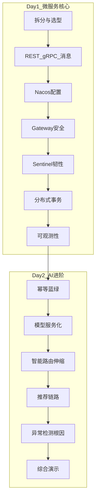

双主线在系统中的落点：

| 主线     | 核心服务                           | 关键能力                                  |
| -------- | ---------------------------------- | ----------------------------------------- |
| 电商订单 | order / inventory / user / account | Feign、Gateway、Sentinel、Seata、事务消息 |
| 智能推荐 | recall / rank / rearrange          | Milvus、ONNX、BentoML/Triton、A/B         |
| 智能运维 | detector / scaler / router         | 隔离森林、Prophet、Trace 根因             |

---

## 总览

### 原理主线（七层）

| 层                   | 讲授核心                         | 对应章节                                                                                                       |
| -------------------- | -------------------------------- | -------------------------------------------------------------------------------------------------------------- |
| **① 为什么拆**       | 单体瓶颈、演进代价、过度拆分反例 | [§1](#一架构演进与微服务设计哲学)                                                                              |
| **② 怎么通信**       | REST / gRPC / 异步事件           | [§2](#二服务通信restgrpc-与异步消息)                                                                           |
| **③ 怎么找到与配置** | 注册发现、健康检查、配置热更新   | [§3](#三服务发现与配置管理)                                                                                    |
| **④ 怎么守门**       | 网关、限流、JWT/OAuth2、灰度标识 | [§4](#四网关与安全防线)                                                                                        |
| **⑤ 怎么扛住**       | 雪崩、熔断、降级、幂等、发布策略 | [§5](#五容错与弹性resilience4j-与-sentinel) [§8](#八微服务高级模式与云原生部署)                                |
| **⑥ 怎么一致**       | 强一致 AT vs 最终一致事务消息    | [§6](#六分布式事务强一致性与最终一致性)                                                                        |
| **⑦ 怎么看见 + AI**  | 三支柱观测；模型服务化；AIOps    | [§7](#七可观测性指标链路与日志) [§9](#九ai-模型服务化基础模型即服务)–[§13](#十三综合项目演示ai-原生微服务系统) |

### 章节与 2 天路线

| 半天        | 章节                                                                              | 原理（讲授）                                | 实验 / 验收（本机 kind `ms-lab`）              |
| ----------- | --------------------------------------------------------------------------------- | ------------------------------------------- | ---------------------------------------------- |
| **D1 上午** | [§1](#一架构演进与微服务设计哲学)–[§3](#三服务发现与配置管理)                     | 演进、拆分、选型；Feign/gRPC/消息；Nacos    | 拆分讨论；Feign/Nacos **现象验收**；热更新演示 |
| **D1 下午** | [§4](#四网关与安全防线)–[§7](#七可观测性指标链路与日志)                           | Gateway+JWT；Sentinel；Seata/事务消息；观测 | 灰度头；chaos 降级体；Outbox；Jaeger 链路可见  |
| **D2 上午** | [§8](#八微服务高级模式与云原生部署)–[§10](#十ai-辅助微服务治理智能路由与弹性伸缩) | 幂等/金丝雀；模型热加载；智能路由与伸缩     | 幂等键；10% 金丝雀统计；模型 reload 演示       |
| **D2 下午** | [§11](#十一智能推荐系统微服务实战)–[§14](#十四课程总结与延展)                     | 推荐链路；AIOps；综合串联                   | A/B 现象；智能告警；故障注入复盘               |

### 半天目标

| 半天    | 目标                                                                             | 选做                              |
| ------- | -------------------------------------------------------------------------------- | --------------------------------- |
| D1 上午 | 能画出订单域拆分图；能说明 Feign / Nacos 各解决什么问题；理解 REST/gRPC/消息边界 | 跟做 Feign 调用与连接池热更新命令 |
| D1 下午 | 能讲清 Gateway+JWT、熔断降级、AT vs 事务消息；能在 Jaeger 指出下单链路           | 跟做灰度头 / chaos 触发降级体     |
| D2 上午 | 能描述幂等、金丝雀、模型热加载与预测扩容「何时用、踩什么坑」                     | 跟跑金丝雀比例统计、模型 reload   |
| D2 下午 | 能串通推荐三阶段与 A/B；能解释智能告警与根因入口；能复述端到端自愈路径           | 跟跑 A/B 日志与 `/rca` 验收       |

### 软硬件预装环境

> **客户自备实验环境。** 逐步安装命令、版本与参数统一见\
> [`learning-microservices-in-2-days-lab.md` · 练习环境搭建（客户机）](./learning-microservices-in-2-days-lab.md#练习环境搭建客户机)。

| 角色            | 要求（摘要）                                                           | 说明                                               |
| --------------- | ---------------------------------------------------------------------- | -------------------------------------------------- |
| **学员机**      | Linux，或 Windows + **WSL2 Ubuntu**；内存 **≥ 16 GiB**（8 GiB 不稳定） | Docker + **kind** 单节点；Namespace `ms-lab`       |
| **软件**        | Docker 24+、kind、kubectl 1.29–1.31；`DOCKER_MIRROR` 建议开启          | 应用运行在容器内；本机可不装 JDK/Python            |
| **IDE（可选）** | VS Code 或 IntelliJ IDEA                                               | 打开 `demo/ms-lab` 看代码，不必本地 Run 全套       |
| **验收**        | `MS_LAB_HOST=127.0.0.1`（kind 端口映射后）                             | gateway `30888` · grafana `30890` · jaeger `30891` |

**学员一键自检（本机 kind）**：

```text
http://127.0.0.1:30888/health     → 期望 200 / ok
http://127.0.0.1:30890            → Grafana 登录页（admin/admin）
http://127.0.0.1:30891            → Jaeger UI
```

### 不覆盖内容

- Istio / Linkerd 完整生产落地（仅讲选型边界与中小团队教训）
- 多活 / 异地容灾详细设计
- 训练大模型本身（只讲推理服务化与治理）
- 商业 APM（Dynatrace / New Relic）深度对比
- 完整 CI/CD 平台搭建（仅给流水线清单思路）
- 学员本机不用 Docker Compose 替代 K8s（默认路径为 kind 单节点 `ms-lab`）

### 课程特色速览

- **真实踩坑驱动**：10+ 生产反面教材（过度拆分、事务爆炸、雪崩、模型版本混乱等）。
- **双主线贯穿**：订单微服务改造 + 推荐/异常检测 AI 集成。
- **轻量化实操**：每模块 5–20 分钟；学员以观察验收点为主，有基础者跟做；其余现场演示 +
  错误注入复盘。

[返回总览](#总览)

---

## 第一天 · 上午：微服务基础与通信治理

**上午目标**：建立「为何拆、怎么拆、怎么连、怎么配」的完整认知；全员完成拆分讨论与 Feign/Nacos
**验收**（看见调用成功、热更新生效即可）。配置跟做列为选做。

---

## 一、架构演进与微服务设计哲学

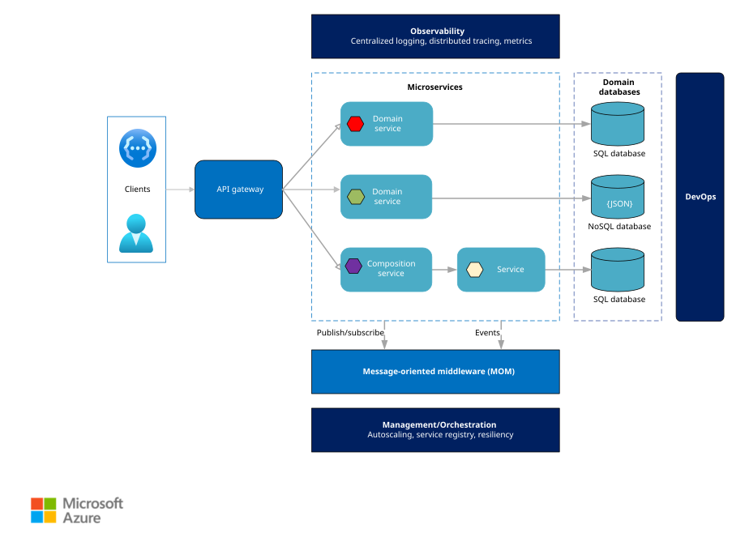

> **图 1.**
> 本课要落地的目标形态：入口在网关，领域服务各自拥有数据库，跨域协作走消息，观测与编排作为横切能力。
>
> Reference:
> [Microservices architecture style](https://learn.microsoft.com/en-us/azure/architecture/guide/architecture-styles/microservices)，Microsoft
> Azure Architecture Center。许可 [CC BY 4.0](https://creativecommons.org/licenses/by/4.0/)。原图
> `images/microservices-logical.svg`。

### 1.1 从单体到微服务：演进代价与误判案例

#### 为什么单体会「突然」扛不住

典型电商订单单体（单一 Spring Boot 进程）在早期很香：一个仓库、一次部署、本地事务
`ACID`。压力上来后，瓶颈往往不是「写业务的人不够」，而是：

| 瓶颈类型      | 表现                               | 单体里为什么难解                                       |
| ------------- | ---------------------------------- | ------------------------------------------------------ |
| 连接池/线程池 | 下单接口 P99 飙升，Tomcat 线程打满 | 库存、支付、积分逻辑耦合在同一进程，无法按热点独立扩容 |
| 数据库锁      | `inventory` 行锁等待、死锁         | 所有域共享一张库甚至一张大表，热点 SKU 锁竞争          |
| 发布耦合      | 改积分规则也要全量发版             | 回归面大，变更窗口被挤占                               |
| 故障半径      | 推荐模块 OOM → 下单全挂            | 无隔离边界                                             |

**判断口诀**：先问「哪个资源先满、哪个变更最频繁、哪个故障最不能连带」。三者指向不同子系统时，再谈拆分。

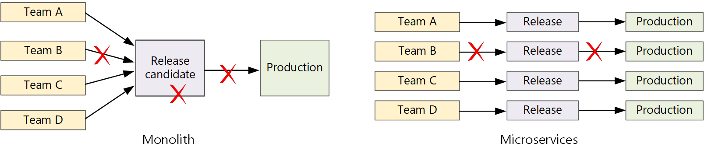

> **图 2.**
> 对应上文「发布耦合」：单体共享一个发布候选，任一团队失败则整包不能上线；拆开后各服务有自己的发布路径。
>
> Reference:
> [CI/CD for microservices architectures](https://learn.microsoft.com/en-us/azure/architecture/microservices/ci-cd)，Microsoft
> Azure Architecture Center。许可 [CC BY 4.0](https://creativecommons.org/licenses/by/4.0/)。原图
> `images/cicd-monolith.png`。

#### 1.1.1 演示：单体订单系统（Spring Boot）的并发瓶颈分析

**场景**：`POST /api/orders` 同步完成：校验用户 → 扣库存 → 写订单 → 记账户流水。

```java
@Transactional
public Order createOrder(CreateOrderRequest req) {
    User user = userRepo.findById(req.userId());          // DB
    inventoryService.deduct(req.skuId(), req.qty());      // 同行锁
    Order order = orderRepo.save(Order.from(req, user));  // DB
    accountService.freeze(user.getId(), order.getAmount()); // DB
    return order;
}
```

**压测观察点**（课堂用 wrk / JMeter）：

```bash
# 示例：对单体下单接口加压
wrk -t4 -c100 -d30s -s create_order.lua http://localhost:8080
```

关注：

1. **应用线程**：`tomcat.threads.busy` 是否逼近 max。
2. **DB**：`Innodb_row_lock_waits`、慢查询是否集中在 `inventory`。
3. **火焰图**：CPU 是否耗在 JSON 序列化 / 远程调用假同步（若单体已暗含 HTTP 调用）。

**课堂结论板**：把「能垂直扩容的」与「必须拆开才能扩的」分开写——例如静态资源与只读商品详情可先缓存；扣库存与下单写路径才是拆分候选。

#### 1.1.2 经验分享：过度拆分导致分布式事务爆炸

> **踩坑 Callout · 过度拆分**
>
> - **背景**：某零售中台把「订单」拆成 OrderHeader、OrderItem、OrderPrice、OrderPromo、OrderLog
>   五个独立服务，每个服务独立库。
> - **现象**：创建一个订单要跨 5 个服务 + 2PC/TCC；下单 P99 从 80ms 涨到
>   900ms+；大促时事务协调器成为单点。
> - **根因**：按「表」拆而不是按「业务能力 /
>   限界上下文」拆；把本可同聚合内强一致的数据拆到分布式事务里。
> - **补救**：合并回 Order
>   聚合（头+行+价税同库同事务）；促销计价改为领域服务同进程调用；跨上下文（库存、账户）才用最终一致。
> - **原则**：微服务个数 ∝ 独立演进速度与团队边界，**不是** ∝ 表的张数。

**演进代价清单**（拆之前必须签字确认）：

| 代价       | 说明                       | 缓解                               |
| ---------- | -------------------------- | ---------------------------------- |
| 运维复杂度 | 部署单元、配置、密钥暴涨   | 平台化（K8s + GitOps）、统一可观测 |
| 分布式事务 | 本地 `@Transactional` 失效 | 先尽量同库；再 Saga / 事务消息     |
| 联调成本   | 契约、版本、环境一致性     | 契约测试、消费方驱动（CDC）        |
| 延迟叠加   | 一次用户请求多跳 RPC       | 并行调用、异步化、BFF 聚合         |

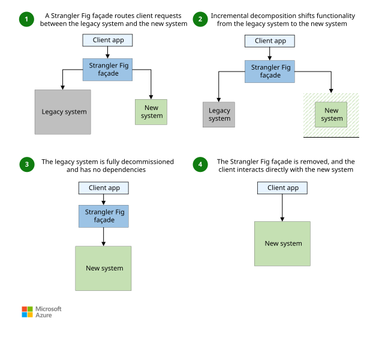

> **图 3.**
> 从单体迁到微服务时，用门面把流量在遗留系统与新服务之间切分，按能力逐块搬，而不是一次重写。
>
> Reference:
> [Strangler Fig pattern](https://learn.microsoft.com/en-us/azure/architecture/patterns/strangler-fig)，Microsoft
> Azure Architecture Center。许可 [CC BY 4.0](https://creativecommons.org/licenses/by/4.0/)。原图
> `_images/strangler-fig-pattern.svg`。

---

### 1.2 微服务拆分方法论

#### 1.2.1 领域驱动设计（DDD）的轻量落地：限界上下文与聚合根

课堂只取 DDD 的「能落地的 20%」：

| 概念                          | 一句话                               | 订单场景例子                                           |
| ----------------------------- | ------------------------------------ | ------------------------------------------------------ |
| 限界上下文（Bounded Context） | 同一套术语只在边界内成立             | 「订单」上下文里的 User 只是下单人快照，不是 HR 的员工 |
| 聚合根（Aggregate Root）      | 一致性边界入口，外部只能通过它改内部 | `Order` 根；OrderLine 不对外暴露写接口                 |
| 领域事件                      | 事实已发生，供他上下文订阅           | `OrderPaid`、`InventoryReserved`                       |
| 防腐层（ACL）                 | 翻译外部模型，避免污染本域           | 对接支付渠道的状态码映射                               |

**推荐拆分结果（本课主线）**：

```text
[User Context]     用户注册、登录、收货地址
[Order Context]    下单、取消、状态机（聚合根 Order）
[Inventory Context] SKU 库存、预留、释放
[Account Context]  余额、冻结、扣款
[Rec Context]      推荐召回/排序（辅线，可晚于主线引入）
```

**上下文映射**：

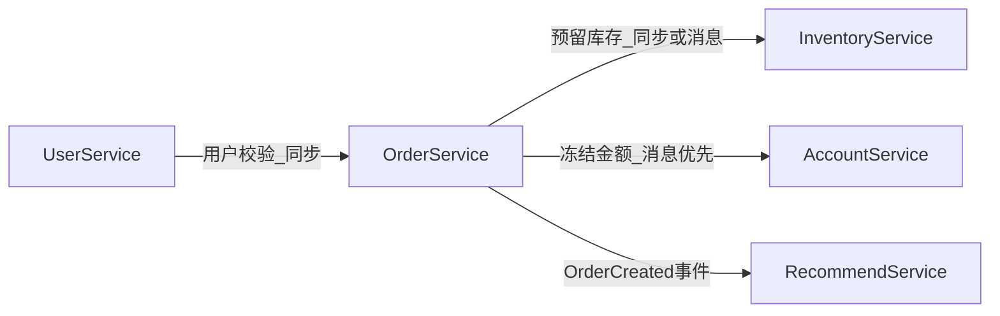

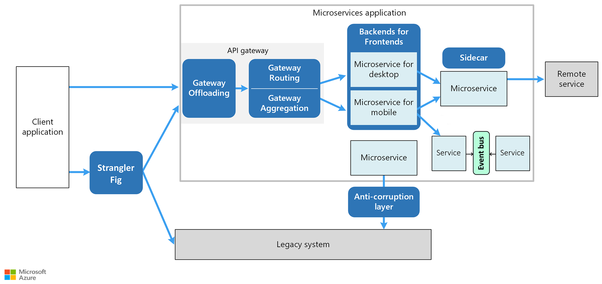

> **图 4.**
> 和上文限界上下文配套：对外用网关，对接遗留系统用防腐层，跨上下文用事件总线，而不是共享库表。
>
> Reference:
> [Design patterns for microservices](https://learn.microsoft.com/en-us/azure/architecture/microservices/design/patterns)，Microsoft
> Azure Architecture Center。许可 [CC BY 4.0](https://creativecommons.org/licenses/by/4.0/)。原图
> `images/microservices-patterns.png`。

**同步 vs 异步选择**：

| 调用             | 建议                | 理由                             |
| ---------------- | ------------------- | -------------------------------- |
| 下单前读用户状态 | 同步（短超时）      | 需要立即失败                     |
| 扣减库存         | 同步或「预留+确认」 | 强业务约束，但可用预留降低长事务 |
| 积分、推荐刷新   | 异步事件            | 可最终一致                       |
| 账单流水         | 事务消息 / Outbox   | 避免「订单成功、流水丢失」       |

#### 1.2.2 实操：基于订单/库存/用户场景的拆分练习（10 分钟）

**目标**：小组产出一张上下文图 + 「同步/异步」标注。

**步骤**：

1. 列出用户故事：注册、浏览、加购、下单、支付回调、缺货取消。
2. 把名词圈成候选实体，合并同生命周期的实体到同一聚合。
3. 标出跨聚合的每次交互：同步 RPC 或领域事件。
4. 指出至少一处「若拆开会引入分布式事务」的边界，并给出合并或最终一致方案。

**验收标准**：

- [ ] 不超过 5 个上下文（本课约束）
- [ ] Order 聚合边界清晰（头+行同上下文）
- [ ] 至少 2 个异步事件，且写明消费失败怎么办（重试 / 死信 / 人工）

**点评清单（讲师用）**：有没有按层拆（Controller/Service
各一服务）？有没有把查询模型强行拆成写服务？

---

### 1.3 微服务技术选型对比（Spring Cloud / Kubernetes / Service Mesh）

| 能力           | Spring Cloud                        | Kubernetes 原生            | Service Mesh（Istio 等）         |
| -------------- | ----------------------------------- | -------------------------- | -------------------------------- |
| 服务发现       | Nacos / Eureka 等                   | Service + Endpoints        | 与 K8s 集成，边车感知            |
| 负载均衡       | 客户端（Spring Cloud LoadBalancer） | Service kube-proxy / IPVS  | 边车 L7                          |
| 熔断限流       | Sentinel / Resilience4j             | 需应用或网关               | 边车策略 + 可选 Wasm             |
| 配置           | Nacos / Apollo                      | ConfigMap/Secret（偏静态） | 与配置中心配合                   |
| 可观测         | 应用埋点 + Micrometer               | metrics-server 等          | 自动指标/部分追踪                |
| 学习与运维成本 | 中（偏开发）                        | 中（偏平台）               | 高（平台+网络）                  |
| 适合团队       | 中小 Java 团队快速治理              | 已上 K8s、多语言           | 多语言、强统一流量治理、有平台组 |

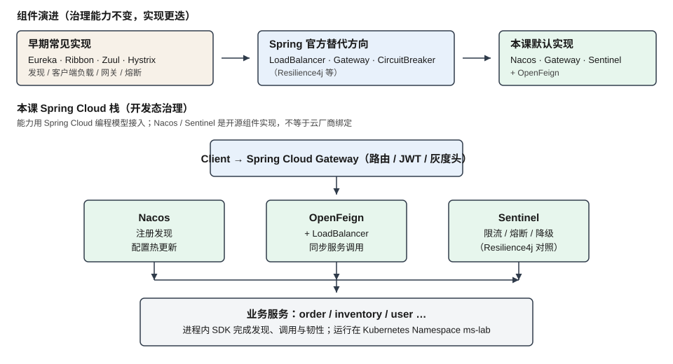

> **图 5.** 上半是治理能力的实现更迭；下半是本课默认栈。Gateway / OpenFeign / LoadBalancer 走 Spring
> Cloud 编程模型，Nacos / Sentinel 是对应能力的开源实现，**不是**云厂商产品课。

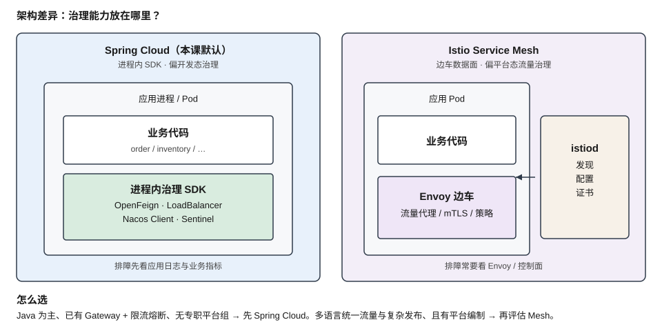

> **图 6.** 同一类治理问题，落点不同：本课把发现、调用、熔断放在**应用进程内**；Istio 把流量治理放到
> **Envoy 边车 + istiod**。对照 §1.3 选型表与 §1.3.1。

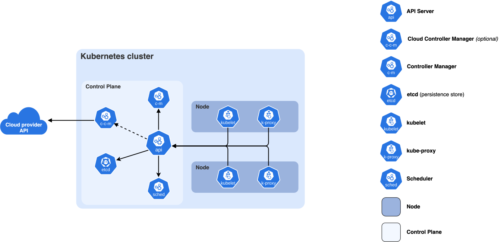

> **图 7.** 课堂运行时落在这张图的工作节点上：控制面调度，节点上的 kubelet 拉起 Pod，kube-proxy 提供
> Service 负载均衡。
>
> Reference: [Cluster Architecture](https://kubernetes.io/docs/concepts/architecture/)，Kubernetes
> Documentation。许可 [CC BY 4.0](https://creativecommons.org/licenses/by/4.0/)。原图
> [components-of-kubernetes.svg](https://kubernetes.io/images/docs/components-of-kubernetes.svg)。

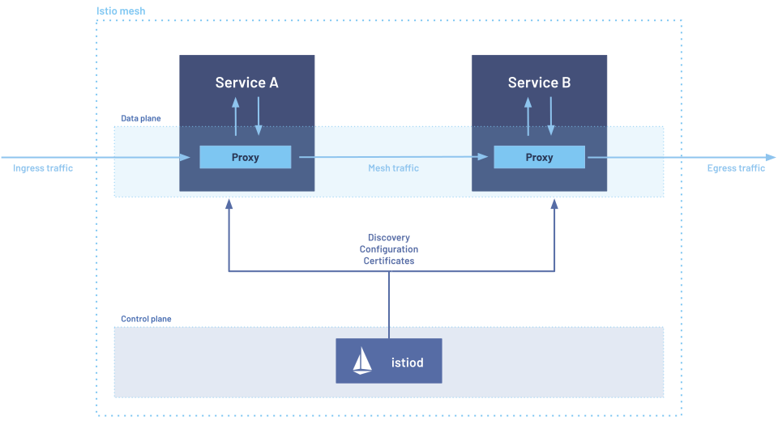

> **图 8.** Istio 官方架构细图（控制面 / 数据面）。先看图 6 的对比结论，需要细节时再展开本图。
>
> Reference: [Istio Architecture](https://istio.io/latest/docs/ops/deployment/architecture/)，Istio
> authors。许可
> [Apache License 2.0](https://www.apache.org/licenses/LICENSE-2.0)（[istio.io 仓库](https://github.com/istio/istio.io)）。原图
> [arch.svg](https://istio.io/latest/docs/ops/deployment/architecture/arch.svg)。

**本课默认选型**：

- **开发态治理**：Spring Cloud 编程模型 + Gateway + OpenFeign/LoadBalancer + Nacos + Sentinel（见图
  5）
- **课堂运行态**：**Kubernetes `ms-lab`**（Java 主干落实上述治理；Day2 模型/AIOps 用 Python；见
  [`demo/ms-lab`](../demo/ms-lab/)）
- **Mesh**：不作为默认；用图 6 讲清与进程内 SDK 的差异，再决定何时值得上

#### 1.3.1 经验分享：中小团队盲目上 Service Mesh 的教训

> **踩坑 Callout · 盲目上 Mesh**
>
> - **背景**：20 人研发团队，业务 Java 为主，已有 Spring Cloud Gateway + Sentinel，为了「云原生」上
>   Istio。
> - **现象**：边车吃掉显著 CPU/内存；证书轮换与升级导致间歇 503；排障要从业务日志切到 envoy
>   日志，MTTR 变长。
> - **根因**：Mesh 解决的是**多语言统一流量治理与复杂发布**；团队痛点其实是「业务超时与慢
>   SQL」，Mesh 帮不上忙却增加平面。
> - **补救**：回退到 Gateway + 应用内 Sentinel；把精力投入可观测与数据库治理；待出现 3+
>   语言栈且平台组编制到位再评估 Mesh。
> - **选型检查表**：是否有专职平台？是否多语言？是否已有网关/限流不够用？三项两否 → 先不上 Mesh。

**§1 小结**：拆分看限界上下文；技术栈匹配团队能力；Mesh 是能力放大器也是复杂度放大器。

[返回总览](#总览)

---

## 二、服务通信：REST、gRPC 与异步消息

### 通信选型总表

| 模式      | 典型技术                  | 延迟 | 耦合          | 适用                     |
| --------- | ------------------------- | ---- | ------------- | ------------------------ |
| 同步 REST | OpenFeign + JSON          | 中   | 契约 URL/字段 | 查询、简单命令、对外 API |
| 同步 gRPC | ProtoBuf + HTTP/2         | 低   | IDL 强契约    | 内网高频、流式、多语言   |
| 异步消息  | RabbitMQ / Kafka + Stream | 可变 | 事件 schema   | 最终一致、削峰、扇出     |

---

### 2.1 同步通信：Feign + 负载均衡

#### 声明式客户端在做什么

Feign 把「HTTP 调用」收成接口方法；配合 Spring Cloud LoadBalancer，按服务名从注册中心解析实例。

```java
@FeignClient(name = "inventory-service", path = "/api/inventory",
             fallbackFactory = InventoryFallbackFactory.class)
public interface InventoryClient {
    @PostMapping("/{skuId}/reserve")
    ReserveResult reserve(@PathVariable("skuId") String skuId,
                          @RequestBody ReserveRequest req);
}
```

#### 2.1.1 演示：声明式 HTTP 客户端的最佳实践（异常处理、超时重试）

**必须显式配置的三项**：

```yaml
spring:
  cloud:
    openfeign:
      client:
        config:
          inventory-service:
            connectTimeout: 200
            readTimeout: 800
            loggerLevel: BASIC
          default:
            connectTimeout: 300
            readTimeout: 1000
```

**重试原则**（避免重试风暴，详见 §8）：

| 请求类型                        | 可否自动重试          | 说明                   |
| ------------------------------- | --------------------- | ---------------------- |
| GET 查询                        | 可以（限次数 + 退避） | 需保证幂等             |
| POST 扣库存                     | 默认不要              | 除非有幂等键           |
| 幂等 POST（带 Idempotency-Key） | 可以                  | 与 §8 Redis 幂等表配合 |

**异常处理推荐结构**：

```java
@Component
public class InventoryFallbackFactory implements FallbackFactory<InventoryClient> {
    @Override
    public InventoryClient create(Throwable cause) {
        return (skuId, req) -> {
            log.warn("inventory reserve fallback, sku={}, cause={}", skuId, cause.toString());
            // 返回明确业务结果，禁止返回 null（见 §5.2.2）
            return ReserveResult.rejected("INVENTORY_UNAVAILABLE");
        };
    }
}
```

**最佳实践清单**：

1. 每个下游独立超时，禁止全局 10s「一刀切」。
2. Fallback 返回**可编译的业务对象**，并带错误码。
3. 透传 `X-Request-Id` / `traceparent`，便于 §7 串联。
4. 对 4xx 与 5xx 分开度量：4xx 多半是契约/参数，不应熔断成「下游挂了」。

#### 2.1.2 实操：配置 Feign 客户端调用库存服务（10 分钟）

**目标**：订单服务通过 Feign 调用库存 `reserve`，超时 800ms，失败走 Fallback。

**步骤**：

1. 在 order-service 引入 `spring-cloud-starter-openfeign`，启动类加 `@EnableFeignClients`。
2. 编写 `InventoryClient` 与 `ReserveRequest` / `ReserveResult` DTO（字段与库存 API 对齐）。
3. 按上文 YAML 配置 `inventory-service` 的 connect/readTimeout。
4. 实现 `InventoryFallbackFactory`，失败返回 `rejected`。
5. 用 Postman/curl 调下单；再 `docker pause` 库存容器，确认走 Fallback 而非线程挂死。

**验收标准**：

- [ ] 正常路径返回 200 且库存减少
- [ ] 暂停库存后，订单接口在 ~1s 内返回明确错误码，线程池不耗尽
- [ ] 日志中有 `inventory reserve fallback`

**ms-lab 等价验收**（gateway → order → inventory）：

```bash
TOKEN=$(curl -sf -X POST http://103.198.127.21:30888/public/token \
  -H 'Content-Type: application/json' -d '{"user_id":"u1"}' \
  | python3 -c 'import sys,json;print(json.load(sys.stdin)["access_token"])')
curl -sf -X POST http://103.198.127.21:30888/api/orders \
  -H "Authorization: Bearer $TOKEN" -H 'Content-Type: application/json' \
  -d '{"user_id":"u1","sku":"sku-1","qty":1}' | python3 -m json.tool
# 期望 ok=true, inventory.code=RESERVED
```

---

### 2.2 高性能 gRPC：IDL 定义与协议选型

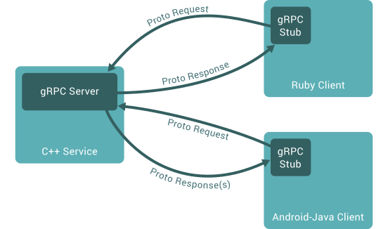

> **图 9.** IDL 生成的 stub 把远程方法伪装成本地调用。课堂里 Java 订单服务与 Python
> 推荐服务可以用同一份 proto 对接。
>
> Reference: [Introduction to gRPC](https://grpc.io/docs/what-is-grpc/introduction/)，gRPC
> authors。许可
> [Apache License 2.0](https://www.apache.org/licenses/LICENSE-2.0)（[grpc.io 仓库](https://github.com/grpc/grpc.io)）。原图
> [landing-2.svg](https://grpc.io/img/landing-2.svg)。

#### 何时用 gRPC

- 内网服务间、QPS 高、payload 中等偏大（列表、特征向量）。
- 需要双向流 / 服务端流（推送推理进度）。
- 多语言客户端（Java 订单 + Python 推荐）。

对外公网 API、浏览器直连，仍优先 REST/JSON（或 gRPC-Web，成本更高）。

#### 2.2.1 演示：基于 ProtoBuf 的订单查询服务改造

```protobuf
syntax = "proto3";
package order.v1;

service OrderQuery {
  rpc GetOrder (GetOrderRequest) returns (Order);
  rpc ListOrdersByUser (ListOrdersRequest) returns (stream Order);
}

message GetOrderRequest { string order_id = 1; }
message ListOrdersRequest { string user_id = 1; int32 page_size = 2; }
message Order {
  string order_id = 1;
  string user_id = 2;
  string status = 3;
  int64 amount_cents = 4;
}
```

服务端骨架（概念）：

```java
@GrpcService
public class OrderQueryService extends OrderQueryGrpc.OrderQueryImplBase {
    @Override
    public void getOrder(GetOrderRequest req, StreamObserver<Order> obs) {
        var entity = repo.findById(req.getOrderId())
            .orElseThrow(() -> Status.NOT_FOUND.asRuntimeException());
        obs.onNext(toProto(entity));
        obs.onCompleted();
    }
}
```

**契约演进规则**：字段只增不改语义；用 `reserved` 冻结删除号；重大不兼容升 `order.v2`。

#### 2.2.2 性能对比：gRPC vs REST（带实测数据）

课堂同机实测参考量级（具体数字随环境变化，讲清**相对关系**）：

| 场景            | REST/JSON    | gRPC/Protobuf         | 观察                         |
| --------------- | ------------ | --------------------- | ---------------------------- |
| 小对象查询 ~1KB | QPS 基准 1.0 | QPS ~1.3–1.8          | 序列化与 HTTP/2 多路复用占优 |
| 中等列表 ~50KB  | 基准 1.0     | QPS ~1.5–2.5          | JSON 解析 CPU 明显           |
| 高并发短连接    | 连接开销大   | 复用连接更稳          | 注意 LB 对 HTTP/2 支持       |
| 浏览器调试      | 友好         | 需 grpcurl / BloomRPC | 运维工具链要补齐             |

```bash
# REST
wrk -t4 -c100 -d20s http://localhost:8080/api/orders/O1001
# gRPC（示例）
ghz --insecure --proto order.proto --call order.v1.OrderQuery/GetOrder \
  -d '{"order_id":"O1001"}' -c 100 -z 20s localhost:9090
```

**选型口诀**：对外 REST；对内热点与多语言 gRPC；已经 REST 且 QPS 够用 → 别为微优化强迁。

---

### 2.3 异步消息：RabbitMQ / Kafka 事件驱动

| 维度     | RabbitMQ             | Kafka              |
| -------- | -------------------- | ------------------ |
| 模型     | 队列 / 交换器        | 日志型分区 Topic   |
| 吞吐     | 中高                 | 很高               |
| 回溯消费 | 弱                   | 强（按 offset）    |
| 顺序     | 单队列内可           | 分区内有序         |
| 典型     | 任务、通知、复杂路由 | 事件流、削峰、分析 |

订单场景建议：

- **订单状态变更、通知**：RabbitMQ 或 Kafka 均可。
- **双 11 特征流、推荐异步推理**：Kafka（见 §9.3）。
- **事务消息**：RocketMQ 事务消息或 Kafka + Outbox（见 §6）。

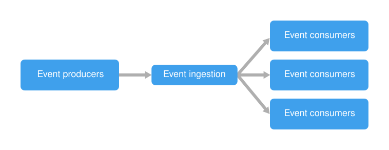

> **图 10.**
> 订单状态变更走这条路：订单服务是生产者，积分、推荐、通知是互相独立的消费者，中间不互相调用。
>
> Reference:
> [Event-driven architecture style](https://learn.microsoft.com/en-us/azure/architecture/guide/architecture-styles/event-driven)，Microsoft
> Azure Architecture Center。许可 [CC BY 4.0](https://creativecommons.org/licenses/by/4.0/)。原图
> `images/event-driven.svg`。

#### 2.3.1 经验分享：订单状态同步因消息堆积导致的线上事故

> **踩坑 Callout · 消息堆积**
>
> - **背景**：支付成功发 `OrderPaid`，下游 5
>   个消费者（积分、推荐、发票、短信、数据分析）共用一个慢消费者逻辑混在热点组。
> - **现象**：大促支付洪峰后，订单中心显示已支付，用户 App「我的订单」仍显示待支付长达 30+
>   分钟；客服工单暴涨。
> - **根因**：① 消费端同步调用外部短信网关，拖慢整组；② 分区数/并发不足；③ 无滞后告警（lag）。
> - **补救**：拆消费组职责；慢 IO 改为异步再投递；监控 `consumer lag`
>   与死信队列；对查询侧提供「以订单库状态为准」的短缓存失效。
> - **预防**：每个事件定义 SLA（如支付状态可见 ≤ 5s）；压测消费速率 ≥ 生产峰值 × 1.5。

#### 2.3.2 演示：Spring Cloud Stream 实现事件驱动架构

```yaml
spring:
  cloud:
    stream:
      bindings:
        orderPaid-out-0:
          destination: order.paid
          content-type: application/json
        orderPaid-in-0:
          destination: order.paid
          group: inventory-compensator
      kafka:
        binder:
          brokers: localhost:9092
```

```java
@Bean
public Consumer<OrderPaidEvent> orderPaid() {
    return event -> inventoryService.confirmReserve(event.orderId(), event.items());
}

// 发送侧
streamBridge.send("orderPaid-out-0", OrderPaidEvent.from(order));
```

**至少要有的配套**：

1. **幂等消费**（§8.1）：同一 `eventId` 只处理一次。
2. **死信**：重试耗尽进 DLQ，人工/自动回放。
3. **Outbox（推荐）**：先写业务库 Outbox 表，再异步发消息，避免「库成功、消息丢」。

**§2 小结**：同步要管超时与 Fallback；gRPC 赢在内网热点；异步要管 lag、幂等与死信。

[返回总览](#总览)

---

## 三、服务发现与配置管理

### 3.1 服务注册与健康检查

#### 注册中心在链路中的位置

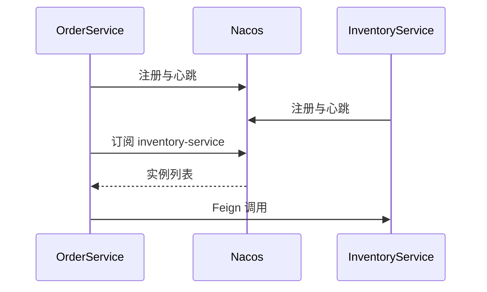

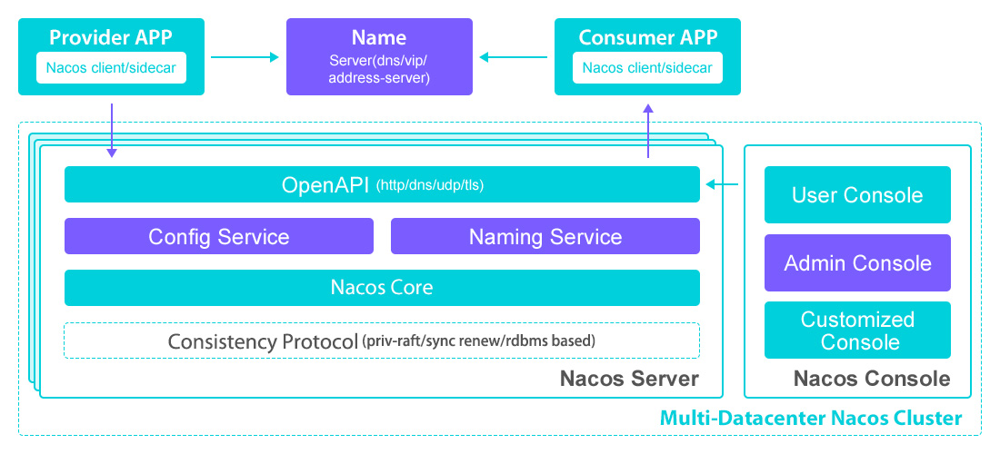

> **图 11.** 注册与配置在同一集群：Naming Service 管实例，Config Service 管配置，客户端通过 OpenAPI
> 接入。
>
> Reference: [Nacos Architecture](https://nacos.io/en/docs/architecture/)，Alibaba Nacos。许可
> [Apache License 2.0](https://www.apache.org/licenses/LICENSE-2.0)。原图文档中的 `nacos_arch.jpg`。

#### 3.1.1 演示：Nacos 服务注册及心跳机制排查（模拟服务假死）

**健康检查分层**：

| 层级     | 机制                                   | 假死能否发现                   |
| -------- | -------------------------------------- | ------------------------------ |
| 进程存活 | Nacos 心跳 / 临时实例                  | 进程杀了能发现；死锁假活不一定 |
| 应用就绪 | Spring `readiness`（K8s）              | 可拒绝流量                     |
| 业务探针 | 自定义 `/actuator/health` 检查 DB/依赖 | 可把「连不上库」标 DOWN        |

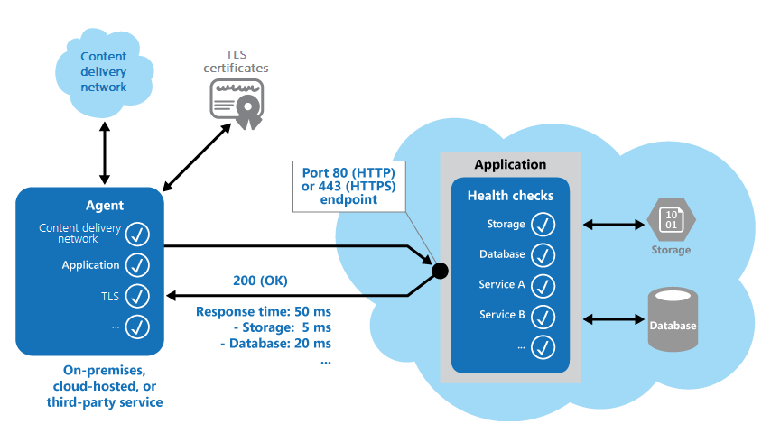

> **图 12.** 对应表中的「业务探针」：只看进程还活着不够，健康端点要能反映数据库和下游是否真的可用。
>
> Reference:
> [Health Endpoint Monitoring pattern](https://learn.microsoft.com/en-us/azure/architecture/patterns/health-endpoint-monitoring)，Microsoft
> Azure Architecture Center。许可 [CC BY 4.0](https://creativecommons.org/licenses/by/4.0/)。原图
> `_images/health-endpoint-monitoring-pattern.png`。

**模拟假死**：

```bash
# 线程死锁或 pause 容器：心跳可能仍在，取决于故障模式
docker pause inventory-service
# 观察：Nacos 实例是否仍为 UP；Feign 调用是否超时
docker unpause inventory-service
```

**排查清单**：

1. Nacos 控制台实例是否健康、权重是否为 0。
2. 客户端订阅是否拿到过期列表（本地缓存）。
3. 是否只做了 liveness、没有 readiness，导致 K8s 仍转发。
4. 优雅下线：先从注册中心摘流，再等 in-flight 请求结束。

#### 3.1.2 经验分享：Eureka 自我保护机制引发的惨痛调用失败

> **踩坑 Callout · Eureka 自我保护**
>
> - **背景**：网络抖动导致大量实例心跳短暂失败；Eureka 进入自我保护，**不剔除**过期实例。
> - **现象**：真实已下线的节点仍留在列表；客户端负载均衡打到僵尸实例，错误率升高；运维以为「自我保护是安全的」而忽略了。
> - **根因**：自我保护假设「是网络问题不是实例挂了」；在实例真实缩容/发布场景会误判。
> - **补救**：生产谨慎评估自我保护；配合更准确的健康检查与网关重试预算；迁移 Nacos
>   等并理清「临时实例」语义。
> - **课堂态度**：任何注册中心都有「保护 vs 及时摘除」的权衡，要配监控而不是盲信默认值。

---

### 3.2 动态配置中心

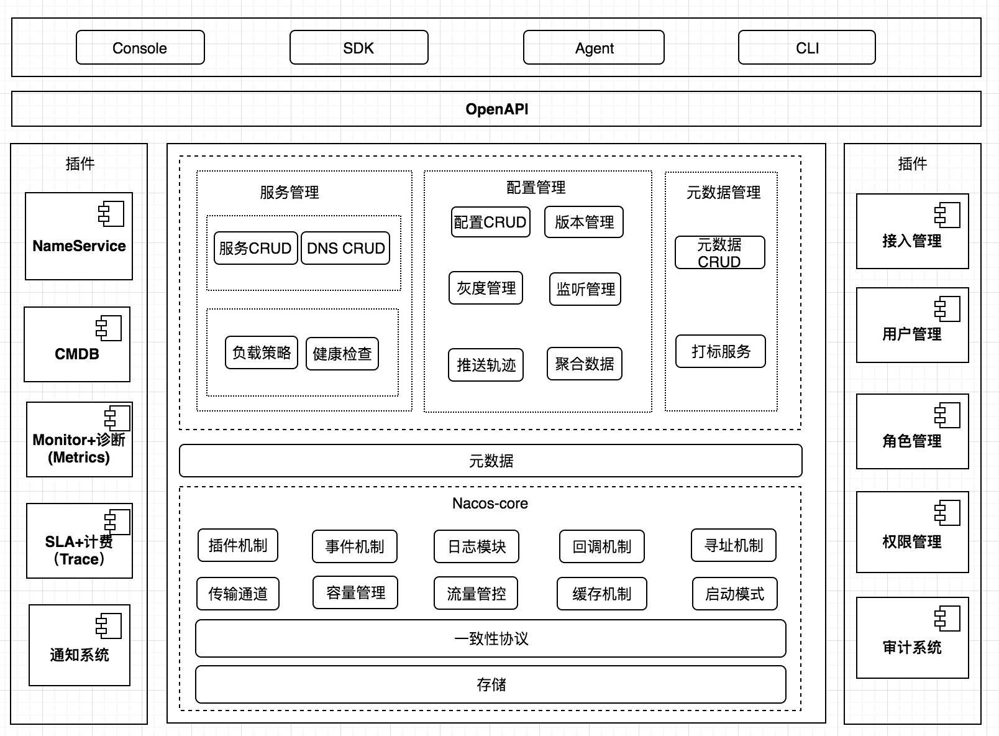

> **图 13.** 配置热更新看中间的「配置管理」：配置
> CRUD、版本、灰度、监听和推送。左侧服务管理同时负责负载和健康检查。
>
> Reference: [Nacos Architecture](https://nacos.io/en/docs/architecture/)（Logical
> architecture），Alibaba Nacos。许可
> [Apache License 2.0](https://www.apache.org/licenses/LICENSE-2.0)。原图文档中的
> `nacos-logic.jpg`。

#### 3.2.1 配置热更新：Nacos / Apollo 对比演示

| 维度         | Nacos           | Apollo                 |
| ------------ | --------------- | ---------------------- |
| 定位         | 注册 + 配置一体 | 专注配置治理           |
| 灰度发布配置 | 支持            | 强（多环境/集群/灰度） |
| 权限审计     | 有              | 企业特性成熟           |
| 运维         | 一套组件搞定    | 需额外注册发现方案     |
| 本课选择     | **默认 Nacos**  | 对比演示 UI 与灰度能力 |

**Spring Cloud 监听刷新**：

```yaml
spring:
  application:
    name: order-service
  cloud:
    nacos:
      config:
        server-addr: 127.0.0.1:8848
        file-extension: yaml
        refresh-enabled: true
```

```java
@RefreshScope
@ConfigurationProperties(prefix = "order.datasource-pool")
public class PoolProps {
    private int maxSize = 20;
    private int minIdle = 5;
    // getters/setters
}
```

**热更新安全边界**：

| 可热更新                                 | 不建议热更新                               |
| ---------------------------------------- | ------------------------------------------ |
| 限流阈值、开关、超时、线程池参数（谨慎） | 数据库 URL、账号密码（需重建连接池并验证） |
| 降级开关、实验流量比例                   | 服务端口、序列化协议                       |

#### 3.2.2 实操：动态切换订单服务的数据库连接池参数（10 分钟）

**目标**：在 Nacos 修改 `order.datasource-pool.maxSize`，应用不重启生效，并观察连接数变化。

**步骤**：

1. 将连接池参数外置到 Nacos DataId：`order-service.yaml`。
2. Bean 使用 `@RefreshScope` 或 `@NacosValue(autoRefreshed = true)`。
3. 在 Nacos 控制台把 `maxSize` 从 20 改为 30，发布。
4. 打日志或 Actuator 端点确认新值；用压测看活跃连接是否按新上限增长。
5. **回滚演练**：改回 20，确认再刷新成功。

**验收标准**：

- [ ] 无需重启进程即看到新配置日志
- [ ] 有配置变更审计（谁在何时改了什么）意识——课堂用账号区分讲师/学员
- [ ] 故意发一条非法值（如 maxSize=0），有校验拒绝或快速回滚方案

**§3 小结**：发现要能摘除假活；配置热更新要有白名单与校验。

[返回总览](#总览)

---

## 第一天 · 下午：分布式韧性、数据一致性与可观测性

**下午目标**：守住入口（网关+安全），扛住依赖故障（熔断限流），选对一致性方案，并让系统「可看见」。全员以
Jaeger/降级体/Outbox **现象验收**为主；配置跟做选做。

---

## 四、网关与安全防线

### 4.1 统一入口：Spring Cloud Gateway

#### 网关职责边界

| 该做                                     | 不该做                                 |
| ---------------------------------------- | -------------------------------------- |
| 路由、鉴权、全局限流、灰度标识、TLS 终止 | 复杂业务编排、长事务、重业务校验       |
| 请求日志（采样）、跨域、协议转换         | 聚合过多下游变成新单体（「上帝网关」） |

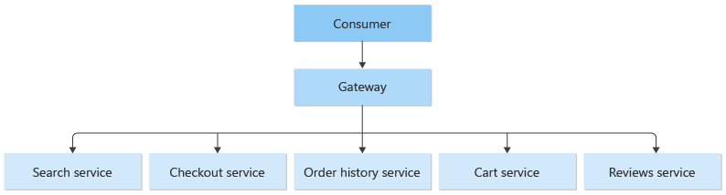

> **图 14.** 网关只做路由和横切，不把多个后端的业务编排吃进自己。
>
> Reference:
> [Gateway Routing pattern](https://learn.microsoft.com/en-us/azure/architecture/patterns/gateway-routing)，Microsoft
> Azure Architecture Center。许可 [CC BY 4.0](https://creativecommons.org/licenses/by/4.0/)。原图
> `_images/gateway-multiple-services.png`。

```yaml
spring:
  cloud:
    gateway:
      routes:
        - id: order-route
          uri: lb://order-service
          predicates:
            - Path=/api/orders/**
          filters:
            - name: RequestRateLimiter
              args:
                redis-rate-limiter.replenishRate: 100
                redis-rate-limiter.burstCapacity: 200
                key-resolver: "#{@userKeyResolver}"
            - StripPrefix=0
        - id: inventory-route
          uri: lb://inventory-service
          predicates:
            - Path=/api/inventory/**
```

#### 4.1.1 演示：路由断言、过滤器链与限流（令牌桶）

**断言（Predicate）常用**：`Path`、`Method`、`Header`、`Query`、`After`/`Before`（时间窗发布）。

**过滤器链顺序直觉**：

```text
全局 Pre Filter → 路由 Predicate 匹配 → 局部 Filter → 代理下游
                 ↑                              ↓
            鉴权失败直接 401              Post Filter 改写响应
```

**令牌桶参数**：

| 参数          | 含义               | 调参提示                     |
| ------------- | ------------------ | ---------------------------- |
| replenishRate | 每秒放入令牌数     | ≈ 稳态 QPS                   |
| burstCapacity | 桶容量             | 允许短时突发；过大等于没限流 |
| key-resolver  | 按用户/IP/API 维度 | 登录用户按 userId；匿名按 IP |

```java
@Bean
KeyResolver userKeyResolver() {
    return exchange -> Mono.just(
        Optional.ofNullable(exchange.getRequest().getHeaders().getFirst("X-User-Id"))
            .orElse(exchange.getRequest().getRemoteAddress().getAddress().getHostAddress())
    );
}
```

#### 4.1.2 经验分享：网关成为性能瓶颈后的重构方案（水平扩展 + 异步）

> **踩坑 Callout · 网关瓶颈**
>
> - **背景**：所有流量经单机 Gateway；过滤器内同步调用鉴权服务 + 同步写审计日志到 DB。
> - **现象**：大促时网关 CPU 打满，后端订单服务还很空；扩容订单副本无效。
> - **根因**：① 网关无水平扩展（会话粘滞或单点部署）；② 过滤器做了重 IO；③
>   阻塞式编程模型在高并发下线程耗尽。
> - **补救**：Gateway 无状态化后多副本 + LB；鉴权改 JWT 本地验签（见
>   4.2）；审计日志改为异步消息；保持 WebFlux 链不阻塞。
> - **容量口诀**：先压网关再压业务；网关 CPU > 70% 且下游空闲 → 网关是瓶颈。

---

### 4.2 安全设计（JWT + OAuth2）

#### 推荐模式：网关验签 + 下游信任内网头

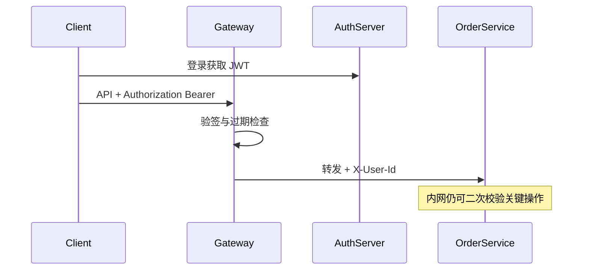

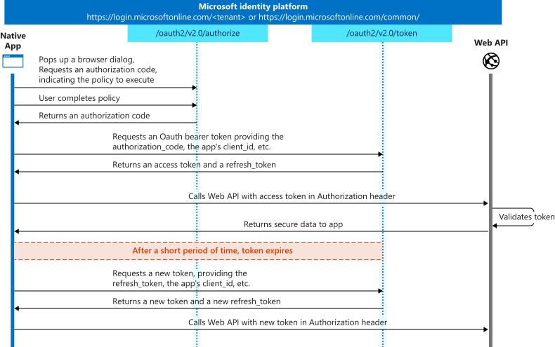

> **图 15.** 登录拿令牌、API 带 Bearer、令牌过期后用 refresh token
> 续期。课堂网关做的是图中右侧「校验 token」，而不是在每个请求里再走一遍授权码。
>
> Reference:
> [Microsoft identity platform and OAuth 2.0 authorization code flow](https://learn.microsoft.com/en-us/entra/identity-platform/v2-oauth2-auth-code-flow)，Microsoft
> Entra。许可 [CC BY 4.0](https://creativecommons.org/licenses/by/4.0/)。原图
> `media/v2-oauth2-auth-code-flow/convergence-scenarios-native.svg`。

#### 4.2.1 演示：网关层 JWT 全局校验与透传

```java
@Component
public class JwtAuthFilter implements GlobalFilter, Ordered {
    private final JwtDecoder jwtDecoder;

    @Override
    public Mono<Void> filter(ServerWebExchange exchange, GatewayFilterChain chain) {
        String path = exchange.getRequest().getURI().getPath();
        if (path.startsWith("/public/") || path.equals("/actuator/health")) {
            return chain.filter(exchange);
        }
        String auth = exchange.getRequest().getHeaders().getFirst(HttpHeaders.AUTHORIZATION);
        if (auth == null || !auth.startsWith("Bearer ")) {
            exchange.getResponse().setStatusCode(HttpStatus.UNAUTHORIZED);
            return exchange.getResponse().setComplete();
        }
        return Mono.fromCallable(() -> jwtDecoder.decode(auth.substring(7)))
            .flatMap(jwt -> {
                String userId = jwt.getSubject();
                ServerHttpRequest req = exchange.getRequest().mutate()
                    .header("X-User-Id", userId)
                    .header("X-Roles", String.join(",", jwt.getClaimAsStringList("roles")))
                    .build();
                return chain.filter(exchange.mutate().request(req).build());
            })
            .onErrorResume(e -> {
                exchange.getResponse().setStatusCode(HttpStatus.UNAUTHORIZED);
                return exchange.getResponse().setComplete();
            });
    }

    @Override
    public int getOrder() { return -100; }
}
```

**安全注意**：

1. 下游**不要**信任客户端直接传入的
   `X-User-Id`（仅信任网关剥离后重写的头；网络层限制只允许网关访问下游）。
2. Access Token 短过期 + Refresh Token；密钥轮换有计划。
3. OAuth2 授权码模式给第三方；纯一代 App 可用简化流程，但要防 Token 落盘泄露。

#### 4.2.2 实操：编写自定义过滤器实现灰度发布标识注入（10 分钟）

**目标**：按用户 ID 哈希，将约 10% 流量打上 `X-Canary=true`，供下游或路由使用。

**步骤**：

1. 实现 `CanaryHeaderFilter`（`GlobalFilter`）：从 JWT/`X-User-Id` 取用户，`hash % 100 < 10`
   则注入头。
2. 增加路由谓词或下游逻辑：`Header=X-Canary, true` → `lb://order-service-canary`。
3. 用两个测试用户 ID 验证：一个进金丝雀，一个进稳定版。
4. 打日志：`userId=..., canary=true/false`。

**验收标准**：

- [ ] 约 10% 用户稳定进入 canary（可用 100 个连续 ID 统计）
- [ ] 未登录流量有明确策略（全部稳定版或按 IP）
- [ ] 过滤器失败时**默认走稳定版**，不 500

**§4 小结**：网关做薄做扩；JWT 本地验签；灰度标识在边缘注入。

[返回总览](#总览)

---

## 五、容错与弹性：Resilience4j 与 Sentinel

### 5.1 服务雪崩的常见模式

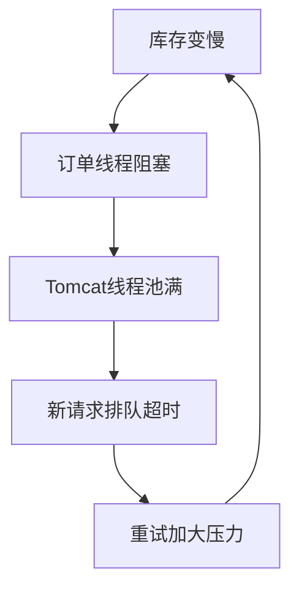

常见模式：

| 模式           | 描述                            |
| -------------- | ------------------------------- |
| 慢依赖占满线程 | 下游 P99 升高 → 调用方线程耗尽  |
| 重试放大       | 无退避的重试把 2x 变成 10x 流量 |
| 缓存击穿连击   | 热点 key 失效，全部打到模型/DB  |
| 连接池耗尽     | DB/HTTP 连接借不出，全链路失败  |

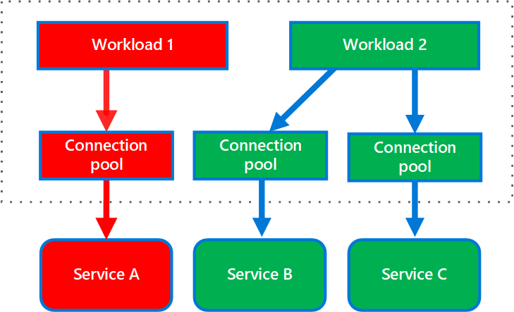

> **图 16.** 对应上文「连接池耗尽」和后面的 Resilience4j bulkhead：库存调用的并发槽和其它接口分开。
>
> Reference:
> [Bulkhead pattern](https://learn.microsoft.com/en-us/azure/architecture/patterns/bulkhead)，Microsoft
> Azure Architecture Center。许可 [CC BY 4.0](https://creativecommons.org/licenses/by/4.0/)。原图
> `_images/bulkhead-connection-pool.png`。

#### 5.1.1 演示：模拟依赖服务超时导致的线程池耗尽

```java
// 库存服务：故意 sleep 模拟变慢
@GetMapping("/api/inventory/{sku}/slow")
public Stock slow(@PathVariable String sku) throws InterruptedException {
    Thread.sleep(3000);
    return stockService.get(sku);
}
```

观察订单侧：

1. 不设超时：线程数上升，最终报无法创建线程 / 请求排队。
2. 设 800ms 超时 + 舱壁（bulkhead）：失败局部化，其它接口仍可用。

```yaml
resilience4j:
  timelimiter:
    instances:
      inventory:
        timeoutDuration: 800ms
  bulkhead:
    instances:
      inventory:
        maxConcurrentCalls: 20
```

---

### 5.2 熔断、限流、降级实战

#### Sentinel vs Resilience4j（课堂口径）

| 维度     | Sentinel            | Resilience4j              |
| -------- | ------------------- | ------------------------- |
| 动态规则 | 控制台/配置中心强   | 偏代码/配置，可自建动态   |
| 生态     | 阿里系、国内资料多  | 与 Spring Boot 微内核友好 |
| 本课     | **主演示 Sentinel** | 对照舱壁与注解风格        |

#### 5.2.1 演示：Sentinel 动态限流规则与熔断器状态转换

熔断器状态：

```text
CLOSED --失败率/慢调用达阈值--> OPEN --休眠窗结束--> HALF_OPEN
  ^                                                    |
  +---------------- 探测成功 --------------------------+
  +---------------- 探测失败 --> 回 OPEN --------------+
```

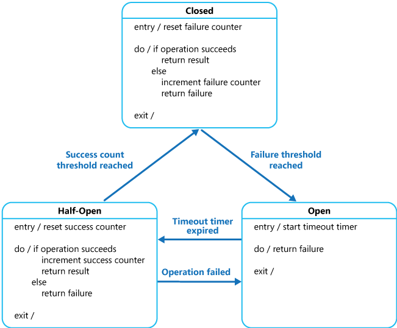

> **图 17.**
> 和上面的文字状态机同一套：关闭时计数，失败到阈值则打开并快速失败，休眠后半开探测，成功再关闭。
>
> Reference:
> [Circuit Breaker pattern](https://learn.microsoft.com/en-us/azure/architecture/patterns/circuit-breaker)，Microsoft
> Azure Architecture Center。许可 [CC BY 4.0](https://creativecommons.org/licenses/by/4.0/)。原图
> `_images/circuit-breaker-diagram.png`。

```java
@SentinelResource(value = "queryOrder",
    blockHandler = "queryOrderBlock",
    fallback = "queryOrderFallback")
public Order queryOrder(String id) { ... }

public Order queryOrderBlock(String id, BlockException ex) {
    return Order.degraded("RATE_LIMITED");
}
public Order queryOrderFallback(String id, Throwable t) {
    return Order.degraded("DEPENDENCY_ERROR");
}
```

慢调用比例熔断示例规则（控制台或 JSON）：

```json
{
  "resource": "queryOrder",
  "grade": 1,
  "count": 0.5,
  "timeWindow": 10,
  "minRequestAmount": 20,
  "statIntervalMs": 1000,
  "slowRatioThreshold": 0.5
}
```

含义直觉：1s 内请求 ≥ 20，且慢调用（超 RT 阈值）比例 ≥ 50% → 熔断 10s。

#### 5.2.2 经验分享：降级策略设计失误（返回 null 导致空指针贯穿业务）

> **踩坑 Callout · 降级返回 null**
>
> - **背景**：库存 Feign Fallback 直接 `return null`；订单代码 `result.isOk()` 未判空。
> - **现象**：下游一熔断，订单服务 NPE 刷屏，错误从「库存不可用」变成「订单
>   500」，监控误判为订单故障。
> - **根因**：降级契约不明确；null 不是合法领域结果。
> - **补救**：Fallback 必须返回空对象/明确错误码；静态检查禁止 Fallback 返回
>   null；契约测试覆盖降级路径。
> - **口诀**：**降级是业务结果，不是「没有结果」。**

#### 5.2.3 实操：为订单查询接口配置慢调用比例熔断（15 分钟）

**目标**：`queryOrder` 在慢调用比例过高时进入 OPEN，返回降级结果；恢复后自动 HALF_OPEN → CLOSED。

**步骤**：

1. 引入 Sentinel，接入控制台或本地规则文件。
2. 给查询接口加 `@SentinelResource` 与 block/fallback。
3. 配置慢调用比例规则（先用宽松阈值验证链路）。
4. 用库存慢接口或 `Thread.sleep` 制造慢调用；观察控制台状态。
5. 恢复正常延迟，确认熔断解除。

**验收标准**：

- [ ] OPEN 期间接口快速返回降级体，无 NPE
- [ ] 指标上能区分 block（限流/熔断）与业务异常
- [ ] 记录规则参数，便于课后在自己环境复现

**ms-lab 等价验收**：

```bash
MS_LAB_HOST=103.198.127.21 bash demo/ms-lab/scripts/chaos.sh
# 出现 {"ok":false,"code":"ORDER_DEGRADED","degraded":true} 即熔断降级生效（非 null）
```

**§5 小结**：超时 + 舱壁 + 熔断 + 合法降级体，四件套缺一不可。

[返回总览](#总览)

---

## 六、分布式事务（强一致性与最终一致性）

### 6.1 问题场景：跨服务订单创建（订单 + 库存 + 账户）

业务不变式（希望同时成立）：

1. 订单状态 = `CREATED` 或 `PAID`
2. 库存已预留对应数量
3. 账户已冻结对应金额

本地事务做不到跨库原子提交。

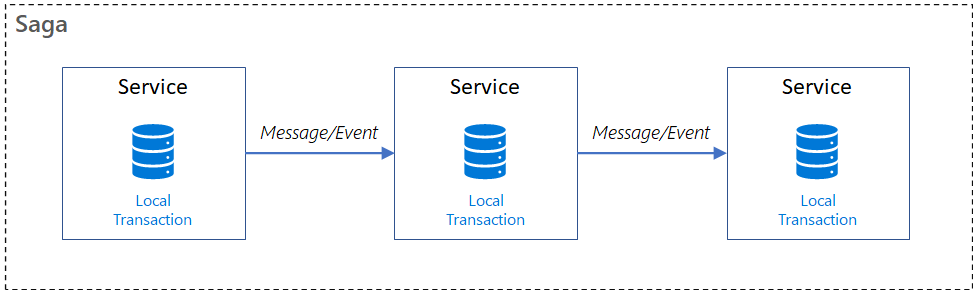

> **图 18.** 订单、库存、账户各自提交本地事务，用事件把下一步串起来，而不是一个跨库的
> `@Transactional`。
>
> Reference:
> [Saga design pattern](https://learn.microsoft.com/en-us/azure/architecture/patterns/saga)，Microsoft
> Azure Architecture Center。许可 [CC BY 4.0](https://creativecommons.org/licenses/by/4.0/)。原图
> `_images/saga-overview.png`。

#### 6.1.1 演示：无事务下数据不一致的复现

```text
1) 写订单成功
2) 调库存成功
3) 调账户超时（实际已冻结 or 未冻结不确定）
→ 用户看到下单失败，但库存被占 / 或账户已冻订单不存在
```

课堂脚本：在账户服务随机 50% 抛超时；重复下单，查三库对账，展示「脏」数据行。

---

### 6.2 可靠方案对比与陷阱

| 方案                           | 一致性   | 延迟  | 复杂度 | 适合                       |
| ------------------------------ | -------- | ----- | ------ | -------------------------- |
| 同库聚合（优先）               | 强       | 低    | 低     | 能合并的边界               |
| Seata AT                       | 近似强   | 中高  | 中     | 短事务、低冲突             |
| TCC                            | 强业务感 | 中    | 高     | 资金等需显式 Try/Confirm   |
| 事务消息 / Outbox + 本地消息表 | 最终     | 低-中 | 中     | 主路径写本地，下游最终对齐 |
| 最大努力通知                   | 弱       | —     | 低     | 通知类                     |

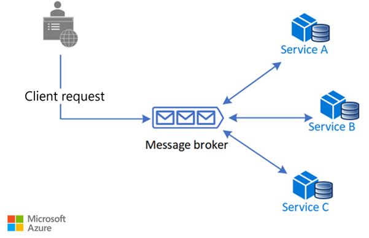

> **图 19.** 没有中心协调器。服务通过消息代理互相驱动，耦合更低，补偿路径要在事件契约里写清。
>
> Reference:
> [Saga design pattern — Choreography](https://learn.microsoft.com/en-us/azure/architecture/patterns/saga)，Microsoft
> Azure Architecture Center。许可 [CC BY 4.0](https://creativecommons.org/licenses/by/4.0/)。原图
> `_images/choreography-pattern.png`。

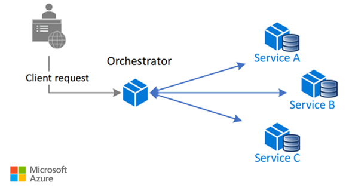

> **图 20.** 订单服务或独立编排器决定下一步调库存还是账户。Seata AT 更接近这种集中协调，而不是图 19
> 的纯事件协同。
>
> Reference:
> [Saga design pattern — Orchestration](https://learn.microsoft.com/en-us/azure/architecture/patterns/saga)，Microsoft
> Azure Architecture Center。许可 [CC BY 4.0](https://creativecommons.org/licenses/by/4.0/)。原图
> `_images/orchestrator.png`。

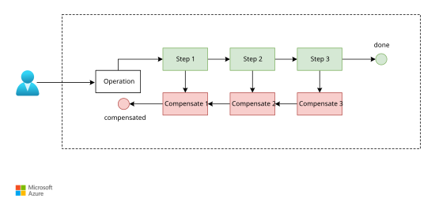

> **图 21.** Saga 失败时不能简单回滚别人的库，只能对已完成的步骤做反向操作，例如释放库存、解冻金额。
>
> Reference:
> [Compensating Transaction pattern](https://learn.microsoft.com/en-us/azure/architecture/patterns/compensating-transaction)，Microsoft
> Azure Architecture Center。许可 [CC BY 4.0](https://creativecommons.org/licenses/by/4.0/)。原图
> `_images/compensating-transaction.svg`。

#### 6.2.1 Seata AT 模式演示：自动回滚的实现与锁竞争问题

AT 直觉：业务 SQL 自动记 undo；协调器决定提交或回滚补偿。

```java
@GlobalTransactional
public Order createOrder(CreateOrderRequest req) {
    orderRepo.insert(...);
    inventoryClient.reserve(...); // 参与 Seata
    accountClient.freeze(...);
    return order;
}
```

**锁竞争问题**：

- 全局锁与 DB 行锁叠加，热点 SKU 下吞吐下降明显。
- 长事务（RPC 慢）放大持锁时间。

**课堂态度**：AT 适合演示与部分后台任务；**下单热点路径**更常落到「库存预留状态机 + 事务消息」。

#### 6.2.2 事务消息（RocketMQ）：演示最终一致性方案

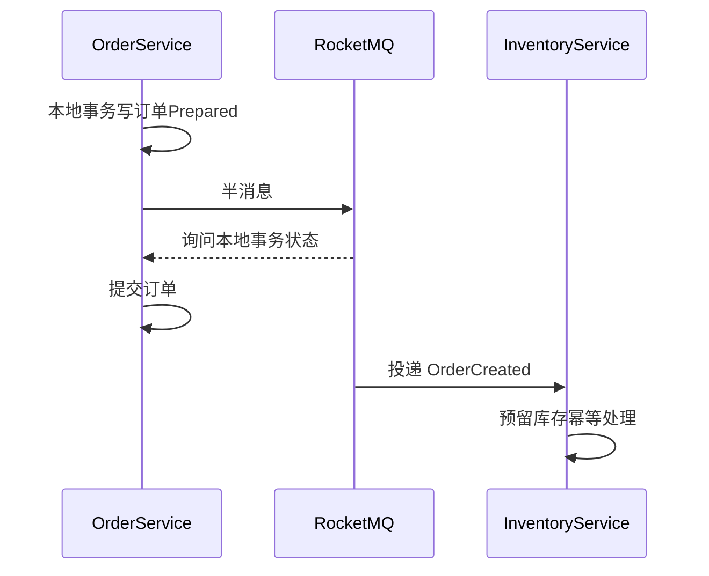

伪代码：

```java
transactionMQProducer.send(halfMsg, (msg, arg) -> {
    try {
        orderRepo.insertPrepared(arg);
        return COMMIT;
    } catch (Exception e) {
        return ROLLBACK;
    }
});
```

Kafka 阵营等价物：**Outbox 表** + Debezium/轮询发布，语义同类。

#### 6.2.3 经验分享：补偿事务设计中「悬挂」与「空回滚」线上案例

> **踩坑 Callout · TCC 悬挂与空回滚**
>
> - **空回滚**：Cancel 先于 Try 到达（超时重试乱序）→ Cancel 以为没业务，直接成功；随后 Try
>   到达留下「脏预留」。
> - **悬挂**：Try 被延迟，Cancel 已执行；之后 Try 成功却无人 Confirm/Cancel。
> - **补救**：事务状态机表（xid → 状态）；Try 前检查是否已
>   Cancel；空回滚要落「已取消」标记拒绝迟到的 Try。
> - **课堂口诀**：分布式补偿不是对称的 try/catch，是**带状态的协议**。

#### 6.2.4 实操：修改订单流程，增加事务消息发送（10 分钟）

**目标**：订单本地提交与 `OrderCreated` 消息要么都成功，要么都失败（半消息或 Outbox）。

**步骤**：

1. 选实现：RocketMQ 事务消息 **或** 本地 Outbox 表（二选一，课堂统一用 Outbox 亦可）。
2. Outbox 方案：同一本地事务写入 `orders` + `outbox(event_id, payload, status=NEW)`。
3. 后台轮询/CDC 发送到 Kafka，成功标记 `SENT`。
4. 库存服务消费并幂等预留。
5. 故意在写 Outbox 后杀进程，重启后确认消息仍会发出。

**验收标准**：

- [ ] 杀进程演练无「有订单无消息」
- [ ] 重复消费不重复扣库存（依赖 event_id）
- [ ] 对账 SQL：订单数 ≈ 库存预留成功数（允许短暂延迟）

**§6 小结**：能不分布式事务就不；AT 慎用于热点；事务消息/Outbox 是主路径常客；TCC
必须防悬挂/空回滚。

[返回总览](#总览)

---

## 七、可观测性：指标、链路与日志

### 三支柱对照

| 支柱    | 工具（本课）         | 回答的问题                     |
| ------- | -------------------- | ------------------------------ |
| Metrics | Prometheus + Grafana | 系统现在健康吗？速率/错误/饱和 |
| Traces  | SkyWalking / Jaeger  | 慢在哪一跳？                   |
| Logs    | ELK                  | 这个请求发生了什么细节？       |

---

### 7.1 分布式链路追踪（SkyWalking / Jaeger）

#### 7.1.1 演示：跨服务调用链的慢节点定位

期望看到的调用链：

```text
Gateway → order-service → inventory-service
                       ↘ account-service
```

慢节点特征：某 Span `duration` 显著大于同级；或等待时间长于执行时间（排队）。

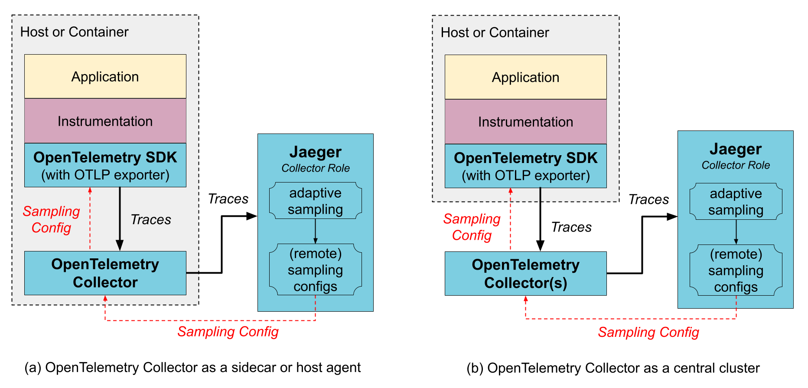

> **图 22.** 应用埋点进 OpenTelemetry SDK，Collector 再把 Trace 交给扮演 Collector 角色的
> Jaeger。课堂 Jaeger UI 看的就是这条链路的结果。
>
> Reference:
> [Jaeger Architecture — With OpenTelemetry Collector](https://www.jaegertracing.io/docs/latest/architecture/#with-opentelemetry-collector)，Jaeger
> authors。许可 [Apache License 2.0](https://www.apache.org/licenses/LICENSE-2.0)。原图
> [architecture-v2-otel.png](https://www.jaegertracing.io/img/architecture-v2-otel.png)。

**OpenTelemetry / Jaeger 概念片段**：

```java
Span span = tracer.spanBuilder("order.create")
    .setSpanKind(SpanKind.SERVER)
    .startSpan();
try (Scope scope = span.makeCurrent()) {
    span.setAttribute("order.id", orderId);
    inventoryClient.reserve(...);
} catch (Exception e) {
    span.recordException(e);
    span.setStatus(StatusCode.ERROR);
    throw e;
} finally {
    span.end();
}
```

SkyWalking：常通过 Java Agent 自动埋点，课堂对比「零侵入 vs 显式 Span」。

---

### 7.2 指标聚合（Prometheus + Grafana）

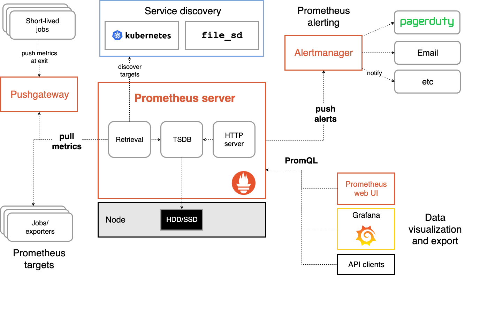

> **图 23.** 服务暴露指标，Prometheus 主动拉取；Grafana 用 PromQL 做大盘，Alertmanager
> 负责告警。短生命周期作业才走 Pushgateway。
>
> Reference: [Prometheus overview](https://prometheus.io/docs/introduction/overview/)，Prometheus
> authors。许可 [Apache License 2.0](https://www.apache.org/licenses/LICENSE-2.0)。原图
> [architecture.svg](https://prometheus.io/assets/docs/architecture.svg)；因原 SVG 用 HTML
> `foreignObject` 标注，Markdown 以图片引用时标签会丢失，此处为同一张图的 PNG 渲染。

#### 7.2.1 演示：自定义业务指标（订单成功率、QPS）大盘监控

```java
Counter ordersTotal = Counter.builder("orders_total")
    .tag("status", "ok") // 或在 inc 时指定
    .register(registry);

Counter ordersError = Counter.builder("orders_total")
    .tag("status", "error")
    .register(registry);

// 业务里
ordersTotal.increment();
```

Grafana 面板建议：

| 面板       | PromQL 思路                                                                            |
| ---------- | -------------------------------------------------------------------------------------- |
| 下单 QPS   | `sum(rate(orders_total[1m]))`                                                          |
| 成功率     | `ok / (ok+error)`                                                                      |
| P95 延迟   | `histogram_quantile(0.95, sum(rate(http_server_requests_seconds_bucket[5m])) by (le))` |
| Feign 错误 | 按 client 名拆分                                                                       |

与 SRE 黄金信号对齐：Latency / Traffic / Errors / Saturation。

---

### 7.3 日志聚合与告警（ELK + 告警规则）

#### 7.3.1 经验分享：全量日志采集导致磁盘爆满的优化方案

> **踩坑 Callout · 全量日志打满磁盘**
>
> - **背景**：DEBUG 全开 + 每个请求打印完整 body + 无采样；Filebeat 全量进 ES。
> - **现象**：日志盘 100%；ES 写入拒绝；连锁导致节点假死。
> - **补救**：① 生产默认 INFO；② 大字段脱敏截断；③ 按比例采样 debug；④ 热点接口单独 logger；⑤
>   磁盘水位告警与日志轮转强制配置。
> - **与 Trace 分工**：细节用 TraceId 关联到日志，而不是把一切打进日志。

#### 7.3.2 实操：为订单服务添加一个 Span 并导出到 Jaeger（10 分钟）

**目标**：在 Jaeger UI 看到 `order.create` 及子调用 Span。

**步骤**：

1. 引入 OTel SDK 或 Spring Observability 与 Jaeger exporter。
2. 在下单方法手动加 Span（或确认自动埋点已覆盖）。
3. 设置 `traceId` 注入 MDC，日志带同一 ID。
4. 发起一次下单，在 Jaeger 按 service=`order-service` 查找。
5. 人为让库存变慢，确认慢 Span 落在 inventory。

**验收标准**：

- [ ] UI 可见完整链路
- [ ] 日志中的 TraceId 与 Jaeger 一致
- [ ] 至少 1 个业务 attribute（如 `order.id`）

**§7 小结**：指标看态势，链路看定位，日志看细节；三者用 TraceId/OrderId 关联。

**第一天收束检查单**：

- [ ] 能画订单上下文拆分图
- [ ] Feign 超时 + Fallback 非 null
- [ ] Gateway JWT + 灰度头
- [ ] Sentinel 慢调用熔断演示过
- [ ] Outbox/事务消息与对账思路清晰
- [ ] Jaeger 看到 Span

[返回总览](#总览)

---

## 第二天 · 上午：微服务高级韧性 + AI 准备工作

**上午目标**：补齐幂等与发布策略；把 AI
模型变成可版本化、可灰度的微服务；用预测做路由与伸缩。不假设学员训过模型——从「模型当服务」讲起，reload
/ 金丝雀以演示+验收为主。

---

## 八、微服务高级模式与云原生部署

### 8.1 重试、幂等与去重

#### 为什么「重试」与「幂等」必须成对出现

网络超时的语义是**不确定**的：请求可能未到、已执行完、或执行中。重试会把「不确定」变成「至少一次」；业务必须能承受「至少一次」→
**幂等**。

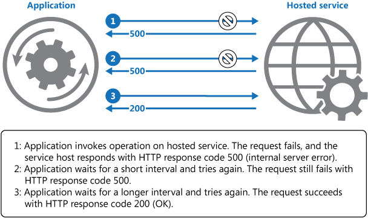

> **图 24.** 只重试幂等操作，并且拉大间隔。多层同时重试会变成 §8.1.2 的重试风暴。
>
> Reference:
> [Retry pattern](https://learn.microsoft.com/en-us/azure/architecture/patterns/retry)，Microsoft
> Azure Architecture Center。许可 [CC BY 4.0](https://creativecommons.org/licenses/by/4.0/)。原图
> `_images/retry-pattern.png`。

| 操作     | 幂等做法                                |
| -------- | --------------------------------------- |
| 创建订单 | 客户端 `Idempotency-Key` / 业务唯一单号 |
| 扣库存   | 预留单号状态机：同一 reserveId 不重复扣 |
| 消息消费 | `eventId` 去重表                        |
| 支付回调 | 支付流水号唯一约束                      |

#### 8.1.1 演示：基于 Redis 的幂等表设计（防止消息重复消费）

```java
public boolean tryConsume(String eventId, Duration ttl) {
    // SET key value NX EX
    Boolean ok = stringRedisTemplate.opsForValue()
        .setIfAbsent("idem:evt:" + eventId, "1", ttl);
    return Boolean.TRUE.equals(ok);
}

@KafkaListener(topics = "order.paid")
public void onOrderPaid(OrderPaidEvent evt) {
    if (!tryConsume(evt.eventId(), Duration.ofDays(7))) {
        log.info("duplicate event {}", evt.eventId());
        return;
    }
    inventoryService.confirm(evt);
}
```

**设计要点**：

1. **先占坑再做事**；若业务失败，要有明确策略：删除 key 允许重试，或写入 `FAIL` 状态人工处理。
2. TTL 覆盖「最大重试窗口」；过短会重复处理，过长占内存。
3. 仅靠 DB 唯一索引也可；Redis 适合高 QPS 前置过滤。

更稳的状态机：

```text
NEW → PROCESSING → DONE
              ↘ FAILED（可回放）
```

#### 8.1.2 经验分享：重试风暴压垮下游的惨剧（带重试退避策略修正）

> **踩坑 Callout · 重试风暴**
>
> - **背景**：库存抖动；订单 Feign 默认重试 3 次；网关再重试 2 次；客户端再刷。
> - **现象**：真实负载 × 乘子；库存从「慢」变「雪崩」；熔断器一直 OPEN。
> - **根因**：多层重试无预算；无抖动退避；对非幂等 POST 也重试。
> - **补救**：
>   - **重试预算**：整条链路最多重试 N 次（只在一层做）。
>   - **指数退避 + 抖动**：`sleep = min(cap, base * 2^attempt) * random(0.5, 1.5)`。
>   - **只对幂等读 / 带幂等键的写重试**。
>   - 与熔断联动：OPEN 时停止重试。

```yaml
# 概念示例：只在客户端一层有限重试
resilience4j.retry:
  instances:
    inventoryRead:
      maxAttempts: 3
      waitDuration: 200ms
      enableExponentialBackoff: true
      exponentialBackoffMultiplier: 2
      ignoreExceptions:
        - BusinessException
```

---

### 8.2 蓝绿部署与金丝雀发布

| 策略   | 做法                 | 回滚          | 风险           |
| ------ | -------------------- | ------------- | -------------- |
| 蓝绿   | 两套环境切流量       | 瞬时切回      | 资源成本高     |
| 滚动   | 逐步替换 Pod         | 向前/向后滚动 | 混合版本时间长 |
| 金丝雀 | 小比例用户先吃新版本 | 切回 0%       | 需指标对比     |

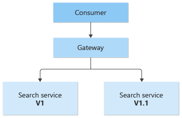

> **图 25.** 金丝雀和蓝绿都依赖这层分流：网关或 Ingress
> 决定多少流量进入新版本，而不是让客户端自己挑实例。
>
> Reference:
> [Gateway Routing pattern — multiple versions](https://learn.microsoft.com/en-us/azure/architecture/patterns/gateway-routing)，Microsoft
> Azure Architecture Center。许可 [CC BY 4.0](https://creativecommons.org/licenses/by/4.0/)。原图
> `_images/gateway-multiple-versions.png`。

#### 8.2.1 演示：K8s + Ingress 实现流量切分

```yaml
# 简化示意：两个 Service + Ingress 权重（实际可用 Gateway API / Nginx canary 注解）
apiVersion: networking.k8s.io/v1
kind: Ingress
metadata:
  name: recommend-ingress
  annotations:
    nginx.ingress.kubernetes.io/canary: "true"
    nginx.ingress.kubernetes.io/canary-weight: "10"
spec:
  rules:
    - http:
        paths:
          - path: /api/recommend
            pathType: Prefix
            backend:
              service:
                name: recommend-canary
                port:
                  number: 80
```

稳定版 Ingress 不带 canary 注解；金丝雀带 `canary-weight: "10"` → 约 10% 流量。

也可沿用 §4.2.2 的 `X-Canary` 头做「按用户」而非「随机比例」切流，利于 A/B（§11.3）。

#### 8.2.2 实操：为推荐服务配置 10% 金丝雀流量（15 分钟）

**目标**：`recommend-service` v2 以 10% 流量上线；错误率升高可一键回 0。

**步骤**：

1. 部署 `recommend:stable` 与 `recommend:canary` 两套 Deployment/Service。
2. 配置 Ingress canary-weight=10（或服务网格/Gateway 等价物）。
3. 压测或脚本发 200 请求，统计打到 canary 的比例（靠响应头 `X-Version=canary`）。
4. 观察 Grafana：canary 与 stable 的错误率、P95。
5. 将 weight 改为 0，确认回滚。

**验收标准**：

- [ ] 流量比例在 8%–12% 附近（统计波动可接受）
- [ ] 响应头能区分版本
- [ ] 回滚操作 < 1 分钟生效

**ms-lab 等价验收**（gateway 按用户哈希切 `recommend-canary`）：

```bash
MS_LAB_HOST=103.198.127.21 bash demo/ms-lab/scripts/smoke-e2e.sh
# 输出含 canary=11/100（约 10%）；响应头 X-Version=v1|v2
```

**§8 小结**：重试有预算；幂等有状态；发布有比例与回滚。

[返回总览](#总览)

---

## 九、AI 模型服务化基础（模型即服务）

### 9.1 AI 模型集成面临的挑战

把「notebook 里的 .pt 文件」变成「微服务」会撞上：

| 挑战         | 说明                         | 工程对策                                |
| ------------ | ---------------------------- | --------------------------------------- |
| 版本管理     | 特征、预处理、权重必须同版本 | 模型包 = 代码 + 权重 + 配置；语义化版本 |
| GPU 调度     | 卡少且贵；碎片化             | Triton 模型仓库、按优先级队列、CPU 回退 |
| 延迟 vs 吞吐 | 单条延迟 vs batch 吞吐       | 动态 batching；在线/近线拆分            |
| 依赖漂移     | CUDA、tokenizer、数值库      | 冻结镜像；训练推理同镜像族              |
| 隔离         | 模型 OOM 不影响订单          | 独立 Deployment；独立限流               |

#### 9.1.1 版本管理、GPU 资源调度、推理延迟 vs 吞吐取舍

```text
在线推荐排序：SLA P99 < 50ms → 小 batch 或 batch=1，GPU 利用率可能不高
近线召回刷新：可等 100–500ms → 大 batch，抬高吞吐、降低单价
离线评测：吞吐优先
```

**资源配额示例（K8s）**：

```yaml
resources:
  limits:
    nvidia.com/gpu: 1
  requests:
    cpu: "2"
    memory: 8Gi
```

#### 9.1.2 经验分享：训练与推理环境不一致导致的线上精度崩塌

> **踩坑 Callout · 训练推理不一致**
>
> - **背景**：训练用 PyTorch 2.1 + 某版 tokenizer；推理镜像是旧 CUDA 与不同预处理（漏了
>   normalize）。
> - **现象**：离线 AUC 很高，线上 CTR 暴跌；长期无人发现，直到业务投诉。
> - **根因**：无「模型包」原子性；无线上影子评测；预处理代码两份实现。
> - **补救**：一份预处理代码进模型包；镜像 digest 钉死；上线前影子流量对比分数分布；监控 CTR/业务
>   KPI 与模型版本标签联动告警。

---

### 9.2 模型热加载与灰度发布

#### 9.2.1 演示：使用 BentoML / Triton 封装 PyTorch 推荐模型为 gRPC 服务

**BentoML 概念示例**：

```python
import bentoml
import torch

@bentoml.service(traffic={"timeout": 50})
class RankService:
    def __init__(self):
        self.model = bentoml.models.get("ranker:1.0.0").to_runner()
        self.model.init_local()

    @bentoml.api(batchable=True)
    def rank(self, user_features: list[dict]) -> list[list[float]]:
        with torch.inference_mode():
            return self.model.run(user_features)
```

**Triton**：多框架模型仓库、动态 batch、HTTP/gRPC
齐备；适合多模型共卡。课堂可用其一做主演示，另一做对比。

#### 9.2.2 演示：模型版本切换（v1→v2）且无中断

策略：

1. **双载**：进程内同时加载 v1/v2，用路由键切换（内存成本高）。
2. **金丝雀 Deployment**：新 Pod 带 v2，流量 10% → 50% → 100%（与 §8.2 一致）。
3. **Triton model control API**：load/unload 版本，客户端指定 `model_version`。

```bash
# 概念：加载新版本后改默认版本
curl -X POST localhost:8000/v2/repository/models/ranker/load
# 客户端：
# model_name=ranker, model_version=2
```

**无中断检查单**：旧请求仍在旧版本完成；就绪探针在模型 load 完后再 Ready；失败自动摘流。

---

### 9.3 异步推理模式

#### 9.3.1 演示：Kafka + 推理 Worker 处理批量特征（双 11 场景仿真）

适用：特征预计算、候选集打分、非用户同步等待的路径。

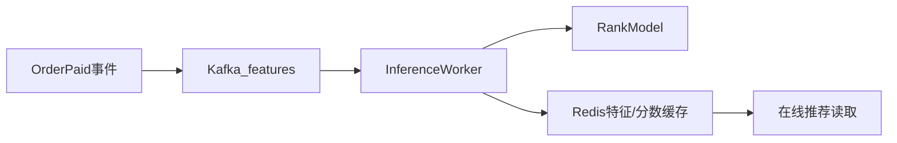

```python
# Worker 伪代码
for batch in consumer.poll_batches(max_records=64, timeout_ms=50):
    scores = model.rank([f.payload for f in batch])
    redis.mset({f.user_id: s for f, s in zip(batch, scores)})
    consumer.commit()
```

**双 11 仿真要点**：

1. 用历史峰值 × 系数灌 Kafka。
2. 观察 lag；Worker HPA 按 lag/CPU 扩容。
3. 在线 API 只读缓存，miss 时降级到默认热榜（合法降级体）。

**§9 小结**：模型包原子化；热加载/金丝雀保无中断；能异步就别占在线 SLA。

[返回总览](#总览)

---

## 十、AI 辅助微服务治理（智能路由与弹性伸缩）

### 10.1 基于实时预测的智能路由

#### 10.1.1 演示：使用简单线性模型预测下游服务延迟，动态路由到最优实例

思路：对每个实例维护近期特征 → 预测下一窗口 RT → 网关/客户端选 RT 更优且健康的实例。

特征示例：

| 特征         | 来源                |
| ------------ | ------------------- |
| 过去 30s P95 | 本地滑动窗口 / 指标 |
| 进行中请求数 | 舱壁计数            |
| 是否同 AZ    | 元数据              |
| 最近错误率   | 熔断统计            |

```python
# 极简示意：线性打分，越小越好
def score(inst):
    return 0.7 * inst.p95_ms + 0.2 * inst.inflight + 0.1 * inst.error_rate * 1000

def pick(instances):
    healthy = [i for i in instances if i.state != "OPEN"]
    return min(healthy, key=score)
```

生产中可把模型换成梯度提升树；**课堂强调闭环**：预测错了要有探活与熔断兜底，AI 不能替代熔断。

#### 10.1.2 经验分享：模型特征漂移导致路由失效的监控方案

> **踩坑 Callout · 路由模型特征漂移**
>
> - **背景**：路由模型用「小时级平均 CPU」作特征；大促形态变为短脉冲，特征分布偏移。
> - **现象**：流量被导向实际更慢的实例；整体 P99 变差，却显示「模型置信度高」。
> - **补救**：监控特征分布 PSI/KL；监控「预测 RT vs 真实
>   RT」误差；误差超阈回退到轮询/加权；定期重训。
> - **原则**：**AI 路由是优化层，熔断与健康检查是安全层。**

---

### 10.2 AI 驱动的弹性伸缩

#### 10.2.1 演示：Prometheus 指标 + 时序预测（Prophet）提前扩缩容 Pod

反应式 HPA：CPU 高了再扩 → 总是慢半拍。

预测式：用历史 QPS/lag 预测下一高峰，提前扩容。

```python
from prophet import Prophet
import pandas as pd

df = pd.DataFrame({"ds": timestamps, "y": qps_series})
m = Prophet(daily_seasonality=True)
m.fit(df)
future = m.make_future_dataframe(periods=30, freq="min")
forecast = m.predict(future)
next_peak = forecast.tail(30)["yhat"].max()
desired_replicas = math.ceil(next_peak / qps_per_pod * safety_factor)
# 调用 K8s API 调整 Deployment replicas 或写 CRD
```

**注意**：

1. 预测失败时回退到 CPU/QPS HPA。
2. 缩容要保守（冷却时间），扩容可激进。
3. GPU 池与 CPU 池分开预测（见 §13.3.2）。

**§10 小结**：智能路由/伸缩是「增强」，不是「替代」经典治理。

[返回总览](#总览)

---

## 第二天 · 下午：AI 核心应用落地实战

**下午目标**：跑通推荐三阶段与 A/B；落地 AIOps
检测与根因；用综合演示把两天能力串成闭环。运维/测试学员侧重告警与 `/rca`；有开发基础者可选跟看 A/B
日志。

---

## 十一、智能推荐系统微服务实战

### 11.1 构建推荐服务链路

#### 11.1.1 架构：召回（协同过滤）→ 排序（DNN）→ 重排（规则）

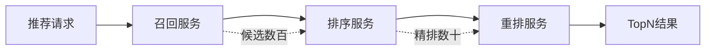

| 阶段 | 目标             | 典型技术                        | SLA               |
| ---- | ---------------- | ------------------------------- | ----------------- |
| 召回 | 从海量物品拉候选 | 协同过滤、向量检索 Milvus、倒排 | 可并行多路召回    |
| 排序 | 精排打分         | DNN / ONNX Runtime              | 紧（P99 几十 ms） |
| 重排 | 业务规则         | 去已购、多样性、保量、合规      | 规则可热配        |

**多路召回合并**：热榜 + 向量相似 + 个性化 CF；每路配额，合并去重。

#### 11.1.2 演示：召回服务（Milvus 向量检索）与排序服务（ONNX 模型）调用链

```python
# 召回：向量近邻
results = milvus.search(
    collection_name="item_emb",
    data=[user_vector],
    anns_field="embedding",
    param={"metric_type": "IP", "params": {"nprobe": 16}},
    limit=200,
)
candidate_ids = [h.id for h in results[0]]
```

```python
# 排序：ONNX
import onnxruntime as ort
sess = ort.InferenceSession("ranker_v1.onnx", providers=["CUDAExecutionProvider", "CPUExecutionProvider"])
scores = sess.run(None, {"features": batch_features})[0]
ranked = sorted(zip(candidate_ids, scores), key=lambda x: -x[1])
```

订单主线如何接推荐：消费 `OrderPaid` / `ItemViewed`
更新用户向量（异步，§9.3）；下单页同步只读缓存结果。

---

### 11.2 性能与缓存优化

#### 11.2.1 演示：Redis 缓存特征向量 + Caffeine 本地热点缓存

多层缓存：

```text
请求 → Caffeine（进程内热点用户/物品）→ Redis（特征向量、召回结果）→ Milvus/Model
```

```java
LoadingCache<String, float[]> localEmb = Caffeine.newBuilder()
    .maximumSize(10_000)
    .expireAfterWrite(Duration.ofSeconds(30))
    .build(key -> redisEmbeddingStore.get(key));
```

**缓存 key 设计**：`emb:user:{id}:v{modelVer}` —— **带模型版本**，避免 v2 读到 v1 向量。

#### 11.2.2 经验分享：缓存穿透导致模型服务崩溃的限流方案

> **踩坑 Callout · 缓存穿透打爆模型**
>
> - **背景**：大量随机 userId / 已下线 itemId 查询；缓存全 miss；请求直打 GPU 推理。
> - **现象**：模型服务 GPU 打满、排队暴涨；正常用户 RT 恶化；可能 OOM。
> - **补救**：① 布隆过滤器 / 合法 ID 校验；② 空结果短 TTL 缓存；③ 模型入口独立 Sentinel
>   限流与隔离舱；④ 超限返回热榜降级。
> - **联动**：缓存命中率、模型排队长度、GPU util 进同一告警仪表盘。

---

### 11.3 A/B 测试框架集成

#### 11.3.1 演示：在网关层基于用户 ID 分流，对比推荐模型 v1/v2 的 CTR

分流要**稳定**：同一用户始终进同一桶，否则污染实验。

```java
int bucket = Math.floorMod(userId.hashCode(), 100);
String exp = bucket < 50 ? "ranker_v1" : "ranker_v2";
exchange.getRequest().mutate().header("X-Experiment", exp).build();
```

**指标**：曝光、点击、CTR、GMV；按 `X-Experiment` 标签进 Prometheus / 日志。

```text
ctr = clicks{exp="ranker_v2"} / impressions{exp="ranker_v2"}
```

#### 11.3.2 实操：为推荐服务增加一个实验层并输出分流日志（20 分钟）

**目标**：推荐链路打印 `userId, experiment, modelVersion, itemIds`；可用日志统计粗 CTR。

**步骤**：

1. 在网关或推荐 BFF 增加稳定哈希分流，写入 `X-Experiment`。
2. 推荐服务读取头，选择 v1/v2 模型（或 canary Service）。
3. 结构化日志（JSON）输出分流字段与曝光物品。
4. 用脚本模拟 1000 用户请求，确认桶大致 50/50（或你定的比例）。
5. 故意让 v2 返回固定差结果，观察指标差异是否可见（课堂人造效应）。

**验收标准**：

- [ ] 同 userId 多次请求实验号不变
- [ ] 日志可被 jq/统计脚本聚合
- [ ] 与金丝雀发布的关系说得清（实验 ≠ 发布，但可共用切流技术）

**§11 小结**：三阶段解耦；缓存带版本；实验要稳定分桶。

[返回总览](#总览)

---

## 十二、AIOps 实践：智能异常检测与根因分析

### 12.1 基于日志的异常检测

#### 12.1.1 演示：使用 Fluentd + 隔离森林算法实时检测异常日志模式

流水线：

```text
App 日志 → Fluentd → 特征化（模板化、计数）→ IsolationForest → 异常事件 → 告警/工单
```

```python
from sklearn.ensemble import IsolationForest
import numpy as np

# X: 每分钟窗口的模板计数向量
clf = IsolationForest(contamination=0.02, random_state=42)
clf.fit(X_train)
pred = clf.predict(X_live)  # -1 异常
```

日志模板化：把数字/ID 变量替换成占位，避免「每条都唯一」导致统计失效。

#### 12.1.2 经验分享：误报率过高如何调整（监督学习 + 标注反馈）

> **踩坑 Callout · AIOps 误报**
>
> - **背景**：隔离森林 contamination 设太大；发布窗口、定时任务被当异常。
> - **现象**：夜间告警风暴；oncall 关闭通知 → 真正故障漏报。
> - **补救**：标注反馈闭环（告警 →
>   有用/无用）；引入简单监督模型；维护「已知变更窗口」抑制；按业务时段自适应阈值（见 12.2）。
> - **指标**：跟踪精确率/召回率，而不是只看「检出了多少」。

---

### 12.2 指标异常检测与告警收敛

#### 12.2.1 演示：Prometheus 指标 + 时序异常检测（3-sigma 自适应、STL 分解）

**3-sigma 自适应**：对滑动窗口算 μ、σ，超出 μ±kσ 告警；夜间 σ 更小，阈值应随窗口变。

**STL 分解**：拆出趋势 / 季节 / 残差，对残差做检测，减少「每天早晚高峰」误报。

```python
# 伪代码
seasonal, trend, resid = stl_decompose(success_rate_series)
if abs(resid[-1]) > threshold_adaptive:
    emit_alert("order_success_rate_anomaly")
```

告警收敛：同一根因窗口合并；抑制 flapping；相关告警归并到「变更/依赖」故事线。

#### 12.2.2 实操：为订单成功率指标配置智能告警（减少夜间误报）（15 分钟）

**目标**：白天/夜间使用不同基线或 STL 残差阈值；人为注入成功率下降时仍能告警。

**步骤**：

1. 导出 `orders_total{status=...}` 成功率序列。
2. 实现简易检测脚本（3-sigma 分时段 **或** STL 残差）。
3. 用历史正常夜间数据验证：误报接近 0。
4. 注入故障（提高库存错误率），确认告警触发。
5. 把告警接到 webhook / 邮件（课堂可用控制台打印代替）。

**验收标准**：

- [ ] 正常夜间回放无明显误报
- [ ] 注入故障后告警延迟可接受（如 < 2 分钟）
- [ ] 告警文案含当前值、基线、关联 Trace 入口链接（可先占位）

---

### 12.3 关联根因分析（基于调用链）

#### 12.3.1 演示：当订单错误率飙升，自动关联 Trace 并定位到故障服务

算法直觉：

1. 指标检测：`order` 错误率上升。
2. 拉出时间窗内错误 Trace 集合。
3. 统计错误 Span 落在哪些服务 / 哪些操作；找「最先变慢或变错」的公共祖先下游。
4. 输出：`疑似根因 = inventory-service.reserve P99 升 + 超时占比`。

```text
order.create ERROR 40%
  ├─ user.check OK
  ├─ inventory.reserve TIMEOUT 38%  ← 根因候选
  └─ account.freeze OK（未调用到）
```

#### 12.3.2 经验分享：分布式环境下 AI 根因分析的常见失效案例

> **踩坑 Callout · 根因分析失效**
>
> - **案例 A**：采样率过低，错误 Trace 几乎没有 → 统计无意义。\
>   **补救**：错误强制全采样；正常流量低采样。
> - **案例 B**：时钟不准，Span 时间线错乱。\
>   **补救**：NTP；依赖因果序与父子关系而非绝对时间。
> - **案例 C**：把「共享基础设施」当业务根因（如整集群 DNS 抖）。\
>   **补救**：引入节点/网络层黄金信号，做多层关联。
> - **案例 D**：模型只学「相关性」：错误总伴随「日志量上升」就报日志系统。\
>   **补救**：用变更事件、部署版本作协变量；人工反馈。

**§12 小结**：检测要控误报；根因要靠 Trace+指标+变更，AI 给候选不给真理。

[返回总览](#总览)

---

## 十三、综合项目演示：AI 原生微服务系统

### 13.1 完整场景串联

#### 13.1.1 用户访问 → 网关智能路由 → 订单服务（分布式事务）→ 推荐服务（模型推理）→ 异常检测实时告警 → 自动弹性伸缩

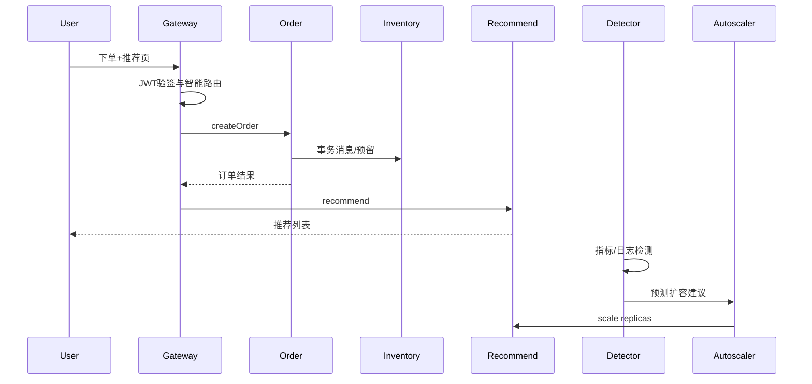

**课堂串讲清单**（每步对应昨天/上午章节）：

| 步骤              | 对应能力   |
| ----------------- | ---------- |
| JWT + 灰度头      | §4         |
| 智能选实例        | §10.1      |
| 下单与库存一致    | §6         |
| 推荐三阶段 + 缓存 | §11        |
| 熔断降级          | §5         |
| 异常检测与扩容    | §12、§10.2 |

---

### 13.2 故障注入与自愈

#### 13.2.1 演示：随机注入服务延迟，观察熔断、智能路由切换、告警触发

故障注入方式：

```bash
# 示例：对库存加 2s 延迟（可用 toxiproxy / 混沌模块 / 代码开关）
curl -X POST inventory:8080/chaos/latency -d '{"ms":2000}'
```

观察顺序：

1. 订单 P99 上升 → Sentinel 慢调用熔断 OPEN。
2. 智能路由降低坏实例权重 / 摘除。
3. 成功率指标触发智能告警。
4. （可选）扩容推荐或订单副本；故障恢复后 HALF_OPEN → CLOSED。

**复盘白板**：画出「注入点 → 保护机制 → 信号 → 人/系统动作」。

---

### 13.3 性能与资源压测

#### 13.3.1 演示：使用 wrk + GPU 监控展示模型服务吞吐量

```bash
wrk -t4 -c64 -d60s -s recommend.lua http://gateway/api/recommend
# GPU
nvidia-smi dmon -s u
```

记录：QPS、P99、GPU util、batch size。调动态 batch，看吞吐升、延迟是否破 SLA。

#### 13.3.2 经验分享：大促前 AI 容量评估的常见误区（CPU/GPU 混合调度）

> **踩坑 Callout · AI 容量评估误区**
>
> - **误区 1**：用 CPU 服务的 HPA 曲线直接套 GPU 服务 → GPU 利用率与 CPU 不对齐。
> - **误区 2**：只压平均值，不压「推荐突刺 + 下单突刺」同位出现。
> - **误区 3**：忽略模型切换期间双版本占双倍显存。
> - **误区 4**：认为扩 Pod 就能扩 GPU —— 节点没有卡时只是 Pending。
> - **做法**：分池压测；显存水位告警；金丝雀双载要算显存；备好 CPU 降级模型。

**§13 小结**：综合演示的价值是「机制联动」，不是新概念堆砌。

[返回总览](#总览)

---

## 十四、课程总结与延展

### 14.1 微服务 + AI 的后续演进方向

#### 14.1.1 大语言模型（LLM）辅助代码生成与运维对话

| 场景                    | 价值     | 风险                     |
| ----------------------- | -------- | ------------------------ |
| 生成 Feign/契约测试骨架 | 提速     | 幻觉字段，需契约测试兜底 |
| 对话查指标 / 写 PromQL  | 降门坎   | 权限与提示注入           |
| 事故摘要                | 缩短复盘 | 必须引用原始 Trace/日志  |

落地建议：LLM 只读可观测数据；变更操作走人工或 Runbook 审批；提示中强制带 TraceId。

#### 14.1.2 WebAssembly + AI 边缘推理

- 在边缘（CDN/网关/设备）跑轻量模型：风控特征、简单分类。
- Wasm 隔离好、冷启动快；适合近用户低延迟。
- 与中心 GPU 大模型形成「边小中心大」分工。

---

### 14.3 Q&A + 针对性答疑

#### 14.3.1 针对学员实际业务场景的架构建议（互动讨论）

**讨论引导问题**：

1. 你现在的系统是单体、模块化单体，还是已微服务？最大痛点是发布、性能还是故障半径？
2. 跨服务事务真实频率？能否通过合并聚合根消掉？
3. 是否已有统一网关与观测？缺哪根柱子？
4. AI 部分是「调用外部 API」还是「自备模型」？SLA 与 GPU 预算？
5. 团队规模与平台组编制？是否触及 Mesh 选型门槛？

**常见场景速配**：

| 学员场景        | 建议起点                                        |
| --------------- | ----------------------------------------------- |
| 中小 Java 电商  | 本课默认栈：Nacos + Gateway + Sentinel + Outbox |
| 已有 K8s 多语言 | 加强 Gateway/Ingress 与观测；Mesh 谨慎评估      |
| 先要 AI 推荐    | 先异步特征 + 缓存；在线路径尽量薄               |
| 强监管金融      | TCC/严谨状态机 + 全审计；AT 慎用                |

**两天知识地图回顾**：

```text
拆分 → 通信 → 发现配置 → 网关安全 → 韧性 → 一致性 → 观测
   → 幂等发布 → 模型服务化 → 智能治理 → 推荐 → AIOps → 综合闭环
```

[返回总览](#总览)

---

## 附录

### A. 组件与选型速查

| 能力       | 本课默认             | 可替换                 | 备注                       |
| ---------- | -------------------- | ---------------------- | -------------------------- |
| 注册/配置  | Nacos                | Consul、Apollo（配置） | 中小团队一体省事           |
| 网关       | Spring Cloud Gateway | APISIX、Nginx Ingress  | 过滤器保持薄               |
| 同步调用   | OpenFeign            | RestClient、gRPC       | 超时必配                   |
| 熔断限流   | Sentinel             | Resilience4j           | 降级体禁止 null            |
| 消息       | Kafka / RabbitMQ     | RocketMQ               | 事务消息可用 RocketMQ      |
| 分布式事务 | Outbox + 消息        | Seata AT、TCC          | 热点慎用 AT                |
| 追踪       | Jaeger / OTel        | SkyWalking             | 错误全采样                 |
| 指标       | Prometheus + Grafana | —                      | 业务指标打标签             |
| 日志       | ELK                  | Loki + Grafana         | 控制采样与字段             |
| 模型服务   | BentoML / Triton     | TorchServe、TFServing  | 版本与镜像钉死             |
| 向量检索   | Milvus               | Faiss 单机             | 召回阶段                   |
| 编排       | Kubernetes `ms-lab`  | 自备单节点 / kind      | 课堂默认 K8s，不用 Compose |

---

### B. 分布式事务模式速查

| 模式           | 核心思想             | 典型陷阱       | 何时用       |
| -------------- | -------------------- | -------------- | ------------ |
| 本地事务       | 同库同连接           | 单体膨胀       | 聚合内       |
| Seata AT       | 自动 undo            | 锁竞争、长事务 | 短链路低冲突 |
| TCC            | Try/Confirm/Cancel   | 空回滚、悬挂   | 资金域       |
| Saga 编排/协同 | 补偿链               | 补偿失败难收口 | 长业务流程   |
| 事务消息       | 半消息与本地事务对齐 | 消费者未幂等   | 主发域事件   |
| Outbox         | 同行写事件表         | 轮询延迟       | 通用推荐     |

**Outbox 表结构示例**：

```sql
CREATE TABLE outbox (
  id           BIGINT PRIMARY KEY AUTO_INCREMENT,
  event_id     VARCHAR(64) NOT NULL UNIQUE,
  aggregate_id VARCHAR(64) NOT NULL,
  event_type   VARCHAR(128) NOT NULL,
  payload      JSON NOT NULL,
  status       VARCHAR(16) NOT NULL, -- NEW/SENT/ERROR
  created_at   TIMESTAMP NOT NULL,
  sent_at      TIMESTAMP NULL
);
```

---

### C. 可观测性栈与黄金信号映射

| 黄金信号   | 订单服务示例           | 推荐/模型服务示例            |
| ---------- | ---------------------- | ---------------------------- |
| Latency    | 下单 P95/P99           | 排序推理 P99、排队时间       |
| Traffic    | `orders_total` QPS     | 推荐请求 QPS、batch 大小     |
| Errors     | 下单失败率、Feign 5xx  | 模型 5xx、超时比             |
| Saturation | Tomcat 线程、DB 连接池 | GPU util、显存、推理队列深度 |

**关联键**：`traceId`、`orderId`、`userId`、`modelVersion`、`experiment`。

---

### D. 超时、重试、熔断推荐基线（需压测校准）

| 调用     | 连接超时 | 读超时  | 重试            | 熔断            |
| -------- | -------- | ------- | --------------- | --------------- |
| 用户校验 | 100ms    | 300ms   | 1 次            | 错误率          |
| 库存预留 | 100ms    | 800ms   | 0（无幂等键时） | 慢调用比例      |
| 账户冻结 | 100ms    | 800ms   | 0               | 慢调用比例      |
| 推荐排序 | 50ms     | 50–80ms | 0–1             | 慢调用 + 隔离舱 |
| 配置中心 | 200ms    | 1s      | 2 次            | —               |

---

### E. 踩坑 Callout 索引（10+）

| 编号 | 主题                       | 章节    |
| ---- | -------------------------- | ------- |
| 1    | 过度拆分导致分布式事务爆炸 | §1.1.2  |
| 2    | 盲目上 Service Mesh        | §1.3.1  |
| 3    | 消息堆积导致状态不同步     | §2.3.1  |
| 4    | Eureka 自我保护与僵尸实例  | §3.1.2  |
| 5    | 网关成为性能瓶颈           | §4.1.2  |
| 6    | 降级返回 null 引发 NPE     | §5.2.2  |
| 7    | TCC 悬挂与空回滚           | §6.2.3  |
| 8    | 全量日志打满磁盘           | §7.3.1  |
| 9    | 重试风暴                   | §8.1.2  |
| 10   | 训练推理环境不一致         | §9.1.2  |
| 11   | 路由模型特征漂移           | §10.1.2 |
| 12   | 缓存穿透打爆模型           | §11.2.2 |
| 13   | AIOps 误报风暴             | §12.1.2 |
| 14   | AI 根因分析失效            | §12.3.2 |
| 15   | 大促 AI 容量评估误区       | §13.3.2 |

---

### F. 实操清单与建议时长

> **本班默认**：学员在本机 kind `ms-lab` 对照「验收关键词」确认；讲师投屏同步演示。\
> 跟做超时不阻塞下午进度；排障可对照 lab 实录踩坑摘要。

| 实操                   | 时长   | 章节    | 验收关键词（全员）        | 本班执行                 |
| ---------------------- | ------ | ------- | ------------------------- | ------------------------ |
| 订单/库存/用户拆分讨论 | 10 min | §1.2.2  | 上下文图、同步/异步标注   | 全员白板                 |
| Feign 调库存           | 10 min | §2.1.2  | 超时、Fallback 非 null    | 本机 curl / 跟讲师演示   |
| 连接池参数热更新       | 10 min | §3.2.2  | 不重启生效                | 本机 Nacos + 下单验证    |
| 灰度标识过滤器         | 10 min | §4.2.2  | X-Canary、默认稳定        | 本机浏览器验收           |
| 慢调用比例熔断         | 15 min | §5.2.3  | 降级体 / OPEN 恢复        | 本机 `chaos.sh` 或跟演示 |
| 事务消息/Outbox        | 10 min | §6.2.4  | Stream 有 `order.created` | 本机 / 跟演示            |
| Jaeger Span            | 10 min | §7.3.2  | 链路可见                  | 全员打开本机 Jaeger UI   |
| 10% 金丝雀             | 15 min | §8.2.2  | 比例约 3–20/100           | 本机统计 / 跟演示        |
| A/B 实验层日志         | 20 min | §11.3.2 | 稳定分桶、`ab_split`      | 本机跟看日志             |
| 智能告警减夜间误报     | 15 min | §12.2.2 | 误报低、故障可检          | 本机 AIOps 接口          |

---

#### F.1 验收归属（单栈 `ms-lab`）

> 一个命名空间 `ms-lab`：Day 1 / §8 由 Java 服务验收，§9–§12 由 Python 服务验收，§13 混合。\
> **学员在本机 kind 构建部署**（见 lab 文首）；验收以 `smoke-e2e.sh` / `chaos.sh` 与 UI 现象为准。

| 实操                         | 语言          | 验收（`smoke-e2e.sh` / `chaos.sh` 断言）                                                       | 说明                                    |
| ---------------------------- | ------------- | ---------------------------------------------------------------------------------------------- | --------------------------------------- |
| 订单/库存/用户拆分讨论       | —             | 仅演示                                                                                         | 讨论题，无 lab 脚本                     |
| Feign 调库存                 | Java          | chaos 出现非 null 降级体                                                                       | 超时与降级体                            |
| 连接池参数热更新             | Java          | Nacos 发布后不重启生效                                                                         | 见统一实录 §3.3.2                       |
| 灰度标识过滤器               | Java          | JWT + `X-Canary`                                                                               | 默认稳定                                |
| 慢调用比例熔断               | Java          | chaos 出现降级体                                                                               | Java 主路径为 Feign 超时，Sentinel 为辅 |
| 事务消息 / Outbox            | Java          | Redis Stream `order.created` 有消息                                                            | 「杀进程不丢事件」为仅演示              |
| Jaeger Span                  | Java          | 服务名含 `order-service`；链路 gateway→order→inventory                                         | 显式 Span 为仅演示                      |
| 10% 金丝雀                   | Java + Python | u1..u100 中 3–20                                                                               | 回滚（`CANARY_PERCENT=0`）为仅演示      |
| 模型服务化 + 热加载          | Python        | 网关响应带 `model_sha`；重训 + reload 后 sha 变化且 `restartCount` 不变                        | §9                                      |
| 智能路由 / 预测扩缩容        | Python        | `/route` 在 canary 变慢后切到 `recommend`；`/scale` 为 `engine=prophet`                        | §10                                     |
| A/B 实验层                   | Java + Python | `X-Experiment` 改变分数；分桶稳定 + `ab_split` 日志                                            | 实验 ≠ 发布，见讲义 §11.3.2             |
| 智能告警 / STL / 日志 / 根因 | Python        | `/health`；STL 与 IsolationForest 合成数据检出；chaos 后 `/rca` 的 top1 为 `inventory-service` | 误报回放与标注反馈为仅演示              |

> 「验收」指脚本中有断言；「仅演示」指讲义中的讲解或白板环节，无自动化断言。

### G. 课堂仓库与 K8s 访问

可运行教学栈：[`../demo/ms-lab/`](../demo/ms-lab/)（Namespace `ms-lab`，Java + Python 同栈）。

```text
demo/ms-lab/
  pom.xml                                   # Maven 多模块（Java）
  gateway/ order-service/ inventory-service/ user-service/ recommend-bff/   # Java
  model-service/                            # Python：BentoML + PyTorch（recommend / recommend-canary）
  ai-governor/                              # Python：/route 线性回归、/scale Prophet
  aiops-detector/                           # Python：阈值 / STL / IsolationForest / Trace 根因
  k8s/00-namespace.yaml … 10-infra … 30-apps … 40-rbac … 50-observability
  scripts/{build-load.sh,deploy.sh,smoke-e2e.sh,chaos.sh,publish-nacos-config.sh}
```

**acubic-cicd NodePort（实测）**：

| 服务       | NodePort | 示例                          |
| ---------- | -------- | ----------------------------- |
| gateway    | 30888    | `http://103.198.127.21:30888` |
| nacos      | 30848    | `/nacos/`                     |
| grafana    | 30890    | admin / admin                 |
| jaeger     | 30891    | UI `/`                        |
| prometheus | 30892    | `/api/v1/query`               |

```bash
# 客户自备机（推荐）
cd demo/ms-lab
kind create cluster --name ms-lab --config k8s/kind-ms-lab.yaml
export DOCKER_MIRROR=docker.m.daocloud.io KIND_CLUSTER=ms-lab
bash scripts/build-load.sh && bash scripts/deploy.sh
MS_LAB_HOST=127.0.0.1 bash scripts/smoke-e2e.sh
```

完整命令与输出见统一实录
[`learning-microservices-in-2-days-lab.md`](./learning-microservices-in-2-days-lab.md) （部署
§2.2，§9–§12 的 Python 服务见 §5）。

---

### H. 配置片段汇编

#### H.1 订单服务 application 摘要

```yaml
spring:
  application:
    name: order-service
  cloud:
    nacos:
      discovery:
        server-addr: ${NACOS_ADDR:127.0.0.1:8848}
      config:
        server-addr: ${NACOS_ADDR:127.0.0.1:8848}
        file-extension: yaml
    openfeign:
      client:
        config:
          default:
            connectTimeout: 200
            readTimeout: 800

management:
  endpoints:
    web:
      exposure:
        include: health,info,prometheus,metrics
  tracing:
    sampling:
      probability: 1.0  # 课堂；生产错误全采、正常降采样
```

#### H.2 Sentinel 慢调用规则（JSON）

```json
[
  {
    "resource": "queryOrder",
    "grade": 1,
    "count": 500,
    "slowRatioThreshold": 0.5,
    "minRequestAmount": 20,
    "statIntervalMs": 1000,
    "timeWindow": 10
  }
]
```

#### H.3 网关限流 KeyResolver 提醒

- 登录用户：`X-User-Id`
- 匿名：IP
- 管理接口：单独更严的路由与 IP allowlist

---

### I. 术语表

| 术语          | 含义                                     |
| ------------- | ---------------------------------------- |
| 限界上下文    | DDD 中术语与模型的边界                   |
| 聚合根        | 一致性边界的入口实体                     |
| 舱壁 Bulkhead | 限制并发，防止耗尽共享线程池             |
| 半消息        | 事务消息中先对消费者不可见的消息         |
| Outbox        | 与业务同行写入的待发事件表               |
| 金丝雀        | 小比例流量验证新版本                     |
| 特征漂移      | 线上特征分布偏离训练/调参分布            |
| 动态 Batching | 聚集短时间请求一起推理以提吞吐           |
| PSI           | Population Stability Index，分布漂移指标 |
| SLI/SLO       | 服务水平指标/目标                        |

---

### J. 延伸阅读

#### 架构图来源

正文图 1–图 25 位于 [`./images/microservices/`](./images/microservices/)。图 5、图 6
为课程自制示意；其余按原许可转载、未改图。Microsoft Learn 文档（含 Azure Architecture Center 与
Microsoft Entra）许可为 [CC BY 4.0](https://creativecommons.org/licenses/by/4.0/)（站点条款见
[Microsoft Learn Terms of Use](https://learn.microsoft.com/en-us/legal/termsofuse)；各文页脚另有 CC
BY 说明）。Kubernetes 文档许可为
[CC BY 4.0](https://github.com/kubernetes/website/blob/main/LICENSE)。Istio、gRPC、Nacos、Jaeger、Prometheus
文档许可为 [Apache License 2.0](https://www.apache.org/licenses/LICENSE-2.0)。

| 图 | 文件                                       | 来源                                                                                                                             |
| -- | ------------------------------------------ | -------------------------------------------------------------------------------------------------------------------------------- |
| 1  | `azure-microservices-logical.svg`          | [Microservices architecture style](https://learn.microsoft.com/en-us/azure/architecture/guide/architecture-styles/microservices) |
| 2  | `azure-cicd-monolith-vs-microservices.png` | [CI/CD for microservices](https://learn.microsoft.com/en-us/azure/architecture/microservices/ci-cd)                              |
| 3  | `azure-strangler-fig.svg`                  | [Strangler Fig](https://learn.microsoft.com/en-us/azure/architecture/patterns/strangler-fig)                                     |
| 4  | `azure-microservices-patterns.png`         | [Design patterns for microservices](https://learn.microsoft.com/en-us/azure/architecture/microservices/design/patterns)          |
| 5  | `spring-cloud-course-stack.svg`            | 课程自制：本课 Spring Cloud 栈与组件演进                                                                                         |
| 6  | `spring-cloud-vs-istio.svg`                | 课程自制：进程内 SDK vs Istio 边车                                                                                               |
| 7  | `k8s-components.svg`                       | [Kubernetes cluster architecture](https://kubernetes.io/docs/concepts/architecture/)                                             |
| 8  | `istio-architecture.svg`                   | [Istio architecture](https://istio.io/latest/docs/ops/deployment/architecture/)                                                  |
| 9  | `grpc-concept.svg`                         | [Introduction to gRPC](https://grpc.io/docs/what-is-grpc/introduction/)                                                          |
| 10 | `azure-event-driven.svg`                   | [Event-driven architecture](https://learn.microsoft.com/en-us/azure/architecture/guide/architecture-styles/event-driven)         |
| 11 | `nacos-architecture.jpeg`                  | [Nacos architecture](https://nacos.io/en/docs/architecture/)                                                                     |
| 12 | `azure-health-endpoint.png`                | [Health Endpoint Monitoring](https://learn.microsoft.com/en-us/azure/architecture/patterns/health-endpoint-monitoring)           |
| 13 | `nacos-logical.png`                        | [Nacos architecture](https://nacos.io/en/docs/architecture/)（Logical architecture）                                             |
| 14 | `azure-gateway-routing.png`                | [Gateway Routing](https://learn.microsoft.com/en-us/azure/architecture/patterns/gateway-routing)                                 |
| 15 | `azure-oauth2-auth-code.svg`               | [OAuth 2.0 authorization code flow](https://learn.microsoft.com/en-us/entra/identity-platform/v2-oauth2-auth-code-flow)          |
| 16 | `azure-bulkhead-pool.png`                  | [Bulkhead](https://learn.microsoft.com/en-us/azure/architecture/patterns/bulkhead)                                               |
| 17 | `azure-circuit-breaker-states.png`         | [Circuit Breaker](https://learn.microsoft.com/en-us/azure/architecture/patterns/circuit-breaker)                                 |
| 18 | `azure-saga-overview.png`                  | [Saga](https://learn.microsoft.com/en-us/azure/architecture/patterns/saga)                                                       |
| 19 | `azure-saga-choreography.png`              | [Saga — Choreography](https://learn.microsoft.com/en-us/azure/architecture/patterns/saga)                                        |
| 20 | `azure-saga-orchestrator.png`              | [Saga — Orchestration](https://learn.microsoft.com/en-us/azure/architecture/patterns/saga)                                       |
| 21 | `azure-compensating-transaction.svg`       | [Compensating Transaction](https://learn.microsoft.com/en-us/azure/architecture/patterns/compensating-transaction)               |
| 22 | `jaeger-otel-architecture.png`             | [Jaeger architecture](https://www.jaegertracing.io/docs/latest/architecture/)                                                    |
| 23 | `prometheus-architecture.png`              | [Prometheus overview](https://prometheus.io/docs/introduction/overview/)                                                         |
| 24 | `azure-retry.png`                          | [Retry](https://learn.microsoft.com/en-us/azure/architecture/patterns/retry)                                                     |
| 25 | `azure-gateway-versions.png`               | [Gateway Routing — multiple versions](https://learn.microsoft.com/en-us/azure/architecture/patterns/gateway-routing)             |

- Sam Newman — _Building Microservices_（拆分与演进）
- Vaughn Vernon — _Implementing Domain-Driven Design_（上下文映射）
- 《微服务架构设计模式》— Chris Richardson（Saga、Out箱等）
- Sentinel 官方文档 — 规则与控制台
- OpenTelemetry 规范 — Trace/Metrics/Logs 关联
- BentoML / NVIDIA Triton 文档 — 模型部署
- Prophet 文档 — 时序预测与季节性
- Google SRE Book — 黄金信号与错误预算

---

### L. 课后作业建议（可选）

1. **作业 A**：把课堂 Outbox 方案落到可运行的 order + inventory 两服务，并写一对账 SQL。
2. **作业 B**：为推荐排序加模型版本标签指标，做一次 v1/v2 影子对比报告（截图 Grafana）。
3. **作业 C**：写一份「本团队是否上 Service Mesh」的一页纸决策记录（对照 §1.3.1 检查表）。
4. **作业 D**：选一个真实业务接口，画出超时/重试/熔断/降级矩阵（对照附录 D）。

---

**文档结束** · 与大纲配套使用；代码片段为课堂示意，生产前需完成安全加固与压测校准。\
**修订**：客户自备 Linux/WSL2（≥16GiB）+ kind 部署 `ms-lab`；环境步骤见 lab 文首。
