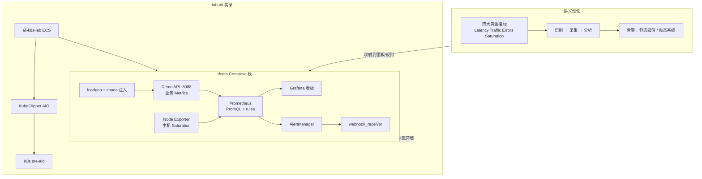
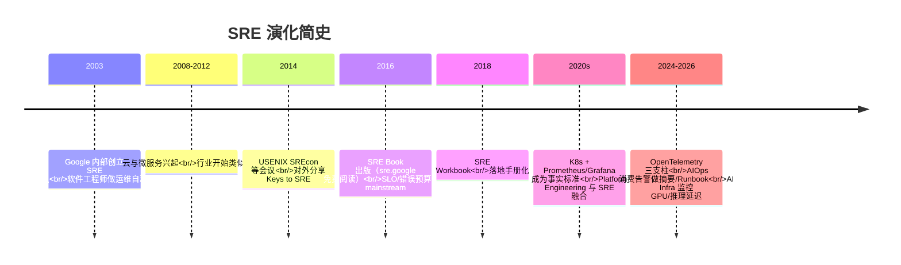
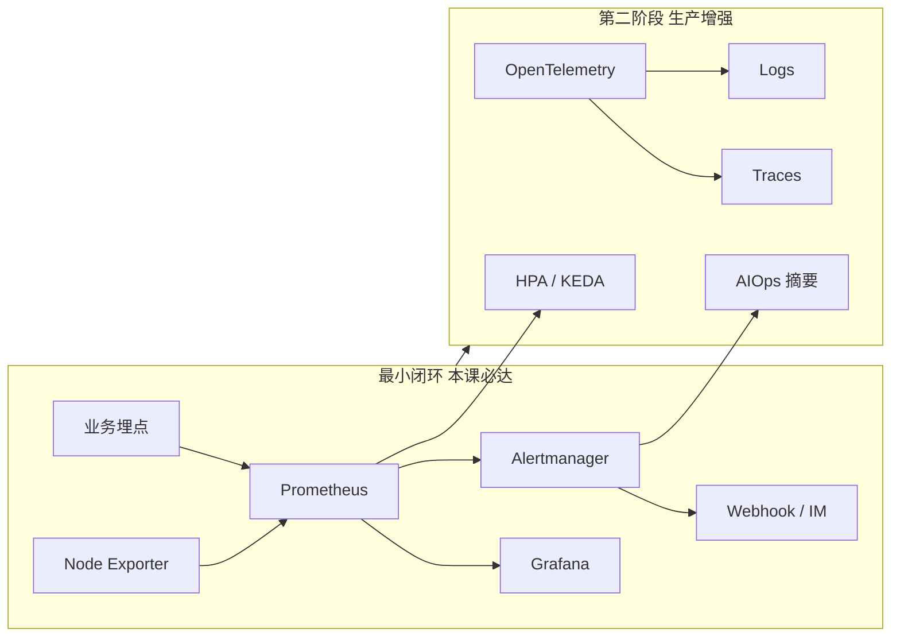
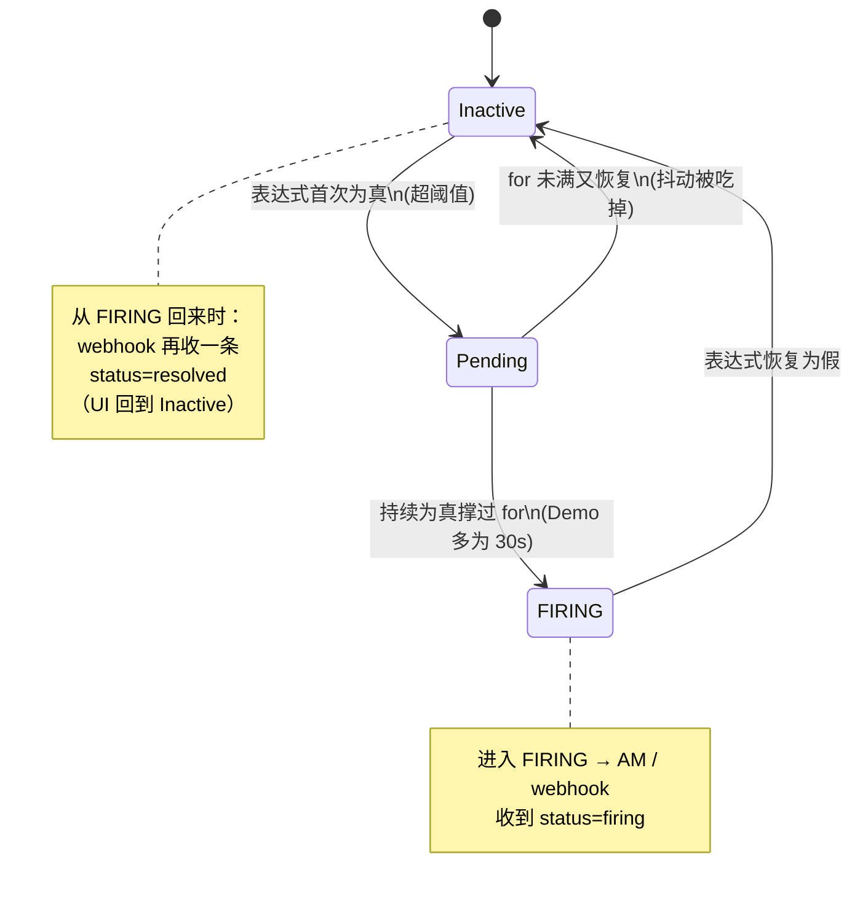
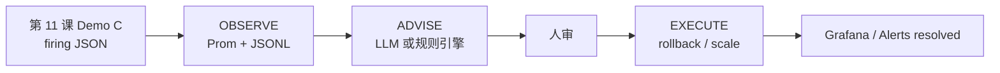
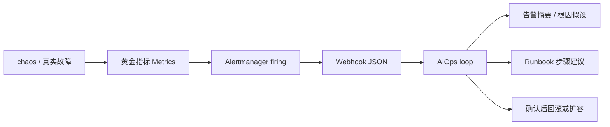
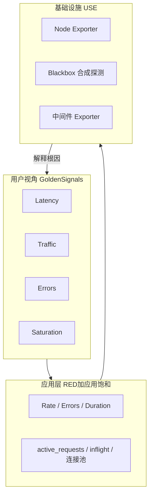

# SRE 黄金指标设计

**目标**：学员掌握 SRE 四大黄金指标（Latency / Traffic / Errors /
Saturation）的原理、识别—采集—分析三段式设计方法、告警策略与 Grafana/Prometheus
工具链，能独立完成「采集 → 可视化 → 告警」端到端闭环。

**时长**：1 天 **6 小时**（08:30–11:30 + 14:00–17:00），**12 课 × 30 min**；章节编排见
[总览 · 12 课路线](#章节与-12-课路线)。

**前置知识**：Linux 基础命令；HTTP/REST 基本概念；Docker 基本使用；有运维或后端经验更佳（无需
Prometheus 经验）

**配套 Demo**：[`../demo/sre-golden-signals/`](../demo/sre-golden-signals/)

**lab 实录**（KubeClipper AIO K8s +
端到端跑通）：[`we-know-sre-golden-signals-lab-ali.md`](./we-know-sre-golden-signals-lab-ali.md)

### 文档与 Demo 如何串联

| 资产                                                                               | 角色                                                                                    |
| ---------------------------------------------------------------------------------- | --------------------------------------------------------------------------------------- |
| 本讲义                                                                             | **教什么**：原理 → 方法 → 工具 → 最佳实践；[附录 I](#i-分层指标速查与业界实践) 分层速查 |
| [`demo/sre-golden-signals`](../demo/sre-golden-signals/)                           | **练什么**：Compose 一键栈，Demo A/B/C                                                  |
| [`we-know-sre-golden-signals-lab-ali.md`](./we-know-sre-golden-signals-lab-ali.md) | **实录**：ali-k8s-lab 实测与踩坑；见 [附录 H](#h-lab-ali-实录ali-k8s)                   |



四大信号在 Demo 中的落点：

| 黄金指标   | Demo 落点                                                               |
| ---------- | ----------------------------------------------------------------------- |
| Latency    | `http_request_duration_seconds` → P50/P95/P99；可 `chaos/latency-ms`    |
| Traffic    | `rate(http_requests_total[…])`；`loadgen.py`                            |
| Errors     | **5xx 比率**（量）→ 告警 **HighErrorRate**（告）；可 `chaos/error-rate` |
| Saturation | Node CPU / `http_inflight_requests`；规则 `HighCPUUsage`                |

> **Errors 术语**：见 [第 4 课 · Errors](#errors错误)（5xx 比率 vs HighErrorRate）。

---

## 总览

### 原理主线（五层）

| 层             | 讲授核心                           | 课次       |
| -------------- | ---------------------------------- | ---------- |
| **① 为什么**   | 监控→可观测性；问用户能否完成业务  | 第 1–2 课  |
| **② 怎么量化** | SLI→SLO→SLA；错误预算              | 第 1 课    |
| **③ 测什么**   | 四大黄金指标 L/T/E/S；三支柱       | 第 2–4 课  |
| **④ 怎么做**   | 识别→采集→分析；告警分级与决策流   | 第 5–8 课  |
| **⑤ 用什么**   | Prom + Grafana + Alertmanager 闭环 | 第 6–12 课 |

### 章节与 12 课路线

| 课次   | 时段  | 章节锚点                                        | 原理（讲授）              | 实验                  |
| ------ | ----- | ----------------------------------------------- | ------------------------- | --------------------- |
| **1**  | 上午① | [第 1 课](#第-1-课-sre-来源与量化)              | SRE 来源；SLI/SLO；最小栈 | 口述                  |
| **2**  | 上午① | [第 2 课](#第-2-课-监控到四信号总览)            | 四信号速查；RED/USE       | 栈架构；看板预览      |
| **3**  | 上午② | [第 3 课](#第-3-课-latency-与-traffic)          | P95；QPS                  | Prom Graph 基线       |
| **4**  | 上午② | [第 4 课](#第-4-课-errors-saturation-与三支柱)  | 错误率；饱和度；M/L/T     | PromQL 试跑           |
| **5**  | 上午③ | [第 5 课](#第-5-课-识别用户路径到指标)          | 四层映射；识别四问        | 埋点对照              |
| **6**  | 上午③ | [第 6 课](#第-6-课-采集分析与-demo-a-拉栈)      | 采集模式；聚合/关联       | **拉栈 Targets UP**   |
| **7**  | 下午① | [第 7 课](#第-7-课-告警策略)                    | 决策流；静/动态阈值       | `rules.yml`           |
| **8**  | 下午① | [第 8 课](#第-8-课-demo-a-promql-四信号实算)    | 四信号 PromQL             | **loadgen + L/T/E/S** |
| **9**  | 下午② | [第 9 课](#第-9-课-grafana-一屏四信号-demo-b)   | 一屏四信号                | Grafana 四面板        |
| **10** | 下午② | [第 10 课](#第-10-课-看板设计)                  | 先总后分；Runbook         | 手工面板（可选）      |
| **11** | 下午③ | [第 11 课](#第-11-课-告警闭环-demo-c)           | AM 架构                   | **chaos + webhook**   |
| **12** | 下午③ | [第 12 课](#第-12-课-简易-aiops-与-ai-场景扩展) | 薄 AIOps；AI Infra 同构   | **aiops_agent**；作业 |

### 与 lab-ali 实录对照

课堂实验以 **本讲义 + Demo**
为准；[`we-know-sre-golden-signals-lab-ali.md`](./we-know-sre-golden-signals-lab-ali.md) 为
**ali-k8s-lab** 上的实测记录（**不必全文合并进讲义**）。对照表见 lab 文首或
[附录 H](#h-lab-ali-实录ali-k8s)。

| 讲义课次 | 实验要点                   | lab 实录章节                     |
| -------- | -------------------------- | -------------------------------- |
| 1–5      | 理论 / 口述 / 小练习       | —                                |
| 6        | 拉栈、Targets UP           | lab §5、§6.1                     |
| 7        | `rules.yml`                | lab §7                           |
| 8        | PromQL + loadgen           | lab §6.2                         |
| 9        | Grafana 四面板             | lab §8                           |
| 10       | 手工面板（可选）           | —                                |
| 11       | chaos + webhook            | lab §9                           |
| 12       | `aiops_agent --rules-only` | lab §13（GLM/K8s 见 §13.3–13.4） |
| 环境     | KC + K8s（**非课堂必做**） | lab §0–§4                        |

### 半天目标

| 半天        | 课次 | 目标                                                                           |
| ----------- | ---- | ------------------------------------------------------------------------------ |
| **上午** 3h | 1–6  | 建立 SRE 语言（SLO+四信号）→ 指标设计 → **栈拉起、看见信号**                   |
| **下午** 3h | 7–12 | 告警策略 → PromQL 实算 → Grafana → **告警闭环** → **简易 AIOps + AI 场景扩展** |

### 软硬件预装环境（课前必须就绪）

| 类别   | 要求                                          | 说明                                          |
| ------ | --------------------------------------------- | --------------------------------------------- |
| 硬件   | CPU ≥ 2 核，内存 ≥ 8 GB，磁盘 ≥ 20 GB 可用    | 本机或云主机均可；Apple Silicon / x86_64 皆可 |
| OS     | macOS 12+ / Ubuntu 22.04+ / Windows 11 + WSL2 | Windows 建议在 WSL2 内跑 Docker               |
| 容器   | Docker Engine 24+，Docker Compose v2          | `docker compose version` 能输出版本号         |
| 语言   | Python 3.10+（系统自带即可）                  | 仅用于 `loadgen.py` / `webhook_receiver.py`   |
| 网络   | 能拉取 Docker Hub 镜像                        | 内网需提前镜像加速或离线导入                  |
| 浏览器 | Chrome / Edge 最新版                          | 访问 Grafana / Prometheus UI                  |
| 可选   | `curl`、`git`                                 | macOS/Linux 通常已有                          |

> **平台说明**：macOS / Windows Docker Desktop 上 Node Exporter
> 采集的是虚拟机内指标，足够课堂演示四大信号；若需真实宿主机 CPU/磁盘，请在 Linux
> 裸机或云主机上运行，并可按 `docker-compose.yml` 注释解开 `pid: host` 与根分区挂载。
>
> **端口说明**：Demo API 宿主机映射为 **8088**（容器内仍为 8080），避免与 KubeClipper API `:8080`
> 冲突。Alertmanager 通过 `host.docker.internal:host-gateway` 回调宿主机 webhook（Linux/macOS
> 通用）。

**一键自检**：

```bash
docker --version && docker compose version && python3 --version && curl --version | head -1
```

**课前拉起 Demo 栈（约 3–5 分钟）**：

```bash
cd demo/sre-golden-signals
docker compose up -d --build
docker compose ps
curl -s http://127.0.0.1:8088/health
curl -s http://127.0.0.1:9090/-/ready
curl -s http://127.0.0.1:3000/api/health
```

| 服务          | 地址                          | 账号          |
| ------------- | ----------------------------- | ------------- |
| Grafana       | http://localhost:3000         | admin / admin |
| Prometheus    | http://localhost:9090         | —             |
| Alertmanager  | http://localhost:9093         | —             |
| Demo API      | http://localhost:8088         | —             |
| Node Exporter | http://localhost:9100/metrics | —             |

**Web 演示看哪里、各 Demo 重点**：见 lab 实录
[§5.1 Web 页面演示指南](./we-know-sre-golden-signals-lab-ali.md#51-web-页面演示指南demo-看什么)。

### 不覆盖内容

- ELK / Loki 日志平台深度配置
- 分布式追踪（Jaeger / Tempo）落地细节
- 商业 APM（Dynatrace / New Relic）对比选型
- 夜莺（N9E）完整集群部署（仅讲告警配置思路，可与 Alertmanager 对照）

---

## 上午 · 第 1–6 课（08:30–11:30）

**上午目标**：建立 SRE 语言（SLO + 四信号）→ 指标设计 → **栈拉起、看见信号**。

[返回总览](#总览)

### 第 1 课 · SRE 来源与量化

**原理层 ① 为什么 · ② 怎么量化** | **讲授**：2003 Google 运维工程化；Treynor
核心理念；SLI→SLO→SLA；错误预算；演化与最小栈。\
**实验**：口述；复述核心理念原句 + 四件套（埋点 / Prom / Grafana / AM）。

[返回总览](#总览)

**SRE**（**Site Reliability Engineering**，站点可靠性工程）由 Google
提出，指用软件工程方法保障线上服务 **稳定、可用、可扩展** 的一套实践：以
SLO/错误预算量化可靠性，用自动化与可观测性在 **发布速度** 与 **系统稳定** 之间取得平衡。本讲义聚焦
SRE 可观测性体系中的 **四大黄金指标**（Golden Signals），而非 SRE
全貌（值班、变更管理、容量规划等另课展开）。

SRE 常用 **SLI → SLO → SLA** 三层量化可靠性（由上至下，承诺逐级收紧）：

| 缩写    | 英文                    | 中文         | 含义                                            | 谁定        |
| ------- | ----------------------- | ------------ | ----------------------------------------------- | ----------- |
| **SLI** | Service Level Indicator | 服务等级指标 | **测什么**（如 P99 延迟、5xx 比例、可用性）     | 工程团队    |
| **SLO** | Service Level Objective | 服务等级目标 | **目标多少**（如「99.9% 请求 P99 < 500ms」）    | 工程 / 产品 |
| **SLA** | Service Level Agreement | 服务等级协议 | **对外承诺**（违约可能有赔偿；通常比 SLO 保守） | 商务 / 合同 |

**错误预算（Error Budget）** = SLO 允许「不达标」的那部分（如 99.9% 可用 ⇒ 每月约 43
分钟不可用）。预算未耗尽时可加速发布；预算燃烧过快则优先稳定性——这与下文告警分级、SLO
驱动变更一脉相承。

#### 来源：2003 年的工程实践

**Site Reliability Engineering** 诞生于 **2003 年 Google 内部**：Ben Treynor Sloss
加入后组建生产可靠性团队（从约 7 名工程师 organically 扩展至千级 SRE），负责 Search、Gmail、Ads
及后来的 Google Cloud 等服务的 **可用性、延迟、容量与变更**。

当时 Google 面临的矛盾与今天许多团队类似，只是规模更早到达极端：

| 背景压力         | 2003 年前后 Google 的处境   | 为何堆人不 work              |
| ---------------- | --------------------------- | ---------------------------- |
| Web 级可靠性     | 搜索、邮件不能常挂、不能慢  | 用户期望接近 7×24            |
| 超大规模基础设施 | 海量分布式机器、多数据中心  | 手工运维无法线性扩展         |
| 业务增速         | 流量与发布频率持续上升      | 「加 SysAdmin 救火」招不够人 |
| 时代语境         | 公有云、DevOps 文化尚未普及 | 只能自己发明一套工程方法     |

Treynor
的解法：**用软件工程师的思维和设计去重构「运维」**——自动化重复劳动（toil）、用数据定义可靠性目标、让
发布与稳定可量化权衡。这是 **生产环境逼出来的工程方法论**，不是高校论文；也 **不是 Google 对外销售的
SKU**（没有「买一份 SRE」），2016 年起通过 O'Reilly 出书、[`sre.google`](https://sre.google/)
免费开放，属于 **开放最佳实践**（对 GCP 等品牌有间接收益，但 SRE 本身是方法而非产品）。

#### 核心理念（行业反复引用的一句话）

> **「SRE is what happens when you ask a software engineer to design an operations function.」**\
> （SRE 就是：你让一个软件工程师去设计运维团队，会发生什么。）\
> — Ben Treynor Sloss，[Google SRE 官方访谈](https://sre.google/in-conversation/)

这句话背后的几条 **至今仍在用的原则**：

| 原则                | 含义                                       | 本课落点                     |
| ------------------- | ------------------------------------------ | ---------------------------- |
| **运维即软件问题**  | 重复手工活应被代码/自动化替代              | Demo 栈、HPA、Runbook 自动化 |
| **SLO + 错误预算**  | 可靠性可量化；发布与稳定有明确 trade-off   | 第 1、7 课告警分级           |
| **消除 toil**       | 重复手工运维应自动化，勿永久占用值班       | 告警抑制、AIOps 摘要         |
| **无责 postmortem** | 从故障中学习，而非追责                     | Runbook、Demo C 复盘         |
| **用数据说话**      | 监控/指标驱动决策，而非「我觉得 CPU 不高」 | **四大黄金指标**（本课主线） |

> **toil 本意是“苦活、繁重乏味的劳动”。Google SRE Book 把它 **术语化** 为：运行线上服务时
> **手工、重复、可自动化、随规模线性增加**
> 的那类运维（如每次发布手工重启、反复抄同一套日志）。**消除 toil** = 用脚本/流水线/Operator
> 等替代；Google 建议专职 SRE 花在 toil 上的时间 **≤50%**，其余做自动化与工程改进。详见
> [SRE Book Ch.5 Eliminating Toil](https://sre.google/sre-book/chapters/eliminating-toil/)。

#### 演化：2003 → 2026，为什么还没「过时」？

SRE 长寿的原因不是 2003 年的工具栈还在用，而是 **「规模变大后如何保可靠」** 的矛盾从未消失；2010
年代云原生普及后，更多团队遇到了「小号的 Google 2003」问题，方法论反而 **扩散** 了。



| 阶段      | 变化                         | 什么变了 / 什么没变                       |
| --------- | ---------------------------- | ----------------------------------------- |
| 2003–2015 | Google 内部实践              | **不变**：SLO、黄金指标、消除 toil        |
| 2016–2019 | 书 + SREcon → 全行业学习     | **变**：工具从自研转向 Prometheus 生态    |
| 2020–2023 | 云原生、Platform Eng         | **变**：组织从「专职 SRE」到「平台+兼岗」 |
| 2024–2026 | AI Infra、AIOps、LLM on-call | **不变**：仍要先 **看见**（Metrics/SLO）  |
|           |                              | **变**：LLM 辅助解读告警，不替代指标真值  |

**仍可原样照搬的部分**：SLO/错误预算、四大黄金指标、告警分级、无责复盘。\
**需打折或简化的部分**：Google 级「50% toil 上限」、严格 SRE/开发分治——中小团队往往 **1–3
人兼平台与业务**，用 **最小栈 + 核心方法** 即可起步。

#### 课堂问答：2003 提出，为何 2026 还在讲？

**Q1：软件还没解决这个问题吗？**

不是没解决，而是这类问题 **不会被一劳永逸消掉**。2003 年提出的是方法（SLO、黄金指标、消除
toil），不是某个可打补丁的 bug。工具一直在换（自研监控 → Prometheus → OTel / AIOps），但矛盾没变：

| 为何消不掉  | 一句话                                                        |
| ----------- | ------------------------------------------------------------- |
| 规模在涨    | 流量、服务数、依赖链、发布频率持续增加                        |
| 系统在变    | 单体 → 微服务 → 云原生 → AI Infra，形态换了，用户体验问题还在 |
| 方法 ≠ 产品 | 没有「买一份 SRE」；每家的业务与错误预算要自己落地            |

**结论**：可观测与可靠性是
**持续运营成本**，不是一次性交付物。软件把苦活自动化了；「看见、定目标、在速度与稳定之间权衡」仍要人（或人 +
平台）来做。

**Q2：个人电脑越来越简单，线上服务为啥消不掉？**

两边不是同一种问题。

| 个人电脑变简单                 | 线上服务难「消掉」                 |
| ------------------------------ | ---------------------------------- |
| 问题域固定（一台机、一个用户） | 问题域一直在扩（用户、依赖、变更） |
| OS / App 厂商替你扛复杂度      | 没有统一厂商替你的业务背锅         |
| 失败可接受（重启一下）         | 失败代价大（钱、信誉、合规）       |
| —                              | 每次「变简单」都换来新层复杂度     |

更贴切的类比：**开车越来越省事，但「安全到达」永远要管速度与路况**——路更宽、车更多，规则反而更重要。

**Q3：为啥个人越来越简单，云端 / 服务器端没办法同样变简单？**

对 **使用者** 已经变简单了；变不简单的是 **运营那一侧**。个人体验变简单，靠的是把复杂度
**外包给云端**。

| 维度         | 个人 / 客户端              | 云端 / 服务器侧                                                                        |
| ------------ | -------------------------- | -------------------------------------------------------------------------------------- |
| 服务关系     | 一对一                     | 一对多（峰值、跨区、级联故障）                                                         |
| 需求是否收敛 | 相对定型（办公、娱乐）     | 业务持续加功能、改接口 → **变更持续注入复杂度**                                        |
| 统一封装     | 有准标准 OS（Windows/iOS） | 业务 + 多云 + 开源拼装，无法一次封装完                                                 |
| 复杂度去向   | 藏进厂商与云端             | 对开发者：托管/Serverless 更简单；对平台/SRE：复杂度挪到多租户、容量、可观测、变更安全 |

**一句话收束**：个人变简单 ←
云端在变复杂；云端对业务方可局部变简单（托管、平台工程），但对「负责可用性的人」而言，规模与变更还在，所以黄金指标这类方法仍要讲。

**Q4：AI 时代，能让这个变简单吗？**

**能简化「干活」，消不掉「问题本身」。** 与云/容器同一套路：对人更省事，复杂度换层，不归零。

| AI 能简化的                          | AI 消不掉 / 甚至加重的                        |
| ------------------------------------ | --------------------------------------------- |
| 告警解读、关联摘要、Runbook 草稿     | 仍要先有 **L/T/E/S 真值**（LLM 不能编造指标） |
| 重复排障、值班噪音中的 toil          | 规模、变更、错误预算权衡仍要人定目标与边界    |
| 建议动作（扩容 / 回滚 / 降级）+ 人审 | AI Infra 新增 GPU、TTFT、tokens/s 等观测对象  |
| 自然语言问「现在哪里不健康」         | 幻觉、误执行风险 → 生产动作必须 **人审**      |

讲义口径（与 [第 12 课](#第-12-课-简易-aiops-与-ai-场景扩展) 一致）：

1. **先看见，再 AIOps**——Prometheus / 黄金指标是地基；LLM 消费告警 JSON，不替代埋点。
2. **AI 是加速器，不是新哲学**——SLI→SLO、四信号语言不变；AI 场景只是换指标名（见第 12 课扩展表）。
3. **简单发生在「读与建议」；「定目标与担责」仍在人**——错误预算烧完要不要停发，模型给不了最终拍板。

**一句话收束**：AI
让值班少抄日志、少翻十个看板；**不让你不用管可靠性**。工具从「手搓监控」→「标准栈」→「栈 + LLM
助手」，方法（黄金指标）仍要会。

#### 哪些核心方法论今天仍在用？谁在用？

| 方法论 / 概念                | 2026 是否仍主流 | 典型使用者                       | 说明                           |
| ---------------------------- | --------------- | -------------------------------- | ------------------------------ |
| **SLI / SLO / 错误预算**     | ✅ 是           | 互联网、SaaS、云厂商、金融、电信 | 发布门禁、SLA 对齐的通用语言   |
| **四大黄金指标 L/T/E/S**     | ✅ 是           | 微服务/API 团队、K8s 平台组      | 本课主线；RED/USE 为其特化     |
| **消除 toil + 自动化**       | ✅ 是           | Platform / DevOps / SRE          | GitOps、Operator、IaC 同一目标 |
| **无责 postmortem**          | ✅ 是           | 有 on-call 的中大型研发组织      | Incident 管理标准动作          |
| **50% 运维负载上限等组织规** | ⚠️ 部分          | 大厂专职 SRE                     | 小团队常简化为「告警可行动」   |
| **专职 SRE 与开发严格分治**  | ⚠️ 部分          | Google、部分超大规模公司         | 中小团队多 **兼岗或嵌入制**    |

岗位名称可能是 **SRE、Production Engineering、Platform
Engineering、可观测性工程师**，内核重叠。下表列出 **公开使用 SRE 或等价实践的大厂**，均附 **官方**
出处（工程博客 / 团队页 / 招聘 JD），非二手解读。

#### 哪些大厂在实践 SRE？（官方 Reference）

> **读表说明**：部分公司岗位名不叫 SRE（如 Meta 的 **Production Engineer**），但官方页面明确与 SRE
> 同源；证据以各公司 **自家域名** 页面为准。

**起源与定义**

| 公司       | 要点                                  | 官方链接                                                                                                                                                             |
| ---------- | ------------------------------------- | -------------------------------------------------------------------------------------------------------------------------------------------------------------------- |
| **Google** | SRE 发源地；对外开放书籍与 sre.google | [What is SRE?](https://sre.google/) · [In Conversation（Treynor）](https://sre.google/in-conversation/) · [SRE Book](https://sre.google/sre-book/table-of-contents/) |

**明确使用「Site Reliability Engineering / SRE」名称**

| 公司             | 官方依据（摘录）                                              | 官方链接                                                                                                                                                                                                                  |
| ---------------- | ------------------------------------------------------------- | ------------------------------------------------------------------------------------------------------------------------------------------------------------------------------------------------------------------------- |
| **Netflix**      | CORE 含 **Site Reliability Engineers**；整体服务可靠性        | [Centralized SRE at Netflix（TechBlog）](https://netflixtechblog.com/keeping-customers-streaming-the-centralized-site-reliability-practice-at-netflix-205cc37aa9fb)                                                       |
| **LinkedIn**     | 官方工程站 **Site Reliability Engineers**；School of SRE      | [Site Reliability Engineers](https://engineering.linkedin.com/india-engineering/site-reliability-engineers) · [School of SRE](https://linkedin.github.io/school-of-sre/)                                                  |
| **Dropbox**      | Staff SRE；incident 管理、SLO、on-call                        | [Staff SRE JD](https://www.dropbox.jobs/en/jobs/7961824/staff-site-reliability-engineer-production-engineering/) · [Incident management](https://dropbox.tech/infrastructure/lessons-learned-in-incident-management)      |
| **Airbnb**       | **Site Reliability Engineering team**、Production/Storage SRE | [Production SRE JD](https://careers.airbnb.com/positions/7565550/) · [Monitoring at scale](https://airbnb.tech/infrastructure/monitoring-reliably-at-scale/)                                                              |
| **Uber**         | 官方博客 **site reliability engineers**；可靠性工程组织       | [How Uber thinks about SRE](https://www.uber.com/blog/site-reliability-engineering-talks-feb-2016/) · [Capacity safety（Reliability engineering）](https://www.uber.com/blog/machine-learning-capacity-safety/)           |
| **Apple**        | 多条 **Site Reliability Engineer** 官方招聘                   | [SRE, iCloud（JD 示例）](https://jobs.apple.com/en-us/details/200665379-2114/site-reliability-engineer-icloud) · [Senior SRE（JD 示例）](https://jobs.apple.com/en-us/details/200604053/senior-site-reliability-engineer) |
| **Amazon / AWS** | **Site Reliability Engineer** 岗位（Region Services 等）      | [SRE, Region Services（amazon.jobs）](https://www.amazon.jobs/en/jobs/3081652/site-reliability-engineer-region-services) · [AWS Careers](https://aws.amazon.com/careers/)                                                 |
| **Microsoft**    | SRE（Azure、Cosmos DB、**Microsoft AI** 基础设施等）          | [MTS SRE \| Microsoft AI](https://microsoft.ai/job/mts-site-reliability-engineer/) · [Microsoft Careers](https://careers.microsoft.com/)                                                                                  |
| **IBM**          | 官方 careers：**Site Reliability Engineer**                   | [Infrastructure & Technology（含 SRE）](https://www.ibm.com/careers/infrastructure-and-technology) · [SRE JD 示例](https://careers.ibm.com/en_US/careers/JobDetail/Site-Reliability-Engineer/113598)                      |
| **Wikimedia**    | 官方 **Site Reliability Engineering team**（Wikipedia）       | [Wikimedia SRE（MediaWiki）](https://www.mediawiki.org/wiki/Wikimedia_Site_Reliability_Engineering) · [SRE — Wikitech](https://wikitech.wikimedia.org/wiki/SRE)                                                           |
| **Spotify**      | 工程博客与岗位中的 **site reliability engineer**              | [Managing Machines at Spotify](https://engineering.atspotify.com/2016/03/managing-machines-at-spotify) · [Spotify Jobs](https://www.lifeatspotify.com/jobs)                                                               |

**实践 SRE 思想、岗位名不同**

| 公司     | 官方称谓                | 与 SRE 关系                            | 官方链接                                                                                                                                                                         |
| -------- | ----------------------- | -------------------------------------- | -------------------------------------------------------------------------------------------------------------------------------------------------------------------------------- |
| **Meta** | **Production Engineer** | 官方写明：其他公司常称 SRE，Meta 称 PE | [How Meta PEs solve scale](https://tech.facebook.com/ideas/2022/10/how-meta-production-engineers-solve-the-problem-of-scale/) · [Meta Careers](https://www.metacareers.com/jobs) |

**国内大厂**：阿里、腾讯、字节、美团等普遍设有 **SRE / 稳定性 / 基础平台**
团队，多在招聘站与技术大会材料中体现；英文一手页分散，课堂可结合学员所在行业举例，**方法论与上表同源**（SLO、黄金指标、on-call）。

#### SRE 技术栈「最小集合」与今日怎么落地

**方法论层（必须有）**——没有工具也能先定：

1. 为用户关键路径定义 **SLI → SLO**（至少 1 条可用性 + 1 条延迟）
2. 用 **四大黄金指标** 覆盖请求驱动型服务
3. **告警分级**（Warning / Critical）+ **Runbook**（每条 Critical 能点下一步）
4. 发布与变更受 **错误预算** 约束（预算紧则慢发、先修稳定）

**工具层（2020 年代最小可运行栈）**——与本课 Demo 对齐：

| 层级              | 最小组件                          | 职责                         | 本课 Demo                        |
| ----------------- | --------------------------------- | ---------------------------- | -------------------------------- |
| 采集              | App 埋点 + Node/cAdvisor Exporter | 应用 L/T/E + 主机 Saturation | FastAPI metrics + Node Exporter  |
| 存储与查询        | **Prometheus**                    | 时序库 + PromQL + 告警规则   | `:9090` + `rules.yml`            |
| 可视化            | **Grafana**                       | 一屏四信号、共识排障         | `SRE Golden Signals` 看板        |
| 告警路由          | **Alertmanager**                  | 分组、抑制、通知             | webhook → `webhook_receiver.py`  |
| 编排（可选）      | **Kubernetes** + HPA              | Saturation/Traffic → 扩缩    | lab 实录 + `k8s/sre-load-deploy` |
| 追踪/日志（增强） | OpenTelemetry → Tempo/Loki        | Traces/Logs 补 Metrics 盲区  | 本课不展开，生产建议第二阶段接入 |



**今日落地路径（按团队规模）**：

| 阶段    | 团队规模 / 成熟度    | 建议动作                                                                                     | 时间预期 |
| ------- | -------------------- | -------------------------------------------------------------------------------------------- | -------- |
| **0→1** | 无监控或只有主机监控 | 拉本课 Demo；为 1 个核心 API 定 L/T/E/S + 2 条告警                                           | 1–2 天   |
| **1→2** | 已有 Prometheus      | 统一标签；Grafana 一屏四信号；Critical 绑 Runbook                                            | 1–2 周   |
| **2→3** | K8s 生产             | kube-state-metrics；HPA；错误预算进发布流程                                                  | 1–2 月   |
| **3→4** | on-call 疲劳         | 告警抑制 + AIOps 摘要（见 [第 12 课](#第-12-课-简易-aiops-与-ai-场景扩展)）；仍 **不删规则** | 持续迭代 |

**新场景落地要点**（云原生 / 多区域 / 混合云）：

- 标签纪律：`env` / `service` / `version` 强制；禁 `user_id` 等高基数进 Metrics
- 聚合优先：`sum by (service)` 看全局，再 `topk` 下钻实例（见 [附录 G](#g-最佳实践与-demo-d)
  反模式）
- 金丝雀 / 蓝绿：按 `version` 切片看 Error Rate 与 P95，不达标自动回滚

#### AI Infra 与 AIOps（课堂预告）

本课主线是 **HTTP API 的 L/T/E/S + Prom/Grafana/AM 闭环**。\
**AI Infra**（GPU / 推理 TTFT）与 **简易 AIOps**（告警之后 LLM 摘要 + 人审执行）集中在
[第 12 课](#第-12-课-简易-aiops-与-ai-场景扩展)：**同一套黄金指标语言换到 AI 场景**，并用
`aiops_agent.py` 在 Demo C 之上走 **10 分钟薄 loop**（无 API Key 可用 `--rules-only`）。

#### 参考阅读（Reference）

| 类型       | 资源                                                                                                                 | 说明                             |
| ---------- | -------------------------------------------------------------------------------------------------------------------- | -------------------------------- |
| 官方访谈   | [Ben Treynor Sloss — In Conversation](https://sre.google/in-conversation/)                                           | 核心理念出处                     |
| 会议       | [USENIX SREcon14 — Keys to SRE](https://www.usenix.org/conference/srecon14/technical-sessions/presentation/keys-sre) | 2003 背景与团队职责              |
| 书籍       | [_Site Reliability Engineering_（2016）](https://sre.google/sre-book/table-of-contents/)                             | CC 许可在线免费；SLO、监控、toil |
| _workbook_ | [_The Site Reliability Workbook_（2018）](https://sre.google/workbook/table-of-contents/)                            | 落地案例与实施                   |
| 监控章节   | SRE Book Ch.6 _Monitoring Distributed Systems_                                                                       | **四大黄金指标** 原始出处        |
| 本课 Demo  | [`../demo/sre-golden-signals/`](../demo/sre-golden-signals/)                                                         | 最小栈可运行实例                 |

### 第 2 课 · 监控到四信号总览

**原理层 ① 为什么 · ③ 测什么（总览）** | **讲授**：监控 vs 可观测性；L/T/E/S
[速查](#四大信号速查音标--含义--场景--误区)；口诀 E+L→T→S；RED/USE。\
**实验**：Demo 栈架构图；Grafana **SRE Golden Signals** 看板预览（终局画面）。

[返回总览](#总览)

#### 原理：被动响应 → 主动预防

传统监控往往回答：**「机器坏了没有？」**\
SRE / 可观测性回答：**「用户是否还能顺利完成关键业务？」**

| 维度     | 传统监控             | SRE 黄金指标 / 可观测性                      |
| -------- | -------------------- | -------------------------------------------- |
| 关注点   | 主机存活、磁盘、进程 | 用户体验与服务健康                           |
| 触发方式 | 阈值越界后工单       | 错误预算、SLO 驱动变更与发布                 |
| 数据形态 | 零散点位、烟囱式     | 统一标签模型、可关联下钻                     |
| 目标     | 尽快知道「坏了」     | 尽快知道「哪里坏、为什么坏、影响多大」       |
| 姿态     | **被动响应**         | **主动预防**（发布门禁、容量预警、自动扩缩） |

Google SRE 将「黄金指标」定义为刻画 **请求驱动型服务** 健康度的最小充分集。

#### 四大信号速查（音标 · 含义 · 场景 · 误区）

| 信号                  | 音标           | 含义（问什么）                     | 适用场景                                           | 常见误区                                                                            |
| --------------------- | -------------- | ---------------------------------- | -------------------------------------------------- | ----------------------------------------------------------------------------------- |
| **Latency** 延迟      | /ləˈtənsi/     | 请求耗时**分布**——用户是否感觉慢？ | HTTP/gRPC、依赖调用、页面/推理耗时                 | 只看均值；成败混算（失败常很快，「美化」延迟）；用 P50 当 SLO（痛在尾部 → P95/P99） |
| **Traffic** 流量      | /ˈtræfɪk/      | 系统承受的**需求量**——现在有多忙？ | HTTP→QPS；队列→消费速率；批处理→jobs/s；容量与归因 | 把带宽当业务流量；只看总量不分路由；静态 QPS 忽略潮汐                               |
| **Errors** 错误       | /ˈerəz/        | **失败比率**——有多少请求失败？     | 5xx、业务码≠0、超时、部分成功；对齐可用性 SLO      | 告绝对次数（低峰漏、高峰噪）；4xx 一律算服务错；错误定义未业务化                    |
| **Saturation** 饱和度 | /ˌsætʃəˈreɪʃn/ | 资源「填满」程度——还剩多少余量？   | CPU/内存/磁盘 IO、连接池/线程池、队列、inflight    | **利用率 ≠ 饱和**（队列堆积、拒连才是强信号）；只看主机 CPU 忽略池/队列             |

> **方法论口诀**：先看 **Errors + Latency**（用户痛），再看 **Traffic**（是否异常负载），最后看
> **Saturation**（根因在资源层还是应用层）。

> **展开**：Latency / Traffic → [第 3 课](#第-3-课-latency-与-traffic)（分布与 PromQL）；Errors /
> Saturation → [第 4 课](#第-4-课-errors-saturation-与三支柱)（比率与利用率辨析）。三支柱见第 4
> 课末。

#### 与 RED / USE 方法的关系

| 方法           | 适用对象              | 指标集合                        | 关系                   |
| -------------- | --------------------- | ------------------------------- | ---------------------- |
| Golden Signals | 请求驱动服务          | L/T/E/S                         | 本课主线               |
| RED            | 微服务 / HTTP API     | Rate, Errors, Duration          | 黄金指标在应用层的特化 |
| USE            | 资源（CPU/网卡/队列） | Utilization, Saturation, Errors | 饱和度与基础设施层互补 |

---

### 第 3 课 · Latency 与 Traffic

**原理层 ③ 测什么** | **讲授**：分布 P50/P95/P99；Traffic 形态；PromQL 入门（语法见
[附录 D.1](#d1-promql-速查课后-reference)；四信号定义见
[速查](#四大信号速查音标--含义--场景--误区)）。\
**实验**：Prometheus Graph 看无流量基线；预告 loadgen（第 6、8 课）。

[返回总览](#总览)

#### Latency（延迟）

- **测分布**（P50/P95/P99），勿只看均值；SLO 盯尾部（P95/P99）。
- **成败分开**：失败常很快返回，混算会「美化」延迟。

**P50 / P95 / P99 各自用于什么场景？**（百分位 = 有多少比例的请求「不慢于」该值）

| 百分位  | 含义（通俗）                          | 典型场景                                                             | 不适合                                             |
| ------- | ------------------------------------- | -------------------------------------------------------------------- | -------------------------------------------------- |
| **P50** | 一半请求 ≤ 此值；接近「多数人的体感」 | 日常看板看趋势、对比版本/机房「整体变没变慢」、容量规划看常态        | **不当 SLO / Critical 告警**——长尾再痛也拉不动 P50 |
| **P95** | 95% 请求 ≤ 此值；**工程默认盯的尾部** | API SLO、发布门禁、金丝雀对比、Latency 告警（本课 `HighLatencyP95`） | 极高 SLA（金融撮合、核心支付）可能仍偏松           |
| **P99** | 99% 请求 ≤ 此值；**更狠的长尾**       | 对尾部敏感的服务（交易、鉴权、核心链路）、排障找偶发尖刺、定更严 SLO | 流量小时样本噪、易误报；不必每个内部服务都盯 P99   |

**怎么记**：用户痛在尾部 → SLO/告警用 **P95/P99**，不是均值或 P50。课堂默认：**看板看 P50 + P95（+
可选 P99）**；**告警/SLO 优先 P95**；核心链路再加严到 P99。

- **PromQL**（Histogram）：

```promql
histogram_quantile(
  0.95,
  sum(rate(http_request_duration_seconds_bucket{job="api"}[5m])) by (le)
)
```

> **解读**：从 Histogram bucket 估 **P95 延迟**（秒）。`rate(...[5m])` 看近 5 分钟增量；
> `sum(... ) by (le)` 按桶上界 `le` 合并；`histogram_quantile(0.95, …)` 取第 95 百分位。换 `0.50` /
> `0.99` 即 P50 / P99。

#### Traffic（流量）

- **形态随系统**：HTTP→QPS；队列→消费速率；批处理→jobs/s。
- **价值**：区分「流量打满」vs「基线流量下的故障」。

```promql
sum by (method) (rate(http_requests_total{job="api"}[5m]))
```

> **解读**：Counter → `rate` 得 **QPS**；`sum by (method)` 按 HTTP 方法汇总。打 `loadgen`
> 后此曲线应抬升。

---

### 第 4 课 · Errors、Saturation 与三支柱

**原理层 ③ 测什么 · 三支柱** | **讲授**：错误率；饱和 vs 利用率；三支柱（定义见
[速查](#四大信号速查音标--含义--场景--误区)）。\
**实验**：Graph 试跑错误率、Node CPU；说明默认 ~2% 错误率为正常低水位。

[返回总览](#总览)

#### Errors（错误）

- **定义业务化**：5xx、`code!=0`、超时、部分成功——先约定再计量。
- **用比率**，不用绝对次数（低峰漏报、高峰误报）。

| 说法              | 角色                     | 含义                                                                                                                                                    |
| ----------------- | ------------------------ | ------------------------------------------------------------------------------------------------------------------------------------------------------- |
| **5xx 比率**      | **怎么量**（SLI / 指标） | HTTP **5xx**（`status=~"5.."`，如 500/502/503）请求速率 ÷ 全部请求速率                                                                                  |
| **HighErrorRate** | **怎么告**（规则名）     | `prometheus/rules.yml` 告警：比率 **> 5%** 且持续约 **30s** → Critical **FIRING**（状态含义见 [第 7 课](#告警状态inactive--pending--firing--resolved)） |

Demo 链路：`chaos/error-rate=0.2` 把失败率打到约 20% → 5xx 比率升高 → HighErrorRate **FIRING**；调回
`0.02`（约 2% 低水位）后 **Resolved**。

```promql
sum(rate(http_requests_total{job="api",status=~"5.."}[5m]))
/
clamp_min(sum(rate(http_requests_total{job="api"}[5m])), 0.001)
```

> **解读**：**5xx 比率** = 5xx 速率 ÷ 总速率。`status=~"5.."` 匹配 5xx；`clamp_min(..., 0.001)`
> 避免零流量时除零。结果为 0～1（如 0.05 = 5%）。

#### Saturation（饱和度）

- **余量视角**：CPU、内存、磁盘 IO、连接池、线程池、队列深度、inflight。
- **Utilization ≠ Saturation**：利用率高≠已饱和；队列堆积、拒绝新连接才是强信号。

```promql
# CPU 利用率（近似）——饱和需另看队列 / inflight / 拒连
100 - (avg by (instance) (rate(node_cpu_seconds_total{mode="idle"}[5m])) * 100)
```

> **解读**：用 **非 idle** 时间占比估 CPU 利用率（%）。这是 Utilization；真正饱和还需对照队列 /
> `http_inflight_requests` / 拒连。

#### 可观测性三支柱的分工与联动

三支柱回答的不是同一类问题，**串联顺序**才是关键：

```
                 ┌─────────────────────────────────────┐
告警 / SLO ───►  │  Metrics（指标）  低成本、可聚合、可告警 │
                 └──────────────┬──────────────────────┘
                                │ 异常时刻 / 标签下钻
                 ┌──────────────▼──────────────────────┐
调用链分析 ────► │  Traces（追踪）  跨服务路径与瓶颈跨度 │
                 └──────────────┬──────────────────────┘
                                │ trace_id / span 关联
                 ┌──────────────▼──────────────────────┐
根因确认 ──────► │  Logs（日志）    高基数事件、上下文文本 │
                 └─────────────────────────────────────┘
```

**分工（各自回答什么）**

| 支柱        | 回答的问题                              | 数据形态                           | 擅长                            | 不擅长                           | 与黄金指标                     |
| ----------- | --------------------------------------- | ---------------------------------- | ------------------------------- | -------------------------------- | ------------------------------ |
| **Metrics** | 「现在/最近整体是否健康？该不该告警？」 | 数值时间序列（计数、直方图、仪表） | 趋势、SLO、容量、**低成本告警** | 单次请求细节、跨服务谁拖慢       | **L/T/E/S 的主载体**           |
| **Traces**  | 「这次慢/失败，卡在哪一段调用？」       | 一次请求上的 span 树（服务→依赖）  | 跨服务延迟分解、找瓶颈 hop      | 长期全局趋势、便宜地全量告警     | 把 **Latency** 拆到具体依赖    |
| **Logs**    | 「那一下到底报了什么错、什么上下文？」  | 带时间戳的事件文本/结构化字段      | 错误栈、审计、参数与业务上下文  | 高基数全量存成本高；难做全局 SLO | 解释 **Errors / Latency** 尖刺 |

**联动（一次排障怎么串）**——课堂记法：**Metrics 发现 → Traces 定位路径 → Logs 确认根因**。

| 步骤    | 用什么           | 具体动作（示例）                                                                          |
| ------- | ---------------- | ----------------------------------------------------------------------------------------- |
| 1. 发现 | Metrics          | Grafana/告警：`P95↑` 或 `ErrorRate↑`；记下时间窗与标签（`service` / `version` / `route`） |
| 2. 收窄 | Metrics → Traces | 用同一标签与时间窗打开 Trace：看是本服务慢，还是下游 DB / 支付 / 缓存慢                   |
| 3. 确认 | Traces → Logs    | 用 `trace_id`（或 `span_id`）跳到对应日志：异常栈、SQL、超时、限流原因                    |
| 4. 闭环 | 回到 Metrics     | 修复/回滚后看四信号与告警是否 Resolved；必要时补规则或看板                                |

**联动靠什么粘在一起**：统一 **时间窗** + 可控标签（`service`/`env`/`version`）+ **`trace_id` 贯穿
Logs↔Traces**。没有关联键，三支柱就变成三个烟囱。

**原则**：不要试图用一种数据回答所有问题——Metrics 便宜但不能替代单次上下文；Logs/Traces
贵，适合下钻，不适合当唯一 SLO 源。本课 Demo 以 **Metrics 闭环** 为主；Traces/Logs
为生产第二阶段（OTel → Tempo/Loki），上午理论（第 1–4 课）至此收束。

---

### 第 5 课 · 识别：用户路径到指标

**原理层 ④ 怎么做（识别）** | **讲授**：四层映射；识别四问；反模式「有什么 Exporter 监控什么」。\
**实验**：对照 Demo API 埋点与 L/T/E/S 对应关系；小练习「登录 API」4 条指标。

[返回总览](#总览)

#### 阶段一：识别（Identification）

先画 **用户关键路径**，再映射指标，避免「有什么 exporter 就监控什么」。

| 层级   | 示例指标                                                    | 对应黄金信号         | 备注         |
| ------ | ----------------------------------------------------------- | -------------------- | ------------ |
| 业务层 | 订单支付成功率、登录成功率、用户次日留存                    | Errors / Traffic     | 直接对齐 SLO |
| 应用层 | `http_requests_total`、`http_request_duration_seconds`      | L/T/E                | RED 模型     |
| 系统层 | `node_cpu_*`、`node_disk_io_time_seconds_total`、内存可用量 | Saturation           | USE 模型     |
| 依赖层 | DB 连接池使用率、下游 P99、缓存命中率                       | Latency / Saturation | 常成瓶颈     |

> **分层速查**：各层「最少必盯」指标名、**含义与用途**、Exporter 与官方 Reference →
> [附录 I · 分层指标速查与业界实践](#i-分层指标速查与业界实践)（课后 Reference，含 RabbitMQ / Kafka
> / Redis / PG / MariaDB 等）。

**识别检查清单**（四问都过关，再投入采集与告警；任一答「否」就先改设计）：

1. 这条指标异常时，用户是否可感知？
2. 能否在 1–2 次下钻内关联到 Logs/Traces？
3. 标签是否可控（避免 `user_id` 等高基数）？
4. 有没有对应的「恢复/缓解」动作（扩容、限流、回滚）？

##### 1. 用户是否可感知？

指标最终要服务 **用户体验 / 业务结果**，不是「机器上有什么就采什么」。

|      | 可感知（优先）                             | 难感知（降级或不要当主告警）                                     |
| ---- | ------------------------------------------ | ---------------------------------------------------------------- |
| 例子 | 登录失败率、支付成功率、API P95、5xx 比率  | 某块磁盘 inode 余量、某 sidecar 的 GC 次数（无映射到用户路径时） |
| 问法 | 「这条红了，用户会慢/失败/做不成生意吗？」 | 「只有运维自己焦虑，用户无感？」                                 |
| 做法 | 对齐 SLI/SLO，可进 Critical                | 可进看板或 Warning；或先补「到用户路径」的映射再建告警           |

**反模式**：Exporter 有 200 个点位就全告警 → 值班风暴，真正伤用户的信号被淹没。

##### 2. 能否 1–2 次下钻关联到 Logs/Traces？

告警只说「坏了」不够，还要能 **快速接到上下文**（见 [三支柱联动](#可观测性三支柱的分工与联动)）。

| 好                                                                                     | 差                                                               |
| -------------------------------------------------------------------------------------- | ---------------------------------------------------------------- |
| Metrics 上有 `service`/`route`/`version` → 同时间窗打开 Trace → 用 `trace_id` 打开日志 | 只有一个全局 `cpu_usage`，不知道哪个服务、哪条路由；日志无关联键 |
| 下钻路径短：看板 → Trace 列表 → 一条错误日志                                           | 要人肉 SSH、猜主机、grep 半小时                                  |

**这是运维单独能管到的吗？还是研发写代码时就要埋？**

**结论：平台（运维/SRE）搭「管道与约定」，应用侧（研发）出「信号」——多数不是运维在机器上装个 Agent
就完事。** 也不等于人人手写 AOP。

| 谁               | 管什么                                                  | 例子                                                                                    |
| ---------------- | ------------------------------------------------------- | --------------------------------------------------------------------------------------- |
| **平台 / SRE**   | 采集与存储、看板关联、标签规范、采样率、Tempo/Loki/Prom | 部署 OTel Collector；Grafana 点 Metrics 跳 Trace；禁止高基数；规定日志必须带 `trace_id` |
| **研发 / 应用**  | 请求路径上真正发出 Metrics/Spans/结构化日志             | HTTP 中间件打点；业务错误码写入日志；关键事务加 span 属性                               |
| **可少写代码**   | **自动埋点 / Agent**（语言与框架支持时）                | OpenTelemetry Auto-Instrumentation、Java Agent、部分 Service Mesh 边车出 RED 指标       |
| **仍要研发配合** | 业务语义、关联键进日志、自定义关键路径                  | 「支付失败原因」「订单状态」不会凭空出现在自动埋点里                                    |

**和「面向切面（AOP）」的关系**：AOP / 中间件 / Filter 是 **常见实现手段**（在入口统一注入
`trace_id`、记耗时、记状态码），但不是唯一写法。等价路径包括：OTel SDK 手动
`start_span`、框架插件、自动埋点 Agent。课堂记法——**横切关注点要在请求入口统一做**；至于用 AOP
注解还是中间件，是工程选型。

**检查**：定指标时同步约定关联键（标签 + `trace_id`）以及
**谁负责发出去**（自动埋点能否覆盖？缺口谁补？）。关联不上的指标，排障成本高，不宜单独作为
Critical。

##### 3. 标签是否可控（避免高基数）？

Prometheus 里每个 **指标名 + 标签组合** = 一条独立时间序列。**基数（cardinality）** =
可能出现的不同标签值组合数量；多标签之间是 **相乘** 的（`method`×`status`×`route`）。

| 标签示例                                             | 取值规模（量级）       | 是否适合进 Metrics                    |
| ---------------------------------------------------- | ---------------------- | ------------------------------------- |
| `env` / `service` / `version` / `method` / `status`  | 几个～几十个           | ✅ 可控，利于聚合与告警               |
| `pod`（短期下钻）                                    | 几十～几百             | ⚠️ 可临时 `by (pod)`，勿当长期唯一分组 |
| **`user_id` / `order_id` / `request_id` / 完整 URL** | 百万～亿级，且持续增长 | ❌ **高基数**——会把 TSDB 打爆         |

**为什么危险**：一千万用户 × 若干接口 ≈ 千万级序列 → 内存/磁盘暴涨、查询变慢、甚至 Prometheus
挂掉。Metrics 要的是 **低成本聚合**（「登录 API 的 P95 / 错误率」），不是「张三那一次请求」。

**正确放哪里**：`user_id`、订单号、完整请求体 → 放 **Logs /
Traces**（按需检索）；需要从指标跳到某次请求可用 **exemplars**（histogram 挂 `trace_id`），仍不要把
`user_id` 做成标签。

###### 标签治理（Label Cardinality Governance）方法论

**「设计 → 发出 → 守门 → 观测」** 闭环（与 [附录 G · 标签纪律](#云原生指标标签纪律) 一致）：

**① 设计原则（埋点前先过五问）**

| 问题       | 通过标准                                                                                       |
| ---------- | ---------------------------------------------------------------------------------------------- |
| 有界吗？   | 看的是 **离散取值个数** 有没有已知上界（通常个位～低两位数），**不是**连续数值区间；见下方辨析 |
| 稳定吗？   | 同一实体标签值不随请求乱跳（避免每次发布换一套无意义 ID）                                      |
| 能聚合吗？ | 能写出有意义的 `sum by (...)` / SLO，而不是「只为了存下来」                                    |
| 必要吗？   | 去掉它是否仍能告警与排障；能下钻到 Logs/Traces 的，不必进 Metrics                              |
| 一致吗？   | 同名标签跨服务 **名字 + 取值约定** 统一（`env`/`service`/`version` 强制）；见下方              |

**「有界」= 离散值数量，不是连续值范围**

标签值在 Prometheus 里永远是 **字符串枚举**（`method="GET"`），没有「0～100 的连续标签」。

|        | 离散值数量（cardinality）                 | 连续值范围                                                                                  |
| ------ | ----------------------------------------- | ------------------------------------------------------------------------------------------- |
| 问什么 | 这个标签大概有多少种 **不同取值**？       | 数值从多少到多少？                                                                          |
| 进哪里 | 取值种数 → 决定能不能当 **标签**          | 连续量 → 进指标的 **数值** 或 **histogram 桶**                                              |
| 例子   | `status`∈{200,404,500} → 约 3 种，有界 ✅ | 延迟 12.3ms、CPU 37.2% → 用 `duration_seconds` / gauge，**不要** `latency_ms="12.3"` 当标签 |
| 反例   | `user_id` 有多少用户就有多少种 → 无界 ❌  | 把延迟字符串化成标签 → 每种耗时一条序列，等价无界                                           |

路由要先
**归一化成有限模板**（`/users/:id`），再谈「离散种数是否仍小」；归一化后若仍上百上千条路径，继续合并或归
`other`。

**「一致」是什么意思？**

看板和告警常要 **跨服务拼接**（`sum by (service)`、按 `env="prod"`
过滤）。若大家各写各的，同名标签对不上，查询会漏数或重复劳动。

| 维度          | 一致（✅）                            | 不一致（❌）                                     |
| ------------- | ------------------------------------- | ------------------------------------------------ |
| 名字          | 都叫 `service`、`env`、`version`      | A 用 `svc`，B 用 `app`，C 用 `service_name`      |
| 取值          | `env` 统一 `prod` / `staging` / `dev` | 有的写 `production`，有的写 `线上`，有的写 `prd` |
| version       | 统一用镜像 tag / semver（如 `1.2.3`） | 有的用 git SHA，有的用「蓝色」「v下一版」        |
| 大小写 / 空值 | 约定小写；无则省略或 `unknown`        | 混用 `Prod`/`PROD`；空字符串与缺标签混用         |

**谁保证**：平台给 **标签字典 / OTel resource 约定**（强制那几个键）；研发接入标准中间件或 SDK
默认注入，而不是每个服务自己发明一套。本课 Demo
侧重点是单服务四信号；生产多服务时「一致」决定能不能一张看板看全集群。

**② 标签分层（什么进 Metrics）**

| 层              | 来源             | 例子                                    | 规则                                                    |
| --------------- | ---------------- | --------------------------------------- | ------------------------------------------------------- |
| 目标 / 静态标签 | 抓取侧、服务发现 | `env`、`cluster`、`job`                 | 随 **target 数** 增长，相对便宜，可用                   |
| 业务维度标签    | 应用埋点         | `method`、`status`、`route`（归一化后） | **允许名单 + 有界**；直方图上尤其要少（桶数会再乘一截） |
| 身份 / 事件 ID  | 请求上下文       | `user_id`、`request_id`、完整 URL、邮箱 | **禁止**进 Metrics → Logs/Traces                        |

**③ 有界化手段（研发侧，源头治理优先）**

| 手段                      | 做法                                                                |
| ------------------------- | ------------------------------------------------------------------- |
| **允许名单（allowlist）** | 路由/错误码只认已知集合，其余归为 `other`                           |
| **归一化**                | `/users/123` → `/users/:id`；状态码可聚合为 `2xx`/`5xx`（按需）     |
| **枚举替代自由文本**      | `user_tier=gold\|silver` 代替 `user_id`                             |
| **少标签起步**            | 先 `service+status`；证明需要再加维——加上容易，生产里删标签会断序列 |

**④ 平台守门（运维可做的安全网，不能替代源头）**

平台 / SRE 在 **指标进仓库的关口** 设检查与熔断，防止某个服务乱打标签把整套 Prometheus
拖垮——像防火墙，不是替应用改代码。

|                | **源头治理**（③，优先）    | **平台守门**（④，兜底）                              |
| -------------- | -------------------------- | ---------------------------------------------------- |
| 谁做           | 研发埋点时                 | 运维 / 平台管 Prometheus、规范                       |
| 何时           | 指标发出之前               | 指标已被抓取 / 即将入库时                            |
| 例子           | 不用 `user_id`；路径归一化 | 评审、`sample_limit`、序列数告警                     |
| 能否单靠它搞定 | —                          | **不能**：坏标签仍会在应用里产生；守门只是限损与发现 |

口诀里的「**平台守门，源头优先**」= 有网关保护，但正确做法仍是别往外扔高基标签。

**具体怎么守门？（四道门）**

**门 1：规范 + 入库评审（人审，上线前）**

1. 平台维护一页 **标签字典**（强制：`env`/`service`/`version`；禁止：`user_id`/`request_id`/裸
   URL）。
2. 新服务 / 新指标走 PR 或工单，对照五问；估算序列数：`标签基数之积 ×（直方图则再 × 桶数）`。
3. 超预算（例如单指标预期 > 数千～数万序列，阈值按公司定）→ 驳回，要求归一化或改 Logs/Traces。

**门 2：抓取限额（机器熔断，入库时）**

在 `scrape_configs` 给可疑或新建 job 加 **`sample_limit`**：单次 scrape 样本数超限则
**整次抓取失败**，避免一个坏 target 灌爆全局。

```yaml
scrape_configs:
  - job_name: api
    sample_limit: 50000   # 按环境调；课堂 Demo 可略，生产新建服务建议带上
    static_configs:
      - targets: ["api:8088"]
```

配套：告警 `up == 0` 或 scrape 失败——值班看到「某 job 挂了」先查是否
**序列爆炸撞限额**，再找研发改埋点。\
（可选）对已知垃圾指标名用 `metric_relabel_configs` 的 `drop`/`keep` **按指标名** 过滤；**不要**随便
`labeldrop` 掉仍用于区分序列的标签。

**门 3：基数观测 + 告警（持续盯）**

| 看什么           | 示例 PromQL / 动作                                                                             |
| ---------------- | ---------------------------------------------------------------------------------------------- |
| 全局序列是否飙升 | `prometheus_tsdb_head_series` 趋势；环比突增告警                                               |
| 谁最肥           | Prometheus UI → **Status → TSDB Status**；或按指标名 TopN 序列数（可用 `/api/v1/status/tsdb`） |
| 单 job 是否异常  | 对比各 `job` 的 scrape samples（`scrape_samples_scraped`）                                     |

发现某指标突然多出大量标签值 → 工单打回源头改代码；短期可先对该 job 降 `sample_limit`
或暂时移出抓取，保整体存活。

**门 4：预聚合减负（查询侧，不解决乱埋点）**

高频看板上的「按 service 错误率 / P95」写成 **recording
rule**，看板查预聚合结果，少对原始高维序列做重计算：

```yaml
# 示意：rules 里预聚合（名字按团队规范）
- record: job:http_requests:rate5m
  expr: sum by (job, status) (rate(http_requests_total[5m]))
```

这只让查询更轻；**高基标签若已入库，磁盘和内存照样吃**——所以门 1～3 仍要做。

**值班碰到「撞门」时**：限额触发 / 序列告警 → 定位 job/指标 → 让研发去掉高基标签或归一化 →
确认序列回落再恢复抓取。平台不替业务「猜」该留哪个 `user_id`。

| 手段（对照上表）              | 落在哪道门 |
| ----------------------------- | ---------- |
| 指标 / 标签规范评审           | 门 1       |
| `sample_limit` / 抓取失败告警 | 门 2       |
| 基数观测                      | 门 3       |
| recording rule 预聚合         | 门 4       |

> 注意：在 scrape 上 **随便 `labeldrop` 区分序列的标签** 可能弄坏 `rate()`、造成重复样本；高基标签应
> **别发出** 或换归一化标签，而不是事后乱丢。细节见 Prometheus 社区 cardinality 实践，以及下方
> **OTel semantic conventions**。

**OTel** = [OpenTelemetry](https://opentelemetry.io/)（开源可观测性标准：Metrics / Logs / Traces 的
API、SDK、导出协议）。\
**Semantic conventions（语义约定）** = 社区规定的 **「同类信号该用什么名字、什么属性」**
的字典，避免每家自己发明标签。

|                  | 没有约定                                     | 有语义约定                                                    |
| ---------------- | -------------------------------------------- | ------------------------------------------------------------- |
| HTTP 耗时指标    | A 叫 `http_latency`，B 叫 `request_duration` | 统一如 `http.server.request.duration`                         |
| 服务名           | `svc` / `app` / `service_name` 混用          | 统一 resource：`service.name`                                 |
| HTTP 方法 / 状态 | 各写各的 label                               | 约定属性如 `http.request.method`、`http.response.status_code` |

作用：跨语言、跨团队埋点后，**同一套 Grafana/PromQL
模板能复用**；也支撑前面说的标签「一致吗？」。完整规范见
[OpenTelemetry Semantic Conventions](https://opentelemetry.io/docs/specs/semconv/)（HTTP、DB、K8s、GenAI
等分册）。本课 Demo 仍用经典 Prometheus 名（`http_requests_total` 等）；生产新栈优先跟 OTel
约定对齐。

**⑤ 职责分工**

| 角色       | 职责                                                         |
| ---------- | ------------------------------------------------------------ |
| 研发       | 埋点标签符合允许名单；路径归一化；身份类进日志               |
| 平台 / SRE | 规范、限额、基数大盘、抓取保护；提供标准中间件 / OTel 约定   |
| 双方       | 新维度上线前估算：`各标签基数之积 × 直方图桶数 ≈ 预期序列数` |

**课堂口诀**：**有界才进 Metrics；身份进日志；平台守门，源头优先。**

##### 4. 有没有对应的「恢复/缓解」动作？

**可行动的告警**才值得叫人起来：收到 Critical 后，值班应知道下一步点哪里，而不是只会「再观察观察」。

| 指标/告警                  | 典型缓解动作（示例）         |
| -------------------------- | ---------------------------- |
| ErrorRate / 金丝雀错误升高 | 回滚版本、关 chaos、切流量   |
| Latency P95 升高 + 饱和    | 扩容（HPA）、限流、降级依赖  |
| Traffic 突刺               | 扩容、削峰、开启保护阀       |
| 连接池/队列饱和            | 扩容池、丢弃堆积、重启消费端 |

**没有动作的指标**：可留作观察面板，或先写 Runbook 再升为 Critical（本课 Demo C：每条 Critical
应对得上处理步骤）。「只监不治」会消耗值班注意力，却缩短不了故障时间。

---

### 第 6 课 · 采集分析与 Demo A 拉栈

**原理层 ④ 怎么做（采集/分析）· ⑤ 用什么（起步）** | **讲授**：Agent + 埋点；聚合/对比/关联。\
**实验（必做）**：`docker compose up`；Targets 全 **UP**；Graph 试跑 Node CPU / 磁盘 IO。

[返回总览](#总览)

#### 阶段二：采集（Collection）

| 模式                 | 适用            | 代表技术                           | 优点             | 代价                         |
| -------------------- | --------------- | ---------------------------------- | ---------------- | ---------------------------- |
| Agent                | 主机 / 基础设施 | Prometheus Node Exporter、cAdvisor | 标准化、开箱即用 | 需部署与升级 Agent           |
| Agentless / 自动埋点 | 微服务          | OpenTelemetry Auto-Instrumentation | 少改代码         | 运行时开销、需统一 Collector |
| 代码埋点             | 业务语义指标    | `prometheus_client` / OTel SDK     | 语义最准         | 开发成本                     |
| 黑盒探测             | 可用性          | Blackbox Exporter、合成监控        | 贴近用户路径     | 覆盖面有限                   |

本课 Demo 同时覆盖：**Node Exporter（Agent）** + **FastAPI 代码埋点（业务 Metrics）**。

#### 阶段三：分析（Analysis）

分析层三件事：**聚合、对比、关联**。

| 动作 | 示例                                                        | 目的               |
| ---- | ----------------------------------------------------------- | ------------------ |
| 聚合 | `sum by (status)` / `avg by (node)`                         | 降噪、看全局       |
| 对比 | 今日 vs 上周同时段；版本 A vs B                             | 发现回归与发布风险 |
| 关联 | 错误率 ↑ 且 CPU 饱和 → 容量；错误率 ↑ 且 CPU 低 → 代码/依赖 | 缩小根因面         |

#### Demo A-1：拉栈与 Targets（本课实验）

**实验目标**

上午讲完「测什么 / 怎么识别」，本试验旨在 **把采集链路跑起来**：打通「Agent（Node）+
应用埋点（API）→ Prometheus 抓取 → Graph
能查」的最小路径。还不打业务流量、不算四信号完整看板——那是第 8 课 Demo A-2。本步只验收三件事：

| 验收                                         | 说明什么                                                                                    |
| -------------------------------------------- | ------------------------------------------------------------------------------------------- |
| `docker compose` 起来 + health/ready         | 最小监控栈可复现                                                                            |
| Targets 全 **UP**（node / api / prometheus） | **采集配置正确**：Prometheus 找得到、刮得下；DOWN = 地址/网络/Exporter 挂，先修采集再谈 SLO |
| Graph 能出 Node CPU / 磁盘 IO                | **Saturation 来自主机 Agent**（USE 侧）；后面再叠加 API 的 L/T/E                            |

一句话：**先确认「看得见机器与目标」**，再谈黄金指标算不算得对。

验证 Prometheus 已抓取主机与 API 指标，**Targets 全绿**（见下方）。

打开 http://localhost:9090/targets ：每个抓取目标一行，**State = UP**（界面常显示为绿色）表示
Prometheus **最近一次 scrape 成功**——连得上、超时内拿到了 metrics 文本、解析通过。

| 状态           | 含义                                           | 常见原因                                                          |
| -------------- | ---------------------------------------------- | ----------------------------------------------------------------- |
| **UP（绿）**   | 采集正常，该 target 的指标已在库里（或刚写入） | —                                                                 |
| **DOWN（红）** | 最近 scrape 失败                               | 容器没起、端口错、防火墙、路径不是 `/metrics`、TLS/鉴权失败、超时 |

本课要求 `node`、`api`、`prometheus` **都是 UP**：三条采集链路都通。任一红着，后面 Graph /
告警都可能缺数，先修 DOWN 再往下做。

**1）确认 Targets 为 UP**

打开 http://localhost:9090/targets ，应看到 `node`、`api`、`prometheus` 均为 **UP**。

**2）主机饱和度（Node Exporter）— Graph 试跑**

```promql
# CPU 使用率
100 - (avg by (instance) (rate(node_cpu_seconds_total{mode="idle"}[2m])) * 100)

# 磁盘 IO 时间占比（近似繁忙度）
rate(node_disk_io_time_seconds_total[5m])
```

> **解读**：第一条同第 4 课 CPU 利用率（窗口 2m，拉栈后立刻可见变化）。第二条：磁盘处于 IO
> 的时间增速，接近 1 表示该盘几乎一直在忙（繁忙度示意，非精确饱和定义）。

```bash
cd demo/sre-golden-signals
docker compose up -d --build && docker compose ps
curl -s http://127.0.0.1:8088/health && curl -s http://127.0.0.1:9090/-/ready
```

---

## 下午 · 第 7–12 课（14:00–17:00）

**下午目标**：告警能分级决策 → PromQL 四信号实算 → Grafana 共识 → **告警 firing/resolved 闭环** →
**简易 AIOps + AI 场景扩展**。 收束。

[返回总览](#总览)

### 第 7 课 · 告警策略

**原理层 ④ 怎么做（告警）** | **讲授**：Traffic→Saturation→E/L
决策流；静/动态阈值；Warning/Critical。\
**实验**：打开 `prometheus/rules.yml` 对照四条规则与级别（见下
[实验目标](#实验目标与验收rulesyml)）。

[返回总览](#总览)

#### 本课定位

|              | 内容                                                                                                                                                                                               |
| ------------ | -------------------------------------------------------------------------------------------------------------------------------------------------------------------------------------------------- |
| **讲什么**   | 告警 **策略**：决策流（忙 vs 坏）、阈值类型、分级、状态机、`rules.yml` 设计                                                                                                                        |
| **不讲什么** | PromQL **怎么算**四信号（[第 8 课](#第-8-课-demo-apromql-四信号实算)）；firing/webhook **实跑**（[第 11 课](#第-11-课-告警闭环-demo-c)）；AIOps（[第 12 课](#第-12-课-简易-aiops-与-ai-场景扩展)） |
| **承接**     | 上午已会 **识别/采集**（第 5–6 课）；Metrics 已在库里                                                                                                                                              |
| **下游**     | 第 8 课把 PromQL **嵌进**面板与规则；第 11 课 **实跑** FIRING/Resolved；第 12 课决策流 **同构**                                                                                                    |

#### 实验目标与验收（`rules.yml`）

本课实验 **不注入 chaos、不要求 Alerts 页变红**——那是第 11 课。此处只验收
**规则设计是否与决策流、四信号一致**。

| 验收项                                                        | 说明                                                                         |
| ------------------------------------------------------------- | ---------------------------------------------------------------------------- |
| 四条规则各对应 L/T/E/S 之一                                   | 不是「随便设 CPU>90%」                                                       |
| `HighErrorRate` 为 **critical**，其余演示规则多为 **warning** | 级别与「用户是否受损」一致                                                   |
| 每条规则能解释 `expr` / `for` / `severity` / `annotations`    | `for` 对应 [状态机](#告警状态inactive--pending--firing--resolved) 的 Pending |
| 能口头走一遍 [决策工作流](#决策工作流课堂标准路径)            | 给定「QPS↑+CPU↑」vs「5xx↑+CPU 不高」说出级别与动作                           |

**`rules.yml` 与四信号 / 级别对照**（`demo/sre-golden-signals/prometheus/rules.yml`）：

| 规则名            | 黄金信号       | severity     | 决策流位置         | 为何这样定级                                   |
| ----------------- | -------------- | ------------ | ------------------ | ---------------------------------------------- |
| `HighRequestRate` | **Traffic**    | warning      | 步骤 1：流量抬升   | 可能是高峰或容量前兆，需结合 Saturation 再看   |
| `HighErrorRate`   | **Errors**     | **critical** | 步骤 3：用户已失败 | 错误率 >5% = SLI 受损，优先回滚/熔断           |
| `HighCPUUsage`    | **Saturation** | warning      | 步骤 2：资源顶满   | 容量预警，扩容/限流，未必已是业务故障          |
| `HighLatencyP95`  | **Latency**    | warning      | 步骤 3：变慢       | 用户体感恶化；需与 Traffic/Saturation 关联定因 |

> **课堂说明**：Demo 阈值为 **演示用静态值**（如 QPS>5）；生产应按 SLO 与历史基线调整。动态基线与 ML
> 异常检测见 [静/动态阈值](#静态阈值-vs-动态基线) 与 lab-ai 孤立森林实验。

#### 决策工作流（课堂标准路径）

告警响了先别只会「重启看看」——按 **Traffic → Saturation → Errors/Latency** 判断是 **容量问题** 还是
**故障问题**，级别和动作不同：

```
流量突增 (Traffic)
        │
        ▼
检查饱和度 (CPU / 内存 / 队列) ──是──► 容量类告警（Warning）→ 扩容 / 限流
        │
        否
        ▼
错误率 / 延迟是否恶化？ ──是──► 应用/依赖故障（Critical）→ 回滚 / 熔断
        │
        否
        ▼
记录为「可解释的业务高峰」，避免无效打扰
```

| 步骤                           | 在问什么                       | 若「是」说明什么                                 | 典型动作                        |
| ------------------------------ | ------------------------------ | ------------------------------------------------ | ------------------------------- |
| 1. Traffic 抬升                | 是不是来了更多请求？           | 可能是大促/热点/刷量，也可能是故障前兆           | 先别定级，往下看                |
| 2. Saturation 是否同时高？     | 资源/队列是不是顶满了？        | **扛不住的量**——偏容量                           | Warning → 扩容、限流、削峰      |
| 3. Errors / Latency 是否恶化？ | 用户是否开始失败或变慢？       | 流量未必高，但是 **坏了**（bug、坏发布、依赖挂） | Critical → 回滚、熔断、关 chaos |
| 4. 两路都否                    | 流量高但机器有余量、用户也没痛 | 可解释的业务高峰                                 | **不叫夜班**；记一笔即可        |

**为啥这个顺序**：先分清「忙」和「坏」。只看 CPU 会漏掉「CPU 不高但 5xx
狂涨」；只看错误率又可能把「该扩容」误判成「该回滚」。Demo D /
金丝雀场景也是同一套思维：指标要能指向动作。多指标关联矩阵与值班 checklist 见
[附录 I.7](#i7-指标关联与根因定位方法论--本课案例)。

#### 静态阈值 vs 动态基线

| 类型        | 适用层级            | 示例                     | 优点                           | 风险                                               |
| ----------- | ------------------- | ------------------------ | ------------------------------ | -------------------------------------------------- |
| 静态阈值    | 基础设施            | CPU > 90% 持续 5m        | 简单、可解释                   | 不同机器水位不同，易误报/漏报                      |
| 动态基线    | 业务 / 流量         | 超过近 7 日同时段 P95    | 适配潮汐流量                   | 需足够历史；突变后基线会「跟着坏」                 |
| ML 异常检测 | Saturation / 多指标 | 孤立森林等多维特征离群点 | 无需手工阈值；适配负载形态变化 | 需训练/推理链路；对周期性弱；**不能替代** SLI 真值 |

**PromQL 动态基线示意**（课堂可只讲思路）：

```promql
sum(rate(http_requests_total{job="api"}[5m]))
>
1.5 * sum(rate(http_requests_total{job="api"}[5m] offset 7d))
```

> **解读**：**动态基线**示意——当前 QPS 是否超过「7 天前同时段」的 1.5 倍。`offset 7d`
> 取历史对照；适合潮汐流量，课堂 Demo 规则仍多用静态阈值。

**ML 异常检测（进阶，非本课 Demo）**：行业里 AIOps 还常用 **无监督异常检测**（如 **孤立森林 /
Isolation Forest**）对 CPU、内存、负载等多维指标找离群点——适合「没有固定阈值、但形态突然不对」的
Saturation 预警；检出后仍要走 [第 7 课决策流](#决策工作流课堂标准路径) 与
[I.7 关联矩阵](#i7-指标关联与根因定位方法论--本课案例) 定根因，**不能**把模型分数当唯一告警源。
动手实验（Prometheus 取数 → scikit-learn 训练/推理 → 可视化验证）见 lab-ai：
[§3.6.1 孤立森林检测服务器负载异常](https://gitee.com/duicikeyihangaolou/lab-ai/blob/master/docs/aiops.md#361-%E5%AD%A4%E7%AB%8B%E6%A3%AE%E6%9E%97%E6%A3%80%E6%B5%8B%E6%9C%8D%E5%8A%A1%E5%99%A8%E8%B4%9F%E8%BD%BD%E5%BC%B8%E5%B8%B8)。

#### 分级与通知通道

| 级别     | 含义                    | 响应预期     | 通道示例                 |
| -------- | ----------------------- | ------------ | ------------------------ |
| Warning  | 余量不足或轻微恶化      | 工作时间跟进 | 企业微信群 / 邮件        |
| Critical | 用户受损或 SLO 燃烧过快 | 立即响应     | 企业微信 + 电话 / 值班页 |

#### 告警状态（Inactive / Pending / FIRING / Resolved）

Prometheus Alerts 页上的状态（**FIRING** = 正在报警）。原先只有表，**状态机如下**：



| 状态         | 含义                                  | 转移条件（Demo）                                                     |
| ------------ | ------------------------------------- | -------------------------------------------------------------------- |
| **Inactive** | 条件不满足，未告警                    | 默认；或 FIRING/Pending 后恢复                                       |
| **Pending**  | 已超阈值，还没撑过 `for`              | Inactive → 表达式为真                                                |
| **FIRING**   | 超阈值 **且** 过了 `for` → 真正告警   | Pending 持续约 **30s**；发给 AM / webhook（`firing`）                |
| **Resolved** | **通知语义**（非 Prom UI 常驻第四格） | 曾 FIRING 后条件恢复 → UI 回 **Inactive**，webhook 多一条 `resolved` |

Demo 例：`HighErrorRate` 错误率 >5% 持续约 30s → **FIRING**；`chaos/error-rate` 调回 ≈2% → webhook
**Resolved**、Alerts 页回 Inactive（第 11 课闭环实操）。

**原则**：同一根因只响一次（抑制规则）；先分页给「能行动的人」，再广播「知情」。`for` 的作用就是
**Pending 缓冲**，避免尖刺立刻 FIRING。

Demo 规则见
`prometheus/rules.yml`：`HighRequestRate`、`HighErrorRate`、`HighCPUUsage`、`HighLatencyP95`。

**要带走的结论**：

1. **告警策略 = 决策流 + 分级 +
   状态机**——先分「忙」（容量/Warning）还是「坏」（故障/Critical），再选动作。
2. **`rules.yml` 是策略的代码化**——四条规则分别钉住 L/T/E/S；`HighErrorRate` 为 critical
   是刻意设计，不是随手标注。
3. **本课只设计规则，不实跑 firing**——PromQL 实算见第 8 课；FIRING/Resolved/webhook 见第 11
   课；AIOps 与第 7 课决策流同构见第 12 课。
4. 多指标如何 **关联定根因** → [附录 I.7](#i7-指标关联与根因定位方法论--本课案例)。

---

### 第 8 课 · Demo A：PromQL 四信号实算

**原理层 ③ 测什么 · ⑤ 用什么** | **讲授**：四条 PromQL；`clamp_min`；`histogram_quantile`。\
**实验（必做）**：`loadgen` 打流；Graph 依次查 L/T/E/S；验收 Traffic 抬升、P95 <200ms。

[返回总览](#总览)

#### Demo A-2：应用四信号 PromQL

**本实验目的**

第 6 课 A-1 只证明 **采集通了**（Targets UP + 主机 CPU）。本课在 **有真实 HTTP 流量** 时，用四条
PromQL 把黄金指标 **从定义变成可算的数**，并建立「正常基线」感觉。

| 相对 A-1                  | A-2 多证明什么                                |
| ------------------------- | --------------------------------------------- |
| 无业务打流 → 有 `loadgen` | Traffic / Errors / Latency 必须靠请求才看得见 |
| 主要看 Node Saturation    | 应用侧 L/T/E + `http_inflight`（应用饱和）    |
| 「能刮到」                | 「能按口诀算出四信号，且未 chaos 时健康」     |

**要带走的结论**：同一套 L/T/E/S，对应四条固定问法的 PromQL；后面 Grafana /
告警只是把这些式子嵌进面板和 `rules.yml`，算法不变。

另开终端打流量：

```bash
cd demo/sre-golden-signals
python3 loadgen.py --base http://127.0.0.1:8088 --qps 8 --seconds 180
```

在 Prometheus Graph 中执行：

```promql
# Traffic
sum by (method) (rate(http_requests_total{job="api"}[1m]))

# Errors
sum(rate(http_requests_total{job="api",status=~"5.."}[1m]))
/
clamp_min(sum(rate(http_requests_total{job="api"}[1m])), 0.001)

# Latency P95
histogram_quantile(
  0.95,
  sum(rate(http_request_duration_seconds_bucket{job="api"}[2m])) by (le)
)

# Saturation（应用侧：在途请求）
http_inflight_requests
```

> **解读**（四条分开粘到 Graph 跑）：
>
> | 信号       | 式子在算什么                                     |
> | ---------- | ------------------------------------------------ |
> | Traffic    | 近 1m **QPS**，按 method 拆                      |
> | Errors     | **5xx 比率**（0～1）；`clamp_min` 防除零         |
> | Latency    | Histogram 估 **P95**（秒）                       |
> | Saturation | Gauge：当前**在途请求数**（应用侧余量/排队压力） |

**验收标准**

- 打流后 Traffic 曲线明显抬升
- 默认 `ERROR_RATE≈2%` 时错误率在低水位波动
- P95 通常 < 200ms（未注入 chaos 时）

---

### 第 9 课 · Grafana 一屏四信号（Demo B）

**原理层 ⑤ 用什么（可视化）** | **讲授**：Grafana 只查询不采集；一屏四信号。\
**实验（必做）**：SRE Golden Signals 看板 + `loadgen --qps 10` 观察四面板。

[返回总览](#总览)

#### 原理

Grafana **不采集**数据，只负责：查询（PromQL）→ 可视化 → 阈值线 / 链接告警。\
好的 SRE 看板 = **一屏看完四大黄金指标**，而不是几十个无关面板。

#### Demo B：使用预置看板（推荐课堂路径）

**本实验目的**

第 8 课在 Prometheus Graph **一条条粘 PromQL**；本课换成 **一屏四面板同时看**，验证同一套式子进
Grafana 后，团队能 **共识排障**（不用每人自己拼查询）。

| 相对 A-2        | Demo B 多证明什么                                 |
| --------------- | ------------------------------------------------- |
| 单条 Graph 手跑 | 预置看板：L/T/E/S **并排、同步时间窗**            |
| 「我会算」      | 「值班打开这一页就够用」——减少面板噪音            |
| 无告警线观感    | Errors 5%、CPU 70%/90% 等 **阈值线** 建立红线直觉 |

**要带走的结论**：Grafana 是 PromQL 的展示层，不替代采集；好看板 = 一屏四信号 +
清晰阈值，而不是指标堆砌。告警闭环仍在第 11 课 Demo C。

栈启动后，登录 http://localhost:3000 （admin/admin）。各页面演示重点见 lab 实录
[§5.1](./we-know-sre-golden-signals-lab-ali.md#51-web-页面演示指南demo-看什么)。

1. 左侧 **Dashboards** → 文件夹 **SRE** → **SRE Golden Signals**
2. 确认数据源 **Prometheus** 已自动配置（Administration → Data sources）
3. 运行
   `python3 loadgen.py --base http://127.0.0.1:8088 --qps 10 --seconds 300`，观察四个面板同步变化

| 面板       | PromQL 要点                                                  | 告警线    |
| ---------- | ------------------------------------------------------------ | --------- |
| Traffic    | `sum by (method) (rate(http_requests_total{job="api"}[1m]))` | —         |
| Errors     | 5xx / 全量，单位 percentunit                                 | **5%**    |
| Latency    | histogram P50/P95/P99                                        | —         |
| Saturation | Node CPU %                                                   | 70% / 90% |

---

### 第 10 课 · 看板设计

**原理层 ⑤ 用什么（设计）** | **讲授**：先总后分；统一时间窗；`$service` 变量；链 Runbook。\
**实验**：可选 15 min 手工加 Error Rate 面板 + Thresholds 5%。

[返回总览](#总览)

#### 本课定位

|              | 内容                                                                                                                                                                                               |
| ------------ | -------------------------------------------------------------------------------------------------------------------------------------------------------------------------------------------------- |
| **讲什么**   | 看板 **设计原则**：先总后分、统一时间窗、少而准、`$service` 变量、链 Runbook                                                                                                                       |
| **不讲什么** | PromQL **怎么算**四信号（[第 8 课](#第-8-课-demo-apromql-四信号实算)）；firing/webhook **实跑**（[第 11 课](#第-11-课-告警闭环-demo-c)）；AIOps（[第 12 课](#第-12-课-简易-aiops-与-ai-场景扩展)） |
| **承接**     | [第 9 课](#第-9-课-grafana-一屏四信号demo-b) Demo B 预置看板（会用）                                                                                                                               |
| **下游**     | [第 11 课](#第-11-课-告警闭环-demo-c) 同一 Error Rate 条件触发 **FIRING**，而不止看板红线                                                                                                          |

#### 本实验目的

第 9 课用的是 **预置看板**（会用就行）。本课讲
**为什么这样排、自己怎么搭一块合格面板**——避免生产里复制出「五十个面板没人看」的看板。

| 相对 Demo B                 | 第 10 课多证明什么                                                  |
| --------------------------- | ------------------------------------------------------------------- |
| 打开现成 SRE Golden Signals | 理解设计原则：先总后分、一问一面板、变量、链 Runbook                |
| 被动观察四格                | （可选）手加 Error Rate + 5% 阈值线 → 知道面板背后仍是同一条 PromQL |

**要带走的结论**：好看板是 **排障工作面**，不是指标博物馆；预置看板可直接用，原则要会讲、会改。

#### 手工加面板（加深理解，可选 15 分钟）

1. Dashboards → New → Add visualization
2. Data source 选 Prometheus
3. 粘贴 Error Rate 表达式，Unit 选 `Percent (0.0-1.0)`
4. Thresholds 增加 `0.05`，Thresholds style 选 `Line + area`

#### 看板设计最佳实践

1. **先总后分**：顶部 GOLDEN 四格，下方再按服务/实例拆分
2. **统一时间窗**：排查时全员看同一 `from/to`
3. **少而准**：每个面板只回答一个问题
4. **标签变量**：`$service` / `$env` 过滤，避免复制 10 份看板
5. **链出排障入口**：面板描述里放 Runbook / 日志查询链接

---

### 第 11 课 · 告警闭环（Demo C）

**原理层 ⑤ 用什么（告警路由）** | **讲授**：Prom → AM → webhook；分组/抑制。\
**实验（必做）**：三终端 webhook + loadgen + `chaos/error-rate=0.2`；验收 **FIRING →
Resolved**（状态见 [第 7 课](#告警状态inactive--pending--firing--resolved)）。

[返回总览](#总览)

#### 架构关系

```
Prometheus (评估 rules.yml)
        │  firing alerts
        ▼
Alertmanager (分组 / 抑制 / 路由)
        │
        ├── Warning  → webhook / 企业微信群
        └── Critical → webhook + 电话网关（生产）
```

本 Demo 默认把告警打到本机 `webhook_receiver.py`（端口 9999），避免依赖企业微信密钥；配置思路与生产
YAML 一致。若使用夜莺（N9E），规则表达式同样可以是 PromQL，差异主要在「规则 UI / 通知模板 /
值班排班」。

#### Demo C：端到端触发 Critical 错误率告警

**本实验目的**

前面 Demo 解决 **看见**（采集 / PromQL / 看板）。本课第一次打通 **告警闭环**：指标恶化 → 规则评估 →
FIRING → Alertmanager → webhook 通知 → 恢复后 Resolved。证明「红线不是只画在看板上」，而是能
**叫到人 / 程序**。

| 相对 Demo B                       | Demo C 多证明什么                                 |
| --------------------------------- | ------------------------------------------------- |
| Errors 面板越过 5% 红线（人眼看） | 同一条件触发 `HighErrorRate` **FIRING**（系统告） |
| 无通知链路                        | Prom → AM → webhook JSON（`firing` / `resolved`） |
| 健康打流                          | **chaos 注入**人为制造故障，再回滚验证状态机      |

**要带走的结论**：可观测闭环 = 看见 + 告警 + 通知（+ 第 12 课才接 AIOps 解读）。状态迁移见第 7 课
Inactive → Pending → FIRING → Resolved。

**终端 1 — 接收告警**：

```bash
cd demo/sre-golden-signals
python3 webhook_receiver.py
```

> macOS Docker Desktop 下，容器访问宿主机用 `host.docker.internal`（已写入 `alertmanager.yml`）。\
> Linux 若收不到，可将 webhook URL 改为宿主机可达 IP，或增加 `extra_hosts`。

**终端 2 — 打流量**：

```bash
python3 loadgen.py --base http://127.0.0.1:8088 --qps 12 --seconds 300
```

**终端 3 — 注入故障**：

```bash
# 错误率拉到 20% → 应触发 HighErrorRate (critical)
curl -X POST 'http://127.0.0.1:8088/chaos/error-rate?rate=0.2'

# （可选）额外延迟 800ms → 触发 HighLatencyP95
curl -X POST 'http://127.0.0.1:8088/chaos/latency-ms?ms=800'
```

**验收**：

1. Grafana Errors 面板越过 5% 红线
2. Prometheus → Alerts 中 `HighErrorRate` 变为 **FIRING**（约 30s+）
3. Alertmanager http://localhost:9093 可见告警分组
4. `webhook_receiver.py` 打印含 `"status": "firing"` 的 JSON

**恢复**：

```bash
curl -X POST 'http://127.0.0.1:8088/chaos/error-rate?rate=0.02'
curl -X POST 'http://127.0.0.1:8088/chaos/latency-ms?ms=0'
```

片刻后告警应 **Resolved**，webhook 收到 resolved 事件。

#### 企业微信对接要点（生产可选）

1. 建群机器人，拿到 Webhook URL，或使用企业微信应用 API
2. Alertmanager `receivers` 配置 `wechat_configs` / 通用 `webhook_configs`
3. 用 **模板** 把 `summary`、`description`、`generatorURL` 拼进消息
4. Critical 与 Warning **分通道**，避免深夜被 Warning 刷屏

夜莺（N9E）对照：在「告警规则」中粘贴同一 PromQL，通知媒介选企业微信；验证方式同样可用 `curl`
注入错误后观察通知。

> **下一课**：第 11 课止于 webhook 打印 JSON；[第 12 课](#第-12-课-简易-aiops-与-ai-场景扩展) 在同一
> firing 之上接 `aiops_agent`，体验 **简易 AIOps**，并讨论 **AI Infra 场景下四信号如何扩展**。

---

### 第 12 课 · 简易 AIOps 与 AI 场景扩展

**原理层 ⑤ 用什么（AIOps）· AI 场景同构** | **讲授**：AIOps
接在告警之后；observe→advise→人审→act；四信号在推理/训练上的换名。\
**实验（必做）**：延续第 11 课 `HighErrorRate` → `aiops_agent`（**无 Key 用 `--rules-only`**）。

[返回总览](#总览)

#### 承接第 11 课：告警之后多问一层

第 11 课闭环：**Metrics 恶化 → AM firing → webhook JSON**。\
值班仍要：读 JSON、判根因、翻 Runbook、选手势。AIOps 在这一步帮忙——**减轻 toil，不替代 Prometheus
真值**。



#### 原理：本课的「薄 AIOps loop」

| 步骤        | 输入                            | 输出                                       | 本课要点                            |
| ----------- | ------------------------------- | ------------------------------------------ | ----------------------------------- |
| **observe** | firing alerts + PromQL 真值     | `error_rate`、`qps`、`cpu_pct`             | 真值来自 Metrics，不是 LLM 编造     |
| **advise**  | 观测 JSON                       | `summary`、`runbook`、`recommended_action` | GLM/OpenAI 兼容；失败则规则引擎降级 |
| **execute** | `--confirm` 或 `--auto-execute` | `rollback_chaos` / `kubectl scale`         | **预批准动作**，非任意 shell        |

**与通用 Agent / Harness 的边界**：

- 本课 `aiops_agent.py` = **一次 LLM + 固定 JSON schema + 白名单动作** 的薄 loop。
- 完整 **Harness**（工具注册、会话压缩、多 Agent、审批治理）见
  [`we-know-ai-harness.md`](./we-know-ai-harness.md)——**另一门课**，不当本课运行时。
- **智能日志 / 告警聚合 Agent**（自然语言问日志、工具调用、RAG、告警聚合助手作业 Spec）见
  [`we-know-python-coding-with-ai.md`](./we-know-python-coding-with-ai.md)——**互补本课**（本课消费
  Metrics/告警 JSON；该课消费日志文本 + Agent 工具链），不当本课运行时。核心章节：
  [§3.7 智能日志 / 运维助手项目](./we-know-python-coding-with-ai.md#37-智能日志--运维助手项目)、
  [§4.1 告警聚合助手作业 Spec](./we-know-python-coding-with-ai.md#41-第三天作业定义推荐告警聚合助手)、
  [§4.2 逐步实现](./we-know-python-coding-with-ai.md#42-逐步实现教学与作业执行顺序)。
- **OpenClaw** 等 Coding Agent 告警接入不对齐运维语义；开源方案对照见
  [附录 F.1](#f1-开源-aiops-方案-reference对比表)。

#### Demo E：课堂 AIOps 体验（约 10–15 min）

**本实验目的**

第 11 课止于 webhook 打印 firing JSON；本课在 **同一告警** 上接 `aiops_agent`，验证
observe→advise→（人审）→execute 的 **薄 AIOps loop**——真值来自 Prom，建议来自规则或
LLM，动作走白名单。

| 相对 Demo C                       | Demo E 多证明什么                                             |
| --------------------------------- | ------------------------------------------------------------- |
| webhook 收到 `"status": "firing"` | **OBSERVE** 拉 Prom 真值，与 Grafana Errors 面板 **数值一致** |
| 人读 JSON、翻 Runbook             | **ADVISE** 输出 `summary` / `runbook` / `recommended_action`  |
| 手动 `curl` 回滚 chaos            | （可选）**EXECUTE** + `--confirm` 走白名单 `rollback_chaos`   |
| 无 Key 也能上课                   | **`--rules-only`** 走规则引擎，loop 形状与有 LLM 时同构       |

**要带走的结论**：AIOps 接在告警 **之后**，减轻 toil、不替代 Prometheus 真值；AI（LLM）只是 advise
的一种实现，execute 仍靠预批准动作 + 默认人审。

**前置**：第 11 课 `webhook_receiver.py` 与 `loadgen` 仍在跑；若无 firing，重新注入：

```bash
curl -X POST 'http://127.0.0.1:8088/chaos/error-rate?rate=0.25'
# 约 30s 后 HighErrorRate → FIRING
```

**路径 A — 全班必做（无需 API Key）**：

```bash
cd demo/sre-golden-signals
python3 aiops_agent.py --mode advise --rules-only
```

**路径 B — 有 GLM / OpenAI 兼容 Key（可选）**：

```bash
pip3 install -r requirements-aiops.txt
export GLM_API_KEY='<your-key>'   # 勿提交 git
export GLM_BASE_URL='https://open.bigmodel.cn/api/paas/v4/'
export GLM_MODEL='glm-4-flash'
python3 aiops_agent.py --mode advise
```

**验收（对照 Grafana）**：

1. `=== OBSERVE ===` 中 `error_rate` 与 Errors 面板一致。
2. `=== ADVICE ===` 中 `recommended_action` 为 `rollback_chaos`（高错误、CPU 不高）。
3. `runbook` 至少 3 条可执行短句；`engine` 为 `rules` 或 `llm`。

**可选：人审后恢复（与 AIOps 建议同构）**：

```bash
python3 aiops_agent.py --mode execute --confirm --rules-only
# 输入 yes → chaos 回 0.02 → 第 11 课告警应 Resolved
```

**`--rules-only` 是什么？**

ADVISE 阶段 **只用本地规则引擎**（`rules_fallback`），**不调 LLM**，因此 **不需要 API Key**。根据
OBSERVE 到的 `error_rate` / `qps` / `cpu_pct` 等套第 7 课同款 if-then（高错误→`rollback_chaos`
等）， `engine` 字段为 `rules`。

| 模式                         | 谁给出建议                      | 何时用                   |
| ---------------------------- | ------------------------------- | ------------------------ |
| **`--rules-only`**（路径 A） | 代码里写死的规则                | 课堂默认；无 Key；可复现 |
| 不加该旗标（路径 B）         | 先调 GLM/OpenAI；失败再降级规则 | 有 Key 时体验 LLM 摘要   |

`--rules-only` **不表示**「只看 Prometheus rules、不执行」——`execute` + `--confirm`
仍会做白名单动作；只是 **建议从哪来**走规则而非大模型。

**与第 7 课决策流对照**：

| 观测                       | 第 7 课决策         | AIOps `recommended_action` |
| -------------------------- | ------------------- | -------------------------- |
| 高错误、CPU 不高           | 应用故障 → 回滚     | `rollback_chaos`           |
| 高 QPS、错误率低、CPU 抬升 | 容量 Warning → 扩容 | `scale_out`                |
| 仅 Traffic 升、E/L 正常    | 记录高峰，少打扰    | `none`                     |

> **AIOps = 告警之后的 observe → advise →（人审）→ execute 辅助闭环**；\
> **AI（大模型）只是 advise 的一种实现**，不是整条链路的代称，更不是无人值守乱执行。

| 步骤        | 谁在干                                                                                                  | 有没有「AI」                                                      |
| ----------- | ------------------------------------------------------------------------------------------------------- | ----------------------------------------------------------------- |
| **observe** | Prometheus / webhook 真值                                                                               | **无**——指标不能编造                                              |
| **advise**  | **路径 B**：LLM 写摘要 / 根因假设 / Runbook / 建议动作；**路径 A `--rules-only`**：本地 if-then（上表） | **仅路径 B 才是 AI**；路径 A 是规则引擎，用来无 Key 时仍走通 loop |
| **人审**    | 值班输入 `yes`（默认）                                                                                  | **无**——生产默认要人点头                                          |
| **execute** | 白名单脚本（回滚 chaos / scale）                                                                        | **无**——不是 LLM 直接 SSH；动作表预先批准                         |

所以上表三行是 **决策同构**（人、规则、LLM 应对齐同一套第 7 课逻辑）；不等于「已经全部由 AI
自动做完」。课堂默认 `--rules-only` 练的是 **loop 形状**；有 Key 再开路径 B，才真正看到 **AI
写自然语言建议**。行业里 AIOps 还可含 **异常检测**（如孤立森林多维离群，见
[第 7 课 · ML 异常检测](#静态阈值-vs-动态基线) 与
[lab-ai §3.6.1](https://gitee.com/duicikeyihangaolou/lab-ai/blob/master/docs/aiops.md#361-%E5%AD%A4%E7%AB%8B%E6%A3%AE%E6%9E%97%E6%A3%80%E6%B5%8B%E6%9C%8D%E5%8A%A1%E5%99%A8%E8%B4%9F%E8%BD%BD%E5%BC%B8%E5%B8%B8)）等，本课刻意做薄，只接在
Demo C 的 firing 之后。

**那 AIOps 只能建议、不能做事吗？**

**不是。** 本课分两截，别混成一句「AI 只能建议」：

|          | **建议（advise）**                                 | **做事（execute）**                                                                       |
| -------- | -------------------------------------------------- | ----------------------------------------------------------------------------------------- |
| 做什么   | 摘要、根因假设、Runbook、选出 `recommended_action` | 真正调用 `rollback_chaos` / `kubectl scale` 等                                            |
| 谁做     | LLM **或** 规则引擎                                | **白名单脚本**（`aiops_actions.py`），不是模型直接敲命令                                  |
| 默认开关 | `advise` 模式只打印建议                            | `execute` + 人审 `--confirm`（输入 `yes`）；或 `--auto-execute` 跳过确认（演示/受控环境） |

口诀：**LLM（或规则）负责「出主意」；执行器负责「动手」；中间默认夹人审。**\
所以：AI 的产出主要是建议；**整条 AIOps loop 可以做事**，但做事有边界（预批准动作表 +
默认人审），不是模型想跑什么就跑什么。

K8s 扩容与 lab 全链路见
[`we-know-sre-golden-signals-lab-ali.md`](./we-know-sre-golden-signals-lab-ali.md)
§13；开源方案大表见 [附录 F.1](#f1-开源-aiops-方案-reference对比表)。

#### 原理延伸：黄金指标在 AI Infra 下怎么扩展

**思维不变**：仍是 SLI→SLO + L/T/E/S；**指标名与 Exporter 换**，不是另起一套监控哲学。

| 维度           | 本课 Demo（HTTP API） | AI Infra（推理 / 训练）            | 课堂记忆点                    |
| -------------- | --------------------- | ---------------------------------- | ----------------------------- |
| **Latency**    | P95 请求延迟          | **TTFT**（首 token）、**TPOT**     | 分布 + 拆分阶段，勿只看平均   |
| **Traffic**    | QPS                   | 并发会话、**tokens/s**、batch 大小 | `rate()` 思维不变             |
| **Errors**     | 5xx 比率              | CUDA OOM、模型加载失败、超时、5xx  | **比率** 优于绝对次数         |
| **Saturation** | CPU、inflight         | **GPU 显存**、KV cache、调度队列   | USE 模型直接套用              |
| **告警**       | PromQL + AM           | 同上 + `model` / `job` 标签        | LLM **解读** JSON，不编造指标 |
| **动作**       | 回滚 chaos、HPA       | 降级模型、回滚权重、scale GPU node | 人审后 execute（同 Demo E）   |

**推理服务**：Latency 拆 TTFT / TPOT；Traffic 用 requests/s 或 tokens/s；Saturation 看显存与 batch
队列。\
**训练 / 批处理**：Traffic 用 samples/s 或 job 完成率；Saturation 看 GPU/网络/存储带宽；Errors 看
checkpoint 失败、节点失联。

**AI 场景闭环（与 HTTP 同构）**：

```
埋点/Exporter（vLLM metrics、DCGM）→ Prometheus 规则 → Alertmanager
       ↓                                    ↓
   Grafana 四信号（换名面板）          AIOps 摘要 + 人审 → 扩容/降级/回滚
```

**原则**：**先 L/T/E/S 真值，再 AIOps**——LLM 摘要不能代替 Prometheus。

#### 收束

- 云原生标签、反模式、Demo D（高 QPS vs chaos 决策演练）→ [附录 G](#g-最佳实践与-demo-d)
- 分层指标速查、中间件必盯点位、大厂实践 → [附录 I](#i-分层指标速查与业界实践)（课后 Reference）
- **指标关联与根因定位** → [附录 I.7](#i7-指标关联与根因定位方法论--本课案例)
- 全天主线：**看见（四信号）→ 告警（AM）→ 减负（薄 AIOps）→ AI 场景同构扩展**

**课后作业（选一，见 [附录 B](#b-作业选一即可)）**

---

## 附录

### A. 授课节奏与取舍（12 课 × 30 min）

| 建议         | 说明                                                                                                        |
| ------------ | ----------------------------------------------------------------------------------------------------------- |
| **讲练比**   | 上午约 60% 讲 / 40% 练；下午约 40% 讲 / 60% 练                                                              |
| **易超时**   | 第 6、8、11、12 课各预留 5 min                                                                              |
| **必保闭环** | Demo A（第 6、8 课）+ Demo C（第 11 课）+ Demo E（第 12 课 `--rules-only`）                                 |
| **可压缩**   | 第 10 课手工面板、[附录 G](#g-最佳实践与-demo-d) 云原生细节、[附录 I](#i-分层指标速查与业界实践) 中间件速查 |

若整体超时：优先保第 11 课告警闭环 + 第 12 课 `aiops_agent --rules-only`；附录 G
反模式可课后阅读。课次路线见 [总览](#章节与-12-课路线)。

### B. 作业（选一即可）

1. 为你负责的一个真实服务画出「用户关键路径 → 四大黄金指标」映射表（不少于 8 个指标）。
2. 在 Demo 板上新增「支付成功率」面板（提示：可用 `status="200"` 且 `endpoint="/api/pay"` 近似）。
3. 写一份 `HighErrorRate` 的一页纸 Runbook（现象 / 影响 / 排查步骤 / 回滚）。

### C. 常用命令速查

```bash
# 启停
docker compose -f demo/sre-golden-signals/docker-compose.yml up -d --build
docker compose -f demo/sre-golden-signals/docker-compose.yml down

# 健康
curl -s http://127.0.0.1:8088/health
curl -s http://127.0.0.1:9090/api/v1/targets | python3 -m json.tool | head

# 故障注入 / 恢复
curl -X POST 'http://127.0.0.1:8088/chaos/error-rate?rate=0.2'
curl -X POST 'http://127.0.0.1:8088/chaos/error-rate?rate=0.02'

# AIOps（第 12 课，无需 Key）
python3 demo/sre-golden-signals/aiops_agent.py --mode advise --rules-only
python3 demo/sre-golden-signals/aiops_agent.py --mode execute --confirm --rules-only
```

### D. 参考阅读

- **SRE 来源与演化、Reference 全表**：见 [第 1 课](#第-1-课-sre-来源与量化)
- Google SRE
  Book：[Ch.6 Monitoring Distributed Systems](https://sre.google/sre-book/chapters/monitoring-distributed-systems/)（黄金指标）、[Ch.4 Service Level Objectives](https://sre.google/sre-book/chapters/service-level-objectives/)
- **PromQL 速查与官方链接**：见 [附录 D.1](#d1-promql-速查课后-reference)
- Grafana：[Dashboard best practices](https://grafana.com/docs/grafana/latest/dashboards/build-dashboards/best-practices/)
- OpenTelemetry：[Metrics 语义约定（HTTP / RPC）](https://opentelemetry.io/docs/specs/semconv/http/http-metrics/)
- **开源 AIOps 方案对照**：见 [附录 F.1](#f1-开源-aiops-方案-reference对比表)
- **智能日志 / 告警聚合 Agent（Python+AI 课程）**：见
  [`we-know-python-coding-with-ai.md`](./we-know-python-coding-with-ai.md)
  [§3.7](./we-know-python-coding-with-ai.md#37-智能日志--运维助手项目) ·
  [§4.1 作业 Spec](./we-know-python-coding-with-ai.md#41-第三天作业定义推荐告警聚合助手) ·
  [§4.2 逐步实现](./we-know-python-coding-with-ai.md#42-逐步实现教学与作业执行顺序)
- **分层指标速查与业界实践**：见 [附录 I](#i-分层指标速查与业界实践)（USE/RED/OTel/各
  Exporter/大厂案例）
- **ML 异常检测实验（孤立森林 · CPU
  负载）**：[lab-ai §3.6.1](https://gitee.com/duicikeyihangaolou/lab-ai/blob/master/docs/aiops.md#361-%E5%AD%A4%E7%AB%8B%E6%A3%AE%E6%9E%97%E6%A3%80%E6%B5%8B%E6%9C%8D%E5%8A%A1%E5%99%A8%E8%B4%9F%E8%BD%BD%E5%BC%B8%E5%B8%B8)（与
  [第 7 课动态基线/ML 异常检测](#静态阈值-vs-动态基线) 对照）

#### D.1 PromQL 速查（课后 Reference）

PromQL（**Prom**etheus **Q**uery **L**anguage）是 Prometheus
的查询语言，在「带标签的时间序列」上选数据、做运算，供 Graph / Grafana / `rules.yml`
告警使用。**不负责采集**——采集由 Exporter / 应用埋点 + scrape 完成。

```
Exporter / 应用埋点 → scrape → Prometheus TSDB → PromQL → Graph / Grafana / rules.yml
```

**本课对应**：Lat/Traffic 入门 → [第 3 课](#第-3-课-latency-与-traffic)；Errors/Saturation →
[第 4 课](#第-4-课-errors-saturation-与三支柱)；四信号实算 →
[第 8 课](#第-8-课-demo-a-promql-四信号实算)；lab 打流验收 →
[lab §6.2](./we-know-sre-golden-signals-lab-ali.md#62-promql-四信号讲义--第-8-课)。

##### 四种指标类型

| 类型          | 含义                 | 典型场景            | 常用写法                           |
| ------------- | -------------------- | ------------------- | ---------------------------------- |
| **Counter**   | 只增不减（可 reset） | 请求总数、错误数    | `rate()` / `increase()`            |
| **Gauge**     | 可涨可跌             | CPU%、在途请求      | 直接查或 `avg()`                   |
| **Histogram** | 分桶统计             | 延迟分布 `*_bucket` | `histogram_quantile()` + `by (le)` |
| **Summary**   | 客户端预算分位       | 老系统              | 新系统优先 Histogram               |

**口诀**：计数用 Counter + `rate`；当前状态用 Gauge；延迟分布用 Histogram + `histogram_quantile`。

##### Instant Vector vs Range Vector

| 类型               | 示例                      | 用途                                     |
| ------------------ | ------------------------- | ---------------------------------------- |
| **Instant Vector** | `http_requests_total`     | Graph 当前点、`rules.yml` 的 `expr`      |
| **Range Vector**   | `http_requests_total[5m]` | 套 `rate()` / `avg_over_time()` 前取窗口 |

`[5m]` 为 **range selector**：取近 5 分钟样本；窗口建议 ≥ 2× scrape 间隔，否则 `rate` 易抖。

##### 标签选择器

```promql
http_requests_total{job="api", method="GET"}       # 精确匹配
http_requests_total{status=~"5.."}                 # 正则（5xx）
http_requests_total{method!="POST"}                # 排除
```

##### 核心算子

```promql
# 聚合
sum by (method) (...)
avg by (instance) (...)
max without (pod) (...)

# Counter → 速率（最常用）
rate(http_requests_total[5m])
increase(http_requests_total[1h])

# Histogram → 分位数
histogram_quantile(
  0.95,
  sum(rate(http_request_duration_seconds_bucket{job="api"}[5m])) by (le)
)

# 防除零（错误率分母）
... / clamp_min(sum(rate(http_requests_total{job="api"}[5m])), 0.001)
```

##### 四信号 PromQL 模板（Demo 栈）

| 信号           | 问什么          | 表达式（与第 8 课一致）                                                                            |
| -------------- | --------------- | -------------------------------------------------------------------------------------------------- |
| **Traffic**    | QPS 多少？      | `sum by (method) (rate(http_requests_total{job="api"}[1m]))`                                       |
| **Errors**     | 5xx 占比？      | `sum(rate(...{status=~"5.."}[1m])) / clamp_min(sum(rate(...[1m])), 0.001)`                         |
| **Latency**    | P95 多少？      | `histogram_quantile(0.95, sum(rate(http_request_duration_seconds_bucket{job="api"}[2m])) by (le))` |
| **Saturation** | 排队/资源压力？ | `http_inflight_requests`（应用）；Node CPU 见 [第 4 课](#第-4-课-errors-saturation-与三支柱)       |

##### 告警规则写法

`prometheus/rules.yml` 中 `expr` 即 PromQL instant query；`for` 表示条件持续多久才 **FIRING**（非
PromQL 语法）：

```yaml
expr: |
  sum(rate(http_requests_total{job="api",status=~"5.."}[1m]))
  /
  clamp_min(sum(rate(http_requests_total{job="api"}[1m])), 0.001)
  > 0.05
for: 30s
```

##### 常见坑

1. **Counter 直接画图** → 必须 `rate` / `increase`
2. **`rate` 窗口过短** → 生产常用 `[1m]`～`[5m]`
3. **Histogram 漏 `by (le)`** → 分位数算错
4. **高基数标签**（如 `user_id`）→ 序列爆炸
5. **Utilization ≠ Saturation** → CPU 高不等于已饱和，还要看队列 / inflight

##### 5 分钟上手（Demo 栈）

1. 打开 `http://localhost:9090/graph`
2. 跑 `up` → 确认 target 在线
3. 跑 Traffic 的 `rate(...)` → 再打 `loadgen` 看曲线抬升
4. 跑 Errors 比率 → `curl -X POST '.../chaos/error-rate?rate=0.2'` 看 >5%
5. 跑 P95 → 理解 `histogram_quantile` + `by (le)`

##### 官方文档（推荐顺序）

| 资源            | 链接                                                                                           | 适合                         |
| --------------- | ---------------------------------------------------------------------------------------------- | ---------------------------- |
| 查询基础        | [Querying basics](https://prometheus.io/docs/prometheus/latest/querying/basics/)               | 第一次学                     |
| 运算符          | [Operators](https://prometheus.io/docs/prometheus/latest/querying/operators/)                  | 聚合、比较                   |
| 函数大全        | [Functions](https://prometheus.io/docs/prometheus/latest/querying/functions/)                  | `rate`、`histogram_quantile` |
| 示例集          | [Query examples](https://prometheus.io/docs/prometheus/latest/querying/examples/)              | 对照练习                     |
| Histogram 实践  | [Histograms and summaries](https://prometheus.io/docs/practices/histograms/)                   | 延迟 / SLO                   |
| 告警规则        | [Alerting rules](https://prometheus.io/docs/prometheus/latest/configuration/alerting_rules/)   | `rules.yml`                  |
| Recording rules | [Recording rules](https://prometheus.io/docs/prometheus/latest/configuration/recording_rules/) | 预计算重查询                 |
| 社区速查        | [Robust Perception examples](https://www.robustperception.io/prometheus-query-examples/)       | 值班速查                     |
| Grafana 数据源  | [Prometheus data source](https://grafana.com/docs/grafana/latest/datasources/prometheus/)      | 面板写 PromQL                |

### E. 目录结构

```
demo/sre-golden-signals/
├── docker-compose.yml          # 一键栈
├── prometheus/
│   ├── prometheus.yml          # 抓取与告警路由
│   └── rules.yml               # 黄金指标告警规则
├── alertmanager/
│   └── alertmanager.yml        # 分组 / 抑制 / webhook
├── api/                        # FastAPI + prometheus_client
├── grafana/                    # 数据源与看板自动装载
├── loadgen.py                  # 流量发生器
├── webhook_receiver.py         # 本地告警接收 + JSONL
├── aiops_agent.py              # AIOps loop（GLM/OpenAI 兼容）
├── aiops_actions.py            # rollback_chaos / kubectl scale
├── requirements-aiops.txt
├── k8s/sre-load-deploy.yaml    # 扩容演示 Deployment
└── README.md
```

### F. AIOps 延伸阅读（开源方案对照）

课堂 **10 分钟实操** 见 [第 12 课 · Demo E](#demo-e课堂-aiops-体验约-10-15-min)；本节为选型
Reference 与 lab 进阶。

黄金指标课程解决 **「看见与告警」**；AIOps 接在告警之后，解决 **「解读、关联、建议动作」**。不替换
Prometheus/Grafana，而是消费其输出。



#### F.1 开源 AIOps 方案 Reference（对比表）

| 方案                      | 仓库                                                                                                            | 告警接入                    | 调查                   | 自动修复/扩缩                      | 人审            | 课堂建议                               | 主要代价                           |
| ------------------------- | --------------------------------------------------------------------------------------------------------------- | --------------------------- | ---------------------- | ---------------------------------- | --------------- | -------------------------------------- | ---------------------------------- |
| runbook-agent             | https://github.com/arec1b0/runbook-agent                                                                        | Alertmanager webhook        | LLM + 预批准 runbook   | 有（含 scale）                     | 有 `/approvals` | **能力最贴闭环**                       | Node≥22、pnpm；需 OpenAI/Anthropic |
| incident-commander        | https://github.com/sahilleth/incident-commander                                                                 | AM webhook                  | 多 worker + LLM/启发式 | rollback/scale                     | UI 审批         | 演示友好备选                           | 组件较多                           |
| HolmesGPT                 | https://github.com/HolmesGPT/holmesgpt                                                                          | AM/CLI/Robusta              | Prom/K8s 工具集强      | 需 MCP/Robusta 等                  | 视集成          | **调查首选**                           | 闭环要额外配                       |
| Vigil                     | https://github.com/linnemanlabs/vigil                                                                           | AM webhook                  | Prom+Loki agentic      | 无（Slack RCA）                    | 无执行审        | 摘要参考                               | Go；偏通知                         |
| SherlockOps               | https://github.com/Duops/SherlockOps                                                                            | AM/Grafana/多源             | Prom/K8s/云 API        | 无（诊断到 IM）                    | 无执行审        | 摘要参考                               | 不修集群                           |
| Kubernaut                 | https://github.com/jordigilh/kubernaut                                                                          | AM + Events                 | MCP + 工作流目录       | 有                                 | OPA/审批        | 进阶班平台                             | 过重                               |
| 裸调 LLM                  | —                                                                                                               | 自写 prompt                 | 一次 completion        | 无                                 | 口头            | 不作运行时                             | 无工具闭环                         |
| 课堂薄 AIOps loop         | `demo/sre-golden-signals/aiops_agent.py`（见 lab 实录）                                                         | Prom alerts + webhook JSONL | GLM/OpenAI 兼容 API    | `rollback_chaos` / `kubectl scale` | `--confirm`     | **本课默认实跑路径**（lab 无 Node 时） | 需 API Key；能力刻意做小           |
| 小龙虾 OpenClaw           | claw0 / OpenClaw                                                                                                | 非 AM 原生                  | 通用 Coding Agent      | 非运维语义                         | 会话内          | **不当本课运行时**                     | 工具面不对齐                       |
| 爱马仕 Harness            | 见 `we-know-ai-harness.md`                                                                                      | —                           | Agent 工程骨架         | —                                  | 治理模型        | **不当本课运行时**                     | 属另一门课                         |
| Python+AI 日志/告警 Agent | 见 [`we-know-python-coding-with-ai.md` §3.7/§4.1](./we-know-python-coding-with-ai.md#37-智能日志--运维助手项目) | 日志文件 / 自然语言         | LLM + 工具 + RAG       | 无（MVP 仅报告）                   | CLI 交互        | **日志侧互补**                         | 属另一门课；无 Metrics 闭环        |

**选型说明**：优先可直接用的开源 runbook-agent / incident-commander；ali-k8s-lab 若无
Node≥22，课堂用 **薄 Python loop + 智谱 GLM（OpenAI 兼容）** 走通同一条链路，并在 lab
实录记录命令与结果。

#### F.2 lab 进阶：LLM advise + execute + 扩容

1. 第 12 课课堂路径：`--rules-only` 或 GLM `advise`（见
   [第 12 课](#第-12-课-简易-aiops-与-ai-场景扩展)）。
2. lab 全链路：`error-rate=0.25` → webhook JSONL → `advise` → `execute --auto-execute`。
3. 审阅 `summary` / `root_cause_hypothesis` / `runbook` / `recommended_action`。

#### F.3 自动扩容 / 回滚（同一 agent）

| 场景         | 触发                                 | 动作                                         |
| ------------ | ------------------------------------ | -------------------------------------------- |
| 应用故障回滚 | `HighErrorRate` / 高错误率           | `POST /chaos/error-rate?rate=0.02`           |
| 容量扩容     | `HighRequestRate` 或建议 `scale_out` | `kubectl scale deploy/sre-load --replicas=3` |

详细命令与实跑输出见
[`we-know-sre-golden-signals-lab-ali.md`](./we-know-sre-golden-signals-lab-ali.md) §13 AIOps。

进阶（超出一天主线）：Embeddings 降噪、日志/Trace 关联（日志 Agent 见
[`we-know-python-coding-with-ai.md` §3.7/§4.1](./we-know-python-coding-with-ai.md#37-智能日志--运维助手项目)）、ChatOps、完整
Kubernaut。

### G. 最佳实践与 Demo D

云原生标签、反模式与「指标 → 动作」思维演练。课堂时间紧时可课后阅读；与
[第 12 课](#第-12-课-简易-aiops-与-ai-场景扩展) Demo E 的决策流对照学习。

#### 云原生：Kubernetes 与标签

| 场景     | 指标 / 对象                                                                | 用途                             |
| -------- | -------------------------------------------------------------------------- | -------------------------------- |
| 容器限额 | `kube_pod_container_resource_limits`                                       | 看 Limit 是否合理                |
| 实际使用 | `container_cpu_usage_seconds_total` / `container_memory_working_set_bytes` | 对比 Limit → 算利用率            |
| 调度压力 | `kube_pod_status_phase`、Pending 时长                                      | 饱和在集群层而非单 Pod           |
| 自动扩缩 | HPA 的目标 CPU/自定义指标                                                  | 把 Saturation / Traffic 变成动作 |

```promql
# 示例：某 namespace 下 CPU Limit 总量（需 kube-state-metrics）
sum(kube_pod_container_resource_limits{resource="cpu",namespace="prod"})
```

> **解读**：汇总 `prod` 命名空间内容器 **CPU Limit**（核数）。对照实际 `container_cpu_usage_*`
> 才能谈利用率；需集群已装 kube-state-metrics。

#### Service Mesh（Istio）

网格侧自带 RED 指标，适合按 **版本 / 命名空间 / 路由** 切片：

```promql
# 示意：按 version 看请求速率（指标名随 Istio 版本略有差异）
sum by (destination_version) (
  rate(istio_requests_total{destination_namespace="prod"}[5m])
)

sum by (destination_version, response_code) (
  rate(istio_requests_total{destination_namespace="prod"}[5m])
)
```

> **解读**：网格侧 Traffic——按 **destination_version** 看 QPS；第二条再按 `response_code`
> 拆，便于算各版本错误率（金丝雀对比 canary vs stable）。

**金丝雀发布**：同时看 `version=canary` 与 `version=stable` 的 Error Rate / P95，不达标则自动回滚。

#### 云原生指标标签纪律

1. 强制 `namespace` / `service` / `version` / `env`
2. 禁止把 `pod_name` 当作长期趋势的唯一分组（滚动发布会爆炸）
3. 聚合优先：`sum by (service)`，下钻再 `by (pod)`

#### 故障案例：反模式与正确做法

##### 案例：只盯单个 Pod 的 CPU

**现象**：某业务高峰偶发超时，值班同学看「当前这个 Pod CPU 才
40%」，认为容量充足，结果用户持续受损。

**根因**：负载在多节点间 **不均衡**；部分节点 / Pod 已打满，平均值与「正在看的那一个」都具有误导性。

|      | 反模式           | 正确实践                                                  |
| ---- | ---------------- | --------------------------------------------------------- |
| 视角 | 单个 Pod CPU     | 按 `node` / `service` **聚合分布**（P95、最大值、直方图） |
| 查询 | 无标签过滤       | `node=~"prod-.*"`、`namespace="prod"` 限定生产面          |
| 动作 | 人工重启单个 Pod | **HPA / 集群扩容** + 检查反亲和与负载均衡                 |
| 看板 | 固定实例名面板   | 变量选择 + TopN 忙实例                                    |

```promql
# 按节点看 CPU，暴露不均衡
100 - (avg by (node) (rate(node_cpu_seconds_total{mode="idle",node=~"prod-.*"}[5m])) * 100)

# 应用侧：按实例看错误率 TopN
topk(
  5,
  sum by (instance) (rate(http_requests_total{job="api",status=~"5.."}[5m]))
  /
  clamp_min(sum by (instance) (rate(http_requests_total{job="api"}[5m])), 0.001)
)
```

> **解读**：第一条按 **node** 看 CPU，避免「全集群平均正常、单节点已打满」。第二条 `topk(5, …)`
> 取错误率最高的 5 个 instance，下钻忙实例而非看全局均值。

#### 其他高频反模式

| 反模式                   | 后果                   | 纠正                              |
| ------------------------ | ---------------------- | --------------------------------- |
| 只告警 CPU，不告警错误率 | 用户已失败却无人知     | Errors / Latency 优先于主机指标   |
| 平均值当唯一延迟指标     | 掩盖长尾               | 至少 P95 + 成功/失败拆分          |
| 高基数标签（user_id）    | TSDB 爆炸              | 业务属性进日志，不进 metrics 标签 |
| 告警风暴无抑制           | 值班疲劳               | inhibit + 分组 + 升级策略         |
| 没有 Runbook             | 人人会收到，没人会处理 | 每条 Critical 绑处理步骤链接      |

#### Demo D：从指标到「动作」的思维演练

不强制接真实 K8s，用本 Demo 走完决策：

1. `loadgen.py` 提高 `--qps 30` → Traffic 升
2. 观察 Saturation（CPU）与 Latency 是否同步恶化
3. 若仅 Traffic 升、Errors 仍低 → **容量预警（Warning）**，对应动作是扩容/限流
4. `chaos/error-rate=0.2` 且 CPU 不高 → **应用故障（Critical）**，对应动作是回滚/查依赖
5. 在 Runbook 笔记里写清：「这条告警下一步点哪里、执行什么」

---

### H. lab-ali 实录（ali-k8s-lab）

[`we-know-sre-golden-signals-lab-ali.md`](./we-know-sre-golden-signals-lab-ali.md) 记录
**ali-k8s-lab** （ECS + KubeClipper + K8s + Compose
同机）上的命令、实测输出与踩坑。**不替代本讲义**——学员在本机 / WSL 上只需 Docker Compose 即可完成第
6–12 课。

| 读者              | 建议                                                                          |
| ----------------- | ----------------------------------------------------------------------------- |
| **一般学员**      | 读讲义正文 + `demo/sre-golden-signals`；遇 Linux webhook 问题查 lab §9 踩坑表 |
| **讲师 / 备课**   | 读 lab 全文；环境准备 §0–§4 仅 lab 主机需要                                   |
| **有 K8s 的进阶** | lab §13.4 `sre-load` 扩容；讲义第 12 课默认 `--rules-only` 即可               |

**课堂实验与 lab 章节**：见 [总览 · 与 lab-ali 实录对照](#与-lab-ali-实录对照) 或 lab 文首对照表。

**已从 lab 提炼进讲义的通用踩坑**（无需读 lab 也知道）：

- Demo API 宿主机 **8088**（避开 KC `:8080`）
- Alertmanager → 宿主机 webhook：`host.docker.internal:host-gateway`
- webhook 启动：`PYTHONUNBUFFERED=1 python3 -u webhook_receiver.py`
- `HighErrorRate` 约 **30s `for` + 评估延迟 → ~40s firing**

**保留在 lab 的细节**：KC/K8s 版本号、公网 IP、GLM 实测 JSON、`pkill` 误杀 SSH、`pause` 镜像源等。

---

### I. 分层指标速查与业界实践

课堂主线见 [第 2–5 课](#第-2-课-监控到四信号总览)；本节是 **课后
Reference**——按层列出「最少必盯」指标、 **含义与用途**、对应
L/T/E/S、官方文档与大厂踩坑；**指标如何关联定根因**见
[I.7](#i7-指标关联与根因定位方法论--本课案例)。安装与 PromQL 实算见第 6–8 课 Demo；K8s/Istio 细节见
[附录 G](#g-最佳实践与-demo-d)。

#### 方法论：Golden Signals / RED / USE 如何嵌套

| 框架                                      | 出处                                                                                                | 适用层                     |
| ----------------------------------------- | --------------------------------------------------------------------------------------------------- | -------------------------- |
| **Golden Signals** L/T/E/S                | [Google SRE Book Ch.6](https://sre.google/sre-book/chapters/monitoring-distributed-systems/)        | 用户-facing 系统（伞）     |
| **RED** Rate / Errors / Duration          | [Tom Wilkie — RED Method](https://grafana.com/blog/the-red-method-how-to-instrument-your-services/) | 请求驱动服务 / 应用层      |
| **USE** Utilization / Saturation / Errors | [Brendan Gregg — USE Method](https://www.brendangregg.com/usemethod.html)                           | CPU / 内存 / 磁盘 / 网络等 |



**口诀**：**服务侧 RED + 饱和，资源侧 USE，业务侧自定义 SLI；黑盒补「用户能不能访问」。**

> **读表约定**：下文各表尽量给出 **含义**（这个数表示什么）与
> **为何有用**（告警/排障时帮什么忙）。PromQL 与安装步骤见第 6–8 课，此处不重复。

---

#### I.1 业务层 — 代码埋点（业务语义）

**采集方式**：研发在关键路径 **手写** Counter / Gauge / Histogram，或 OTel 自定义 instrument。AOP /
自动埋点 **不会** 自动生成「支付成功」「订单状态」等业务语义——须显式埋点。

| 黄金信号       | 典型指标                                                     | 含义                                     | 为何有用                                             |
| -------------- | ------------------------------------------------------------ | ---------------------------------------- | ---------------------------------------------------- |
| **Errors**     | `order_payment_success_total{result="fail"}`；支付成功率 SLI | 业务上「该成但没成」的次数或比率         | HTTP 200 也可能业务失败；直接对齐 SLO / 错误预算     |
| **Traffic**    | `checkout_started_total`；`orders_created_total`             | 关键业务事件发生了多少次（非 HTTP QPS）  | 区分「流量大但转化低」与「系统挂了」；容量与营销归因 |
| **Latency**    | `payment_completion_duration_seconds`                        | 从发起支付到拿到最终结果用了多久（分布） | 用户等的是「钱有没有付成」，不是网关 RTT             |
| **Saturation** | `daily_quota_remaining`；`license_seats_used`                | 离业务配额/席位上限还剩多少              | 配额打满时新用户进不来，需在耗尽前扩容或限流         |

**Reference**

| 资源                                                                                        | 说明               |
| ------------------------------------------------------------------------------------------- | ------------------ |
| [SRE Book Ch.4 — SLI / SLO](https://sre.google/sre-book/chapters/service-level-objectives/) | SLI 定义与业务对齐 |
| [OpenTelemetry Metrics API](https://opentelemetry.io/docs/specs/otel/metrics/api/)          | 自定义 instrument  |

**与 Demo 衔接**：作业 B「支付成功率」可用 `http_requests_total{endpoint="/api/pay",status="200"}`
**近似**（含义：该接口返回 200 的占比；局限：200 不等于支付成功）。**生产**应使用显式业务 Counter。

---

#### I.2 应用层 — AOP / Filter / OTel 自动埋点

**采集方式**：HTTP Filter、AOP 切面、OTel Auto-Instrumentation、Service Mesh sidecar——在
**请求入口** 统一注入（见 [第 5 课 · 识别](#第-5-课-识别用户路径到指标) 中 AOP / OTel 分工）。

| 黄金信号           | 指标（Demo / OTel）                                                        | 含义                                         | 为何有用                                           |
| ------------------ | -------------------------------------------------------------------------- | -------------------------------------------- | -------------------------------------------------- |
| **Traffic (Rate)** | `http_requests_total` → `rate(...[5m])`；OTel duration _count              | 每秒处理多少 HTTP 请求                       | 判断是「突然变忙」还是「本来就闲」；容量与发布对比 |
| **Errors**         | `status=~"5.."` 比率；`error.type`                                         | 返回 5xx 或标记为错误的请求占比              | 用户直接感知失败；SLO 告警主信号                   |
| **Latency**        | `http_request_duration_seconds` → P95；OTel `http.server.request.duration` | 请求耗时分布（秒）；P95 = 95% 请求不慢于此值 | 尾部延迟伤体验；发布/金丝雀对比                    |
| **Saturation**     | `http_inflight_requests`；OTel `http.server.active_requests`               | 此刻正在处理、尚未结束的请求数               | 排队变长前预警；连接池/线程池满的先行指标          |

Demo 源码（[`api/app.py`](../demo/sre-golden-signals/api/app.py)）：中间件在 **每个请求入口**
统一打上述三点，等价于 AOP 横切。

**下游调用（AOP / OTel 自动覆盖）**

| 指标                              | 含义                     | 为何有用                          |
| --------------------------------- | ------------------------ | --------------------------------- |
| `http.client.request.duration`    | 本服务调用外部 HTTP 耗时 | 区分「自己慢」还是「下游 API 慢」 |
| `db.client.operation.duration`    | 单次 DB 操作耗时         | DB 往往是 P99 尖刺来源            |
| `rpc.server.duration` / client 侧 | RPC 调用耗时与错误       | 微服务链路上定位哪一跳拖慢        |

**Reference**

| 资源                                                                                                  | 说明                     |
| ----------------------------------------------------------------------------------------------------- | ------------------------ |
| [OTel HTTP Metrics Semconv（Stable）](https://opentelemetry.io/docs/specs/semconv/http/http-metrics/) | 服务端四指标 + 桶边界    |
| [OTel Database Semconv](https://opentelemetry.io/docs/specs/semconv/database/)                        | DB 客户端 duration       |
| [Prometheus naming practices](https://prometheus.io/docs/practices/naming/)                           | `_total` / `_seconds` 等 |

---

#### I.3 基础设施层 — Node Exporter / cAdvisor / kube-state-metrics

按 **USE 方法**：**Utilization** = 资源忙不忙；**Saturation** = 是否已有排队/等待；**Errors** =
是否出错。

| 资源        | 指标                                                                  | 含义                                    | 为何有用                               |
| ----------- | --------------------------------------------------------------------- | --------------------------------------- | -------------------------------------- |
| **CPU**     | `1 - rate(node_cpu_seconds_total{mode="idle"}[5m])`                   | CPU 非 idle 时间占比 ≈ 利用率           | 高利用率 + 高延迟 → 算力瓶颈           |
| **CPU**     | `node_load1 / CPU 核数`（mixin：`instance:node_load1_per_cpu:ratio`） | 1 分钟平均运行队列长度 / 核数；可 >1    | 队列堆积比「平均 CPU 40%」更早暴露饱和 |
| **Memory**  | `1 - MemAvailable / MemTotal`                                         | 可用内存占比的反面                      | 内存紧张前扩容；避免 swap 拖垮延迟     |
| **Memory**  | `rate(node_vmstat_pgmajfault[5m])`                                    | 每秒 major page fault（换页进内存）次数 | 频繁换页 = 内存已不够用，性能断崖前兆  |
| **Disk**    | `rate(node_disk_io_time_seconds_total[5m])`                           | 磁盘处于 IO 状态的时间占比              | 磁盘忙 → DB/日志写入变慢               |
| **Disk**    | `rate(node_disk_io_time_weighted_seconds_total[5m])`                  | 加权 IO 时间（含队列等待）              | 比纯利用率更能反映「IO 排队」          |
| **Network** | `rate(node_network_*_bytes_total[5m])`                                | 网卡收/发字节速率                       | 流量突增、DDoS、备份占带宽             |
| **Network** | `rate(node_network_*_drop_total[5m])`                                 | 因缓冲区满等原因丢弃的包                | 丢包 → 重传 → 延迟升高，网络层 Errors  |
| **FS**      | `node_filesystem_avail_bytes`                                         | 分区剩余可用空间                        | 磁盘满 → 写失败、服务崩溃              |
| **FS**      | `node_filesystem_readonly`                                            | 文件系统是否只读                        | 常为磁盘错误或满盘后的结果，需立即处理 |

**K8s 补充**（与 [附录 G · 云原生](#云原生-kubernetes-与标签) 互补）

| 指标                                 | 含义                 | 为何有用                        |
| ------------------------------------ | -------------------- | ------------------------------- |
| `container_cpu_usage_seconds_total`  | 容器实际 CPU 消耗    | 对比 Limit 算利用率，驱动 HPA   |
| `kube_pod_container_resource_limits` | 容器 CPU/内存 Limit  | 与 usage 相除得「离顶还有多远」 |
| Pod Pending 时长                     | 调度不上来的等待时间 | 集群资源饱和或调度策略问题      |

**Reference**： [node_exporter](https://github.com/prometheus/node_exporter) ·
[node-mixin USE rules](https://github.com/prometheus/node_exporter/blob/master/docs/node-mixin/rules/rules.libsonnet)
· [USE Method](https://www.brendangregg.com/usemethod.html)

---

#### I.4 黑盒探测 — Blackbox Exporter

从 **用户 / 网络路径外部** 探测；弥补「进程 UP、/metrics 正常，但用户 DNS/证书/路由不通」的盲区。

| 黄金信号       | 指标                                     | 含义                            | 为何有用                                      |
| -------------- | ---------------------------------------- | ------------------------------- | --------------------------------------------- |
| **Errors**     | `probe_success`（0/1）                   | 本次探测是否成功                | 外部视角可用性 SLI；与内部 health 交叉验证    |
| **Latency**    | `probe_duration_seconds`                 | 一次探测总耗时                  | 用户体感延迟趋势；比应用内计时含 DNS/TLS/网络 |
| **Traffic**    | scrape 间隔 × target 数量                | 合成探测覆盖频率                | 评估监控覆盖面，非业务 QPS                    |
| **Saturation** | `probe_http_duration_seconds{phase=...}` | 连接/TLS/传输各阶段耗时         | 定位慢在 DNS、握手还是下载 body               |
| —              | `probe_http_status_code`                 | HTTP 状态码                     | 区分 4xx/5xx/超时                             |
| —              | `probe_ssl_earliest_cert_expiry`         | 证书最早过期时间（Unix 时间戳） | 提前 N 天告警，避免证书过期全站不可用         |

**Reference**： [blackbox_exporter](https://github.com/prometheus/blackbox_exporter) ·
[Multi-target Exporter](https://prometheus.io/docs/guides/multi-target-exporter/)

---

#### I.5 中间件层 — 各组件「最少必盯」

中间件经 Exporter 暴露指标；下表为 **生产优先告警** 点位，均附含义与用途。

##### RabbitMQ

| 黄金信号       | 指标                                                   | 含义                                | 为何有用                                  |
| -------------- | ------------------------------------------------------ | ----------------------------------- | ----------------------------------------- |
| **Saturation** | `rabbitmq_detailed_queue_messages`                     | 队列里 ready + 未 ack 消息总数      | 堆积 = 消费跟不上；Retention 前可能丢消息 |
| **Traffic**    | `rate(rabbitmq_global_messages_received_total[5m])`    | 全局消息入队速率                    | 发布突增 vs 消费能力不足                  |
| **Errors**     | `rabbitmq_detailed_queue_consumers == 0` 且 messages ↑ | 队列无消费者却仍在进消息            | 典型配置错误或消费者全挂                  |
| **Latency**    | `rabbitmq_detailed_stream_consumer_max_offset_lag`     | Stream 消费者相对最新 offset 落后量 | 流式场景下「消费落后」直接量化            |

**踩坑**：全量 `/metrics/per-object` 在 8 万 queue 时可达 **98MB / 58s**；生产用
`/metrics/detailed?family=queue_coarse_metrics` 按需抓取（见
[rabbitmq_prometheus README](https://github.com/rabbitmq/rabbitmq-server/tree/main/deps/rabbitmq_prometheus)）。

Reference：[Prometheus Plugin](https://www.rabbitmq.com/docs/prometheus) ·
[Monitoring Guide](https://www.rabbitmq.com/docs/monitoring)

##### Kafka

| 黄金信号       | 指标                                       | 含义                            | 为何有用                                |
| -------------- | ------------------------------------------ | ------------------------------- | --------------------------------------- |
| **Errors**     | `OfflinePartitionsCount`                   | 无 leader、不可用的分区数       | >0 即严重：部分 topic 不可读写          |
| **Errors**     | `UnderReplicatedPartitions`                | 副本数不足的分区数              | 副本掉线，故障再丢一台可能丢数据        |
| **Errors**     | `UncleanLeaderElectionsPerSec`             | 非 ISR 副本被选为 leader 的次数 | 可能丢已提交数据，需立即排查            |
| **Errors**     | `ActiveControllerCount`（≠1 为异常）       | 集群中 active controller 数量   | 0 或多主 → 集群元数据不可用，全集群故障 |
| **Saturation** | `RequestHandlerAvgIdlePercent` ↓           | Broker 请求处理线程空闲比例     | 接近 0 = Broker 处理不过来              |
| **Saturation** | `records-lag-max` / `consumer-lag-offsets` | 消费者相对 log end 落后消息数   | 消费跟不上生产；SLA 与 retention 边界   |
| **Traffic**    | `MessagesInPerSec` / `BytesInPerSec`       | 入站消息条数/字节速率           | 容量规划、异常流量识别                  |
| **Latency**    | Produce/Fetch `LocalTimeMs`                | Broker 本地处理请求耗时         | Broker 侧慢 vs 网络/客户端慢            |

**最少告警 trio**（Confluent）：`ActiveControllerCount`（≠1 集群无主）、
`OfflinePartitionsCount`、`UncleanLeaderElectionsPerSec`。

Reference：[Broker Metrics](https://docs.confluent.io/platform/current/kafka/broker-metrics.html) ·
[Consumer Lag](https://docs.confluent.io/platform/current/monitor/monitor-consumer-lag.html)

##### Redis

| 黄金信号       | 指标                                               | 含义                         | 为何有用                             |
| -------------- | -------------------------------------------------- | ---------------------------- | ------------------------------------ |
| **Saturation** | `redis_memory_used_bytes / redis_config_maxmemory` | 已用内存占上限比例           | >80% 即将触发 evict 或 OOM           |
| **Saturation** | `connected_clients / maxclients`                   | 连接数占上限比例             | 满则新连接被拒，应用报错             |
| **Errors**     | `rate(redis_evicted_keys_total[5m])`               | 因内存满被驱逐的 key 速率    | 缓存失效、DB 压力骤增                |
| **Errors**     | `redis_rejected_connections_total`                 | 因 maxclients 拒绝的连接累计 | 连接泄漏或池配置过小                 |
| **Traffic**    | `redis_instantaneous_ops_per_sec`                  | 当前每秒命令数               | 流量骤降可能服务不可用或客户端断连   |
| **Latency**    | `redis_latency_percentiles_usec` / SLOWLOG         | 命令延迟分位 / 慢命令日志    | 大 key、阻塞命令（KEYS）定位         |
| **质量**       | `keyspace_hits / (hits + misses)`                  | 缓存命中率                   | miss 高 → 穿透 DB，或 key 设计不合理 |

Exporter：[redis_exporter](https://github.com/oliver006/redis_exporter) ·
[Redis Observability](https://redis.io/docs/latest/operate/oss_and_stack/management/observability/)

##### PostgreSQL

| 黄金信号       | 指标                                                   | 含义                              | 为何有用                                       |
| -------------- | ------------------------------------------------------ | --------------------------------- | ---------------------------------------------- |
| **Saturation** | `pg_stat_activity_count / pg_settings_max_connections` | 当前连接数占 max_connections 比例 | >85% 新连接开始失败，应用报 connection refused |
| **Errors**     | `rate(pg_stat_database_xact_rollback[5m])`             | 事务回滚速率                      | 应用逻辑错误或死锁增多                         |
| **Errors**     | `pg_stat_database_deadlocks`                           | 死锁累计次数                      | 并发设计问题，需查 SQL / 索引                  |
| **Traffic**    | `rate(pg_stat_database_xact_commit[5m])`               | 每秒成功提交事务数（TPS）         | 负载基线与突增识别                             |
| **Latency**    | `pg_stat_activity_max_tx_duration`                     | 当前最长运行事务/语句时长         | 长事务锁表、阻塞 autovacuum                    |
| **复制**       | `pg_replication_lag`                                   | 备库落后主库秒数                  | HA 切换前需确认 lag 可控                       |

```promql
sum by (instance) (pg_stat_activity_count)
/ max by (instance) (pg_settings_max_connections)
```

Reference：[postgres_exporter](https://github.com/prometheus-community/postgres_exporter) ·
[PostgresAI Metrics](https://postgres.ai/docs/monitoring/metrics/system-metrics)

##### MariaDB / MySQL

Exporter：[mysqld_exporter](https://github.com/prometheus/mysqld_exporter)（MariaDB ≥ 10.3）。

| 黄金信号       | 指标                                         | 含义                           | 为何有用                           |
| -------------- | -------------------------------------------- | ------------------------------ | ---------------------------------- |
| **Saturation** | `threads_connected / max_connections`        | 连接占用比例                   | 同 PG，连接池耗尽前预警            |
| **Errors**     | `rate(mysql_global_status_slow_queries[5m])` | 慢查询增长速率                 | 索引缺失、锁等待、磁盘 IO 问题     |
| **Errors**     | `mysql_slave_status_seconds_behind_master`   | 从库复制落后秒数               | 读写分离读到旧数据、 failover 风险 |
| **Traffic**    | `rate(mysql_global_status_questions[5m])`    | 每秒语句数（QPS）              | 负载趋势                           |
| **Latency**    | InnoDB `buffer_pool_reads / read_requests`   | Buffer pool 未命中需读盘的比例 | miss 高 → 磁盘 IO 成为瓶颈         |

##### Web 反向代理 / Ingress

| 组件  | 指标                                      | 含义                        | 为何有用                               |
| ----- | ----------------------------------------- | --------------------------- | -------------------------------------- |
| Nginx | `nginx_http_requests_total`               | 经 Nginx 的 HTTP 请求计数   | 入口 QPS；与后端 RED 对比发现丢失/缓存 |
| Nginx | `nginx_http_request_duration_seconds`     | Nginx 侧请求耗时            | 区分网络/SSL 与 upstream 慢            |
| 通用  | Blackbox `probe_*` + 应用 RED             | 外探测 + 内埋点             | 双重验证，避免「监控全绿用户进不来」   |
| Istio | `istio_requests_total`（by version/code） | 网格内按版本/状态码的请求量 | 金丝雀对比错误率与 QPS（见附录 G）     |

---

#### I.6 大厂实践与踩坑（国内 + 国外）

**整体归纳**：各案 **方法论同源**（Google 四信号 / RED / USE），差异在 **规模与工程选型**——

- **国外**：Netflix / Uber 在超大规模下自研时序库与告警（Atlas、M3），并强调 SLI 关联与 streaming
  降延迟。
- **国内**：阿里 / 腾讯强调 **全链路分层**（网关→服务→中间件→节点）与
  **无侵入补洞**（eBPF/OBI），中间件优先云厂商托管指标。

| 公司                 | 一句话归纳                                                      | 指标 / 架构组合                                             | 踩坑 / 教训                                                                   | Reference                                                                                                                                                                               |
| -------------------- | --------------------------------------------------------------- | ----------------------------------------------------------- | ----------------------------------------------------------------------------- | --------------------------------------------------------------------------------------------------------------------------------------------------------------------------------------- |
| **Google**           | 四黄金指标的 **定义出处**；教「最少盯哪四个」                   | L / T / E / S；Latency 分成功/失败路径                      | 饱和度要在性能下降**前**预警，非 100% 才看                                    | [SRE Book Ch.6](https://sre.google/sre-book/chapters/monitoring-distributed-systems/)                                                                                                   |
| **Netflix**          | 云弹性下给四信号加 **Instances**；Atlas 扛维度爆炸              | 服务看板 L/E/L/S + Instances；基建 USE + 主机 Vector        | ~2M 时间序列撑爆 Epic → 自研 Atlas；滚动发布导致标签 churn，需 rollup         | [Gregg SREcon16 PDF](https://www.usenix.org/sites/default/files/conference/protected-files/srecon16_slides_gregg.pdf)；[Atlas Overview](https://netflix.github.io/atlas-docs/overview/) |
| **Netflix Telltale** | **SLI 异常自动关联**上下游与日志，缩短 MTTR                     | Latency/Error SLI + log-derived metrics；streaming eval     | 轮询式告警慢 → 改流式评估；高基数 log 指标需专门路径                          | [Atlas Streaming Eval](https://netflixtechblog.com/improved-alerting-with-atlas-streaming-eval-e691c60dc61e)                                                                            |
| **Uber**             | **Prometheus 生态 + M3 存储** 统一 4000+ 微服务指标             | 各服务 RED → M3；uMonitor 查 M3 告警；Neris 补主机          | Graphite/Nagios 无法扩展；单节点 Prom retention/HA 不够 → 自研 M3             | [CNCF Uber Case](https://www.cncf.io/blog/2019/02/05/how-uber-monitors-4000-microservices/)；[Uber M3 Blog](https://www.uber.com/blog/m3/)                                              |
| **阿里巴巴**         | **万节点 ACK**：应用 RED + 基建 Exporter + 云产品 + eBPF 无侵入 | 应用 Rate/Error/Duration + UV/营收；node-exporter；ARMS/OBI | 中间件用云监控开箱指标；eBPF 补 Go/Python 等非 Java 栈                        | [万节点 SRE](https://developer.aliyun.com/article/1004954)；[ACK OBI](https://help.aliyun.com/zh/arms/tracing-analysis/access-observable-through-opentelemetry-ebpf-obi-on-ack)         |
| **腾讯云**           | **压测 + 调用拓扑**，逐层看 QPS/耗时/成功率                     | TraceID 串网关→微服务→DB；每层四信号                        | 单点 CPU 正常但链路某层已满 → 必须分层看（见 [附录 G](#g-最佳实践与-demo-d)） | [云原生 SRE 实践](https://cloud.tencent.com/developer/article/1935721)                                                                                                                  |

**演进脉络：痛点 → 各厂做了什么 → 我们能学什么**

**1. 演进前的共同痛点**

| 痛点               | 典型表现                                                                                | 谁最先撞墙                                               |
| ------------------ | --------------------------------------------------------------------------------------- | -------------------------------------------------------- |
| **指标语言不统一** | 各团队盯 CPU/磁盘/自定义计数，值班无法横向对比「用户是否受损」                          | 几乎所有团队；Google 用四信号 + SLO 先定「最少盯哪四个」 |
| **规模撑爆旧栈**   | 微服务 + 弹性扩缩 → 时间序列与标签 churn 爆炸；Graphite/Nagios/单机 Prom 存不下、查不动 | Netflix（~200 万序列撑爆 Epic）、Uber（4000+ 服务）      |
| **告警慢、关联弱** | 轮询式评估 + 单点 SLI 告警 → 不知道上下游谁坏了、日志在哪；MTTR 长                      | Netflix Telltale                                         |
| **分层盲区**       | 某层 CPU 正常，网关/DB/队列另一层已饱和；压测只盯单点                                   | 腾讯等大流量、多跳链路                                   |
| **埋点覆盖不全**   | 多语言栈、遗留服务不愿改代码；中间件指标分散在各处                                      | 阿里 ACK 万节点、混合托管中间件                          |

**2. 各厂分别做了什么（分工不同，不是六套哲学）**

- **Google**：**定方法论**——Latency / Traffic / Errors / Saturation 四黄金信号 + SLO
  语言；教「饱和度要在性能下降**前**预警」，而非等资源 100%
  才看。未卖具体产品，是后续各厂的共同语法。
- **Netflix**：**扛规模 + 统一服务看板**——云上实例频繁替换，在四信号上补 **Instances** 维度；~200
  万时间序列撑爆 Epic 后 **自研 Atlas**；服务看板 checklist（L/E/L/S + Instances），基建层 USE +
  主机 Vector；滚动发布导致标签 churn，需 rollup 聚合。
- **Netflix Telltale**：**缩短 MTTR（关联与流式）**——在 Atlas 上做 **SLI 异常检测**；轮询告警太慢 →
  改 **streaming eval**；异常 SLI 自动 **关联上下游依赖** 并挂 **日志 exemplar**（log-derived
  metrics 走专门路径，避免高基数拖垮存储）。
- **Uber**：**统一格式 + 分层存储告警**——Graphite/Nagios 无法扩展、单机 Prom retention/HA 不够 →
  各服务统一 **Prometheus RED 格式**，指标进自研 **M3**；**uMonitor** 对 M3 告警，**Neris**
  补主机层；4000+ 微服务、多数据中心一套查询语言。
- **阿里巴巴**：**万节点分层 + 少改代码补洞**——ACK 上 **应用 RED**（Rate/Error/Duration）+ 业务
  UV/营收 + **node-exporter** 基建；托管中间件走 **云监控开箱指标**；Go/Python 等非 Java 栈用 **ARMS
  / OBI（eBPF）** 无侵入补 APM 缺口。
- **腾讯云**：**压测 + 拓扑逐层验收**——游戏/社交大流量下，用 **TraceID 串网关 → 微服务 →
  DB**；压测时按 **调用拓扑每一层** 看 QPS/耗时/成功率，避免「单点 CPU 绿、链路某层已满」。

**3. 我们能学什么（不必照搬什么）**

| 可带走                         | 对应做法                                        | 中小团队落地（本课 Demo 已覆盖部分）                                                |
| ------------------------------ | ----------------------------------------------- | ----------------------------------------------------------------------------------- |
| **统一语言**                   | 四信号 / RED / USE 先对齐，再写 PromQL          | 讲义 [第 8 课](#第-8-课-demo-apromql-四信号实算) PromQL 四信号 + Grafana 一屏四信号 |
| **先饱和、后 100%**            | Saturation 含队列/inflight/连接池，而非只看 CPU | 附录 I 中间件表（Kafka lag、PG 连接、Redis memory）                                 |
| **分层看，不单点**             | 网关 RED + 应用 RED + 中间件 + Node             | [附录 G](#g-最佳实践与-demo-d)「指标 → 动作」；腾讯思路用 Trace 串层                |
| **告警可行动**                 | SLI 驱动 + 关联上下游（Telltale 思想）          | 第 11 课 AM 分组/抑制；第 12 课 AIOps 摘要 + Runbook                                |
| **规模未到，别自研 TSDB**      | Atlas / M3 是 Epic/Prom 不够才造                | **Prometheus + Grafana + Alertmanager** 即可；远程存储/Thanos 是下一步              |
| **无侵入是补洞，不是替代埋点** | OBI/eBPF 补多语言栈                             | 业务 SLI 仍要应用埋点（本课 `api` + `prometheus_client`）                           |
| **压测按拓扑验四信号**         | 腾讯式验收清单                                  | Demo A/B 注入 + 第 7 课决策流对照各层指标                                           |

**不必照搬**：Netflix/Uber 的自研时序库与 streaming 平台（运维成本极高）；阿里云产品绑定（自建 K8s
取 **分层 + exporter + OTel** 思路即可）；Telltale 级 log-derived 高基数指标需专门存储路径，课堂先用
**Metrics 真值 + Trace/Logs 人工跳转**（见 [第 12 课](#第-12-课-简易-aiops-与-ai-场景扩展) 与
[Python+AI 日志 Agent](./we-know-python-coding-with-ai.md#37-智能日志--运维助手项目) 分责）。

#### I.7 指标关联与根因定位（方法论 + 本课案例）

告警/看板往往 **同时亮好几条指标**——关联不是「猜」，而是按固定顺序 **缩小根因面**，再下钻到
Trace/Logs 确认。本节把讲义分散的方法论收束为一页；课堂主线见 [第 7 课](#第-7-课-告警策略)、
[第 12 课](#第-12-课-简易-aiops-与-ai-场景扩展)，动手练见
[附录 G · Demo D](#demo-d从指标到动作的思维演练)。

**前提（关联靠得住的条件）**

- **统一时间窗**：所有对比与下钻用同一 incident 起止时间。
- **可控标签**：至少 `service` / `env` / `version`（或 `route`）；禁止用 `user_id`
  等高基数做关联轴。
- **关联键**：Metrics → Traces → Logs 靠 `trace_id` 粘住（见
  [三支柱联动](#可观测性三支柱的分工与联动)）；缺键则只能人肉 grep，MTTR 陡增。

**方法论一：三支柱串联（生产标准路径）**

| 步骤    | 用什么  | 回答什么                             | 本课对应                                                                             |
| ------- | ------- | ------------------------------------ | ------------------------------------------------------------------------------------ |
| 1. 发现 | Metrics | 「哪条 SLI 坏了、何时、哪个服务？」  | 第 8 课 PromQL 四信号、第 11 课 firing                                               |
| 2. 收窄 | Traces  | 「慢/错在本服务还是下游 DB/缓存？」  | 生产 OTel → Tempo；课堂先记路径                                                      |
| 3. 确认 | Logs    | 「具体栈/SQL/超时/限流原因？」       | [Python+AI 日志 Agent](./we-know-python-coding-with-ai.md#37-智能日志--运维助手项目) |
| 4. 闭环 | Metrics | 「修复后 E/L 与告警是否 Resolved？」 | Demo C/E、`rollback_chaos`                                                           |

**方法论二：四信号关联（纯 Metrics 阶段）**

口诀（与 [第 2 课速查](#四大信号速查音标--含义--场景--误区) 一致）：**先看 E+L（用户痛）→ 再看
T（负载是否异常）→ 最后看 S（资源/队列是否顶满）**。

分析层三件事（[第 6 课](#阶段三分析analysis)）：

| 动作     | 示例                                            | 关联目的                                                                   |
| -------- | ----------------------------------------------- | -------------------------------------------------------------------------- |
| **聚合** | `sum by (status)`、`avg by (node)`              | 降噪；暴露 **不均衡**（见 [附录 G 单 Pod 案例](#案例只盯单个-pod-的-cpu)） |
| **对比** | 今日 vs `offset 7d`；`version=canary` vs stable | 发布回归、金丝雀                                                           |
| **关联** | E↑ 且 S↑ → 容量；E↑ 且 S 不高 → 应用/依赖       | **缩小根因面**                                                             |

**方法论三：决策流——先分「忙」还是「坏」**

[第 7 课决策流](#决策工作流课堂标准路径) 是把若干指标 **组合成结论** 的核心表：

```
Traffic↑ → Saturation 也高？ ──是──► 容量（Warning）→ 扩容 / 限流
              │
              否 → Errors/Latency 恶化？ ──是──► 故障（Critical）→ 回滚 / 熔断
              │
              否 → 可解释业务高峰 → 少打扰
```

**方法论四：分层下钻（避免单点误导）**

按 [第 5 课四层映射](#阶段一识别identification) 自上而下关联，**任一层异常都要看相邻层**：

```text
业务 SLI（支付成功率）
  → 应用 RED（http_requests_*）
  → 依赖（PG 连接、Kafka lag、Redis memory）
  → 基建 USE（node_cpu、disk IO、Blackbox）
```

腾讯式补充：有 Trace 时用 **TraceID 串网关 → 微服务 → DB**（见
[I.6 Telltale / 腾讯](#i6-大厂实践与踩坑国内--国外)）。

**关联矩阵（本课 Demo 可直接对照）**

| 观测组合                                 | 根因假设                                | 优先动作                  | 本课落点                                                                         |
| ---------------------------------------- | --------------------------------------- | ------------------------- | -------------------------------------------------------------------------------- |
| E↑，S（CPU/队列）不高                    | **应用/依赖故障**（bug、坏发布、chaos） | 回滚、熔断、查下游        | `chaos/error-rate` → `rollback_chaos`；[Demo D-4](#demo-d从指标到动作的思维演练) |
| T↑，S↑，L↑，E 低                         | **容量不足**                            | 扩容、限流、削峰          | `loadgen --qps 30` → `scale_out`；[Demo D-3](#demo-d从指标到动作的思维演练)      |
| 仅 T↑，E/L 正常                          | **可解释高峰**                          | 记录，Warning 或不告警    | 第 7 课步骤 4；AIOps `none`                                                      |
| L↑，E 低，S 低                           | **依赖慢**（DB/外部 API）               | Trace 找慢 hop；查连接池  | 三支柱步骤 2；中间件 [附录 I](#i-分层指标速查与业界实践)                         |
| S↑（连接池/lag），E/L 滞后               | **中间件/队列饱和**                     | 扩消费、调池、查堆积      | Kafka `consumer-lag`、PG 连接占比                                                |
| 全局 CPU 均值正常，单 node/instance 尖刺 | **负载不均衡**                          | HPA + 反亲和；`topk` 下钻 | [附录 G · 单 Pod CPU](#案例只盯单个-pod-的-cpu)                                  |

**本课三个可跑案例**

1. **Demo D（手动关联）**——`loadgen` 提 QPS vs `chaos/error-rate`，对照四信号走
   [第 7 课决策流](#决策工作流课堂标准路径)。
2. **Demo C + Demo E（告警 + 薄 AIOps）**——`HighErrorRate` firing 后 `aiops_agent` 把 `error_rate` /
   `qps` / `cpu_pct` **关联成** `root_cause_hypothesis` 与 `recommended_action`（见
   [第 12 课](#第-12-课-简易-aiops-与-ai-场景扩展)）。
3. **附录 G 反模式**——「单 Pod CPU 40% 但用户超时」：教 **聚合分布** 而非盯一个实例。

**值班六步（checklist）**

1. 锁定 **时间窗 + 标签**（哪服务、哪版本）。
2. 四信号：**E/L 先痛 → T 是否异常 → S 是否饱和**。
3. 决策流：**忙（T+S）还是坏（E 高 S 不高）**。
4. **分层**：应用 RED → 中间件 → Node；有 Trace 串路径。
5. **确认**：`trace_id` 跳日志；无 Trace 则 Runbook + 依赖指标。
6. **闭环**：动作后看 Metrics / 告警 Resolved。

**进阶：自动关联工具（Reference，非本课运行时）**

| 方案                     | 关联方式                              | 与讲义关系                                                                                                                                                                                                                                                    |
| ------------------------ | ------------------------------------- | ------------------------------------------------------------------------------------------------------------------------------------------------------------------------------------------------------------------------------------------------------------- |
| **Netflix Telltale**     | SLI 异常 → 上下游拓扑 + 日志 exemplar | [I.6](#i6-大厂实践与踩坑国内--国外)                                                                                                                                                                                                                           |
| **HolmesGPT**            | 多源 Prom/K8s 拉取 + LLM 调查         | [附录 F.1](#f1-开源-aiops-方案-reference对比表)                                                                                                                                                                                                               |
| **本课 aiops_agent**     | 四指标 if-then / GLM 摘要             | [第 12 课 Demo E](#demo-e课堂-aiops-体验约-10-15-min)                                                                                                                                                                                                         |
| **Python+AI 日志 Agent** | 日志文本 + 工具 + RAG                 | [we-know-python-coding-with-ai.md §3.7/§4.1](./we-know-python-coding-with-ai.md#37-智能日志--运维助手项目)                                                                                                                                                    |
| **lab-ai 孤立森林**      | 多维 Saturation 无监督离群检测        | [§3.6.1 CPU 负载异常实验](https://gitee.com/duicikeyihangaolou/lab-ai/blob/master/docs/aiops.md#361-%E5%AD%A4%E7%AB%8B%E6%A3%AE%E6%9E%97%E6%A3%80%E6%B5%8B%E6%9C%8D%E5%8A%A1%E5%99%A8%E8%B4%9F%E8%BD%BD%E5%BC%B8%E5%B8%B8) · [第 7 课](#静态阈值-vs-动态基线) |

> **分工**：Metrics/告警关联定 **方向**（容量 vs 故障）；Trace/Logs 定 **证据**；AIOps/Agent 减
> toil， 不替代 Prometheus 真值。

**Reference 汇总（附录 I 全文）**

| 类别        | 链接                                                                                                                                                                                                                                                                                                                                                                                       |
| ----------- | ------------------------------------------------------------------------------------------------------------------------------------------------------------------------------------------------------------------------------------------------------------------------------------------------------------------------------------------------------------------------------------------ |
| 方法论      | [Golden Signals](https://sre.google/sre-book/chapters/monitoring-distributed-systems/) · [RED](https://grafana.com/blog/the-red-method-how-to-instrument-your-services/) · [USE](https://www.brendangregg.com/usemethod.html)                                                                                                                                                              |
| PromQL      | [附录 D.1](#d1-promql-速查课后-reference) · [Querying basics](https://prometheus.io/docs/prometheus/latest/querying/basics/) · [Histograms 实践](https://prometheus.io/docs/practices/histograms/)                                                                                                                                                                                         |
| 应用 / OTel | [HTTP Metrics Semconv](https://opentelemetry.io/docs/specs/semconv/http/http-metrics/) · [DB Semconv](https://opentelemetry.io/docs/specs/semconv/database/)                                                                                                                                                                                                                               |
| 基础设施    | [Node Exporter](https://github.com/prometheus/node_exporter) · [Blackbox Exporter](https://github.com/prometheus/blackbox_exporter)                                                                                                                                                                                                                                                        |
| 中间件      | [RabbitMQ](https://www.rabbitmq.com/docs/prometheus) · [Confluent Kafka](https://docs.confluent.io/platform/current/kafka/broker-metrics.html) · [Redis](https://redis.io/docs/latest/operate/oss_and_stack/management/observability/) · [postgres_exporter](https://github.com/prometheus-community/postgres_exporter) · [mysqld_exporter](https://github.com/prometheus/mysqld_exporter) |
| 大厂实践    | 见上表 I.6 各列 Reference                                                                                                                                                                                                                                                                                                                                                                  |
| 根因定位    | [附录 I.7](#i7-指标关联与根因定位方法论--本课案例) · [第 7 课决策流](#决策工作流课堂标准路径) · [三支柱联动](#可观测性三支柱的分工与联动)                                                                                                                                                                                                                                                  |
| ML 异常检测 | [lab-ai §3.6.1 孤立森林 · CPU 负载](https://gitee.com/duicikeyihangaolou/lab-ai/blob/master/docs/aiops.md#361-%E5%AD%A4%E7%AB%8B%E6%A3%AE%E6%9E%97%E6%A3%80%E6%B5%8B%E6%9C%8D%E5%8A%A1%E5%99%A8%E8%B4%9F%E8%BD%BD%E5%BC%B8%E5%B8%B8) · [第 7 课](#静态阈值-vs-动态基线)                                                                                                                    |

---

## 总结

1. **黄金指标**把监控从「机器视角」拉回「用户与服务视角」。
2. **识别 → 采集 → 分析** 保证指标有业务语义、有来源、能决策。
3. **告警**要分级、可抑制、绑 Runbook；静态阈值与动态基线按层选用。
4. **工具链**只是放大器：Prometheus 负责真值，Grafana 负责共识，Alertmanager 负责找人。
5. **薄 AIOps**（第 12 课）接在告警之后：observe 真值 → advise 摘要/Runbook → 人审 → act；AI Infra
   场景下四信号 **换名不换脑**。
6. **云原生**下优先按服务/版本聚合，警惕单 Pod 视角与高基数标签；指标最终要能驱动 HPA/回滚等动作（见
   [附录 G](#g-最佳实践与-demo-d)）。
7. **分层速查**：业务埋点 / AOP·OTel / Node·Blackbox / 中间件各盯哪些指标、大厂怎么组合——见
   [附录 I](#i-分层指标速查与业界实践)（课后 Reference）。
8. **指标关联定根因**：E/L → T → S 四信号关联 + 第 7 课决策流 + 三支柱下钻——见
   [附录 I.7](#i7-指标关联与根因定位方法论--本课案例)。
