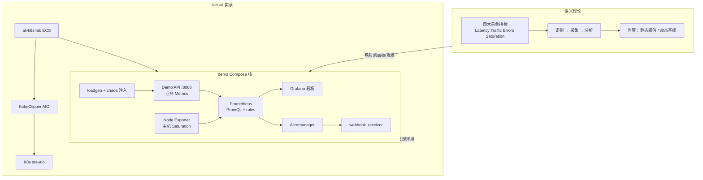
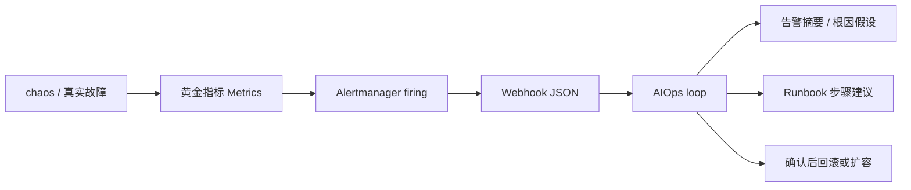

# SRE 黄金指标设计

**目标**：学员掌握 SRE 四大黄金指标（Latency / Traffic / Errors /
Saturation）的原理、识别—采集—分析三段式设计方法、告警策略与 Grafana/Prometheus
工具链，能独立完成「采集 → 可视化 → 告警」端到端闭环。

**时长**：1 天（09:00–12:00，13:30–17:00）

**前置知识**：Linux 基础命令；HTTP/REST 基本概念；Docker 基本使用；有运维或后端经验更佳（无需
Prometheus 经验）

**配套 Demo**：[`../demo/sre-golden-signals/`](../demo/sre-golden-signals/)

**阿里云 lab 实录**（KubeClipper AIO K8s +
端到端跑通）：[`we-know-sre-golden-signals-lab-ali.md`](./we-know-sre-golden-signals-lab-ali.md)

### 文档与 Demo 如何串联

| 资产                                                                               | 角色                                                     |
| ---------------------------------------------------------------------------------- | -------------------------------------------------------- |
| 本讲义                                                                             | **教什么**：原理 → 方法 → 工具 → 最佳实践                |
| [`demo/sre-golden-signals`](../demo/sre-golden-signals/)                           | **练什么**：Compose 一键栈，Demo A/B/C                   |
| [`we-know-sre-golden-signals-lab-ali.md`](./we-know-sre-golden-signals-lab-ali.md) | **在哪练过**：阿里云 ECS 上 KC+K8s 环境 + 实跑命令与踩坑 |



四大信号在 Demo 中的落点：

| 黄金指标   | Demo 落点                                                            |
| ---------- | -------------------------------------------------------------------- |
| Latency    | `http_request_duration_seconds` → P50/P95/P99；可 `chaos/latency-ms` |
| Traffic    | `rate(http_requests_total[…])`；`loadgen.py`                         |
| Errors     | `status=~"5.."` 比率；可 `chaos/error-rate` → `HighErrorRate`        |
| Saturation | Node CPU / `http_inflight_requests`；规则 `HighCPUUsage`             |

---

## 总览

| 时段 | 时长 | 章节                                       | 内容要点                                              |
| ---- | ---- | ------------------------------------------ | ----------------------------------------------------- |
| 上午 | 1.5h | [1. 黄金指标核心理论](#1-黄金指标核心理论) | 监控→可观测性；四大黄金指标；Metrics/Logs/Traces 分工 |
| 上午 | 1.5h | [2. 指标设计实战](#2-指标设计实战)         | 识别—采集—分析三段法；静态阈值 vs 动态基线；告警分级  |
| 下午 | 2.0h | [3. 工具链实操](#3-工具链实操)             | Grafana 看板；Alertmanager 告警；端到端故障注入验证   |
| 下午 | 1.5h | [4. 最佳实践](#4-最佳实践)                 | 云原生指标；反模式与正确聚合；HPA 联动                |

### 软硬件预装环境（课前必须就绪）

| 类别   | 要求                                          | 说明                                          |
| ------ | --------------------------------------------- | --------------------------------------------- |
| 硬件   | CPU ≥ 2 核，内存 ≥ 8 GB，磁盘 ≥ 20 GB 可用    | 本机或云主机均可；Apple Silicon / x86_64 皆可 |
| OS     | macOS 12+ / Ubuntu 22.04+ / Windows 11 + WSL2 | Windows 建议在 WSL2 内跑 Docker               |
| 容器   | Docker Engine 24+，Docker Compose v2          | `docker compose version` 能输出版本号         |
| 语言   | Python 3.10+（系统自带即可）                  | 仅用于 `loadgen.py` / `webhook_receiver.py`   |
| 网络   | 能拉取 Docker Hub 镜像                        | 内网需提前镜像加速或离线导入                  |
| 浏览器 | Chrome / Edge 最新版                          | 访问 Grafana / Prometheus UI                  |
| 可选   | `curl`、`git`                                 | macOS/Linux 通常已有                          |

> **平台说明**：macOS / Windows Docker Desktop 上 Node Exporter
> 采集的是虚拟机内指标，足够课堂演示四大信号；若需真实宿主机 CPU/磁盘，请在 Linux
> 裸机或云主机上运行，并可按 `docker-compose.yml` 注释解开 `pid: host` 与根分区挂载。
>
> **端口说明**：Demo API 宿主机映射为 **8088**（容器内仍为 8080），避免与 KubeClipper API `:8080`
> 冲突。Alertmanager 通过 `host.docker.internal:host-gateway` 回调宿主机 webhook（Linux/macOS
> 通用）。

**一键自检**：

```bash
docker --version && docker compose version && python3 --version && curl --version | head -1
```

**课前拉起 Demo 栈（约 3–5 分钟）**：

```bash
cd demo/sre-golden-signals
docker compose up -d --build
docker compose ps
curl -s http://127.0.0.1:8088/health
curl -s http://127.0.0.1:9090/-/ready
curl -s http://127.0.0.1:3000/api/health
```

| 服务          | 地址                          | 账号          |
| ------------- | ----------------------------- | ------------- |
| Grafana       | http://localhost:3000         | admin / admin |
| Prometheus    | http://localhost:9090         | —             |
| Alertmanager  | http://localhost:9093         | —             |
| Demo API      | http://localhost:8088         | —             |
| Node Exporter | http://localhost:9100/metrics | —             |

### 不覆盖内容

- ELK / Loki 日志平台深度配置
- 分布式追踪（Jaeger / Tempo）落地细节
- 商业 APM（Dynatrace / New Relic）对比选型
- 夜莺（N9E）完整集群部署（仅讲告警配置思路，可与 Alertmanager 对照）

---

## 1. 黄金指标核心理论

[返回总览](#总览)

### 1.1 从监控到可观测性

[返回总览](#总览)

#### 原理：被动响应 → 主动预防

传统监控往往回答：**「机器坏了没有？」**\
SRE / 可观测性回答：**「用户是否还能顺利完成关键业务？」**

| 维度     | 传统监控             | SRE 黄金指标 / 可观测性                      |
| -------- | -------------------- | -------------------------------------------- |
| 关注点   | 主机存活、磁盘、进程 | 用户体验与服务健康                           |
| 触发方式 | 阈值越界后工单       | 错误预算、SLO 驱动变更与发布                 |
| 数据形态 | 零散点位、烟囱式     | 统一标签模型、可关联下钻                     |
| 目标     | 尽快知道「坏了」     | 尽快知道「哪里坏、为什么坏、影响多大」       |
| 姿态     | **被动响应**         | **主动预防**（发布门禁、容量预警、自动扩缩） |

Google SRE 将「黄金指标」定义为刻画 **请求驱动型服务** 健康度的最小充分集：

| 信号   | 英文       | 一句话定义         | 典型问题         |
| ------ | ---------- | ------------------ | ---------------- |
| 延迟   | Latency    | 请求处理耗时分布   | 用户是否感觉慢？ |
| 流量   | Traffic    | 系统承受的需求量   | 现在有多忙？     |
| 错误   | Errors     | 失败请求的比率     | 有多少请求失败？ |
| 饱和度 | Saturation | 资源「填满」的程度 | 还剩多少余量？   |

> **方法论口诀**：先看 **Errors + Latency**（用户痛），再看 **Traffic**（是否异常负载），最后看
> **Saturation**（根因在资源层还是应用层）。

#### 可观测性三支柱的分工

```
                 ┌─────────────────────────────────────┐
告警 / SLO ───►  │  Metrics（指标）  低成本、可聚合、可告警 │
                 └──────────────┬──────────────────────┘
                                │ 异常时刻 / 标签下钻
                 ┌──────────────▼──────────────────────┐
根因定位 ──────► │  Logs（日志）    高基数事件、上下文文本 │
                 └──────────────┬──────────────────────┘
                                │ trace_id / span 关联
                 ┌──────────────▼──────────────────────┐
调用链分析 ────► │  Traces（追踪）  跨服务路径与瓶颈跨度 │
                 └─────────────────────────────────────┘
```

| 支柱    | 擅长                     | 不擅长             | 与黄金指标关系             |
| ------- | ------------------------ | ------------------ | -------------------------- |
| Metrics | 趋势、告警、容量、SLO    | 单次请求细节       | **黄金指标的主载体**       |
| Logs    | 错误栈、审计、排障上下文 | 高基数全量存储成本 | 解释 Errors / Latency 尖刺 |
| Traces  | 跨服务延迟分解           | 长期趋势聚合       | 把 Latency 拆到具体依赖    |

**原则**：用 Metrics 发现问题，用 Traces 定位路径，用 Logs
确认根因——不要试图用一种数据回答所有问题。

#### 与 RED / USE 方法的关系

| 方法           | 适用对象              | 指标集合                        | 关系                   |
| -------------- | --------------------- | ------------------------------- | ---------------------- |
| Golden Signals | 请求驱动服务          | L/T/E/S                         | 本课主线               |
| RED            | 微服务 / HTTP API     | Rate, Errors, Duration          | 黄金指标在应用层的特化 |
| USE            | 资源（CPU/网卡/队列） | Utilization, Saturation, Errors | 饱和度与基础设施层互补 |

---

### 1.2 四大黄金指标详解

[返回总览](#总览)

#### Latency（延迟）

- **正确做法**：看 **分布**（P50/P95/P99），不要只看平均值。
- **区分**：成功请求延迟 vs 失败请求延迟（失败往往很快返回，会「美化」均值）。
- **PromQL 形态**（Histogram）：

```promql
histogram_quantile(
  0.95,
  sum(rate(http_request_duration_seconds_bucket{job="api"}[5m])) by (le)
)
```

#### Traffic（流量）

- **形态因系统而异**：HTTP 用 QPS；消息队列用消费速率；批处理用 jobs/s。
- **价值**：解释「错误率升高是因为流量突增，还是基线流量下的故障」。

```promql
sum by (method) (rate(http_requests_total{job="api"}[5m]))
```

#### Errors（错误）

- **定义要业务化**：HTTP 5xx、业务码 `code!=0`、超时、部分成功都可能算错误。
- **优先用比率**，而非绝对次数（流量低谷时次数告警易漏报）。

```promql
sum(rate(http_requests_total{job="api",status=~"5.."}[5m]))
/
clamp_min(sum(rate(http_requests_total{job="api"}[5m])), 0.001)
```

#### Saturation（饱和度）

- **含义**：关键资源还剩多少余量——CPU、内存、磁盘 IO、连接池、线程池、队列深度。
- **注意**：Utilization（利用率）≠ Saturation（饱和）；队列堆积、拒绝新连接才是饱和的强信号。

```promql
# CPU 利用率（近似）
100 - (avg by (instance) (rate(node_cpu_seconds_total{mode="idle"}[5m])) * 100)
```

---

## 2. 指标设计实战

[返回总览](#总览)

### 2.1 三段式实施方法：识别 → 采集 → 分析

[返回总览](#总览)

#### 阶段一：识别（Identification）

先画 **用户关键路径**，再映射指标，避免「有什么 exporter 就监控什么」。

| 层级   | 示例指标                                                    | 对应黄金信号         | 备注         |
| ------ | ----------------------------------------------------------- | -------------------- | ------------ |
| 业务层 | 订单支付成功率、登录成功率、用户次日留存                    | Errors / Traffic     | 直接对齐 SLO |
| 应用层 | `http_requests_total`、`http_request_duration_seconds`      | L/T/E                | RED 模型     |
| 系统层 | `node_cpu_*`、`node_disk_io_time_seconds_total`、内存可用量 | Saturation           | USE 模型     |
| 依赖层 | DB 连接池使用率、下游 P99、缓存命中率                       | Latency / Saturation | 常成瓶颈     |

**识别检查清单**：

1. 这条指标异常时，用户是否可感知？
2. 能否在 1–2 次下钻内关联到 Logs/Traces？
3. 标签是否可控（避免 `user_id` 等高基数）？
4. 有没有对应的「恢复/缓解」动作（扩容、限流、回滚）？

#### 阶段二：采集（Collection）

| 模式                 | 适用            | 代表技术                           | 优点             | 代价                         |
| -------------------- | --------------- | ---------------------------------- | ---------------- | ---------------------------- |
| Agent                | 主机 / 基础设施 | Prometheus Node Exporter、cAdvisor | 标准化、开箱即用 | 需部署与升级 Agent           |
| Agentless / 自动埋点 | 微服务          | OpenTelemetry Auto-Instrumentation | 少改代码         | 运行时开销、需统一 Collector |
| 代码埋点             | 业务语义指标    | `prometheus_client` / OTel SDK     | 语义最准         | 开发成本                     |
| 黑盒探测             | 可用性          | Blackbox Exporter、合成监控        | 贴近用户路径     | 覆盖面有限                   |

本课 Demo 同时覆盖：**Node Exporter（Agent）** + **FastAPI 代码埋点（业务 Metrics）**。

#### 阶段三：分析（Analysis）

分析层三件事：**聚合、对比、关联**。

| 动作 | 示例                                                        | 目的               |
| ---- | ----------------------------------------------------------- | ------------------ |
| 聚合 | `sum by (status)` / `avg by (node)`                         | 降噪、看全局       |
| 对比 | 今日 vs 上周同时段；版本 A vs B                             | 发现回归与发布风险 |
| 关联 | 错误率 ↑ 且 CPU 饱和 → 容量；错误率 ↑ 且 CPU 低 → 代码/依赖 | 缩小根因面         |

---

### 2.2 Demo A：端到端采集闭环（Node Exporter + Demo API）

[返回总览](#总览)

#### 目标

验证 Prometheus 已抓取主机指标与 API 黄金指标，并能用 PromQL 算出 L/T/E/S。

#### 步骤

**1）确认 Targets 为 UP**

打开 http://localhost:9090/targets ，应看到 `node`、`api`、`prometheus` 均为 **UP**。

**2）主机饱和度（Node Exporter）**

```promql
# CPU 使用率
100 - (avg by (instance) (rate(node_cpu_seconds_total{mode="idle"}[2m])) * 100)

# 磁盘 IO 时间占比（近似繁忙度）
rate(node_disk_io_time_seconds_total[5m])
```

**3）应用流量 / 错误 / 延迟**

另开终端打流量：

```bash
cd demo/sre-golden-signals
python3 loadgen.py --base http://127.0.0.1:8088 --qps 8 --seconds 180
```

在 Prometheus Graph 中执行：

```promql
# Traffic
sum by (method) (rate(http_requests_total{job="api"}[1m]))

# Errors
sum(rate(http_requests_total{job="api",status=~"5.."}[1m]))
/
clamp_min(sum(rate(http_requests_total{job="api"}[1m])), 0.001)

# Latency P95
histogram_quantile(
  0.95,
  sum(rate(http_request_duration_seconds_bucket{job="api"}[2m])) by (le)
)

# Saturation（应用侧：在途请求）
http_inflight_requests
```

**4）验收标准**

- Targets 全绿
- 打流后 Traffic 曲线明显抬升
- 默认 `ERROR_RATE≈2%` 时错误率在低水位波动
- P95 通常 < 200ms（未注入延迟时）

---

### 2.3 告警策略设计

[返回总览](#总览)

#### 决策工作流（课堂标准路径）

```
流量突增 (Traffic)
        │
        ▼
检查饱和度 (CPU / 内存 / 队列) ──是──► 容量类告警（Warning）→ 扩容 / 限流
        │
        否
        ▼
错误率 / 延迟是否恶化？ ──是──► 应用/依赖故障（Critical）→ 回滚 / 熔断
        │
        否
        ▼
记录为「可解释的业务高峰」，避免无效打扰
```

#### 静态阈值 vs 动态基线

| 类型     | 适用层级    | 示例                  | 优点         | 风险                               |
| -------- | ----------- | --------------------- | ------------ | ---------------------------------- |
| 静态阈值 | 基础设施    | CPU > 90% 持续 5m     | 简单、可解释 | 不同机器水位不同，易误报/漏报      |
| 动态基线 | 业务 / 流量 | 超过近 7 日同时段 P95 | 适配潮汐流量 | 需足够历史；突变后基线会「跟着坏」 |

**PromQL 动态基线示意**（生产常用思路，课堂可用绝对阈值代替）：

```promql
# 当前 QPS 相对 7 天前同时段
sum(rate(http_requests_total{job="api"}[5m]))
>
1.5 * sum(rate(http_requests_total{job="api"}[5m] offset 7d))
```

#### 分级与通知通道

| 级别     | 含义                    | 响应预期     | 通道示例                 |
| -------- | ----------------------- | ------------ | ------------------------ |
| Warning  | 余量不足或轻微恶化      | 工作时间跟进 | 企业微信群 / 邮件        |
| Critical | 用户受损或 SLO 燃烧过快 | 立即响应     | 企业微信 + 电话 / 值班页 |

**原则**：同一根因只响一次（抑制规则）；先分页给「能行动的人」，再广播「知情」。

Demo 中的规则见
`prometheus/rules.yml`：`HighRequestRate`、`HighErrorRate`、`HighCPUUsage`、`HighLatencyP95`。

---

## 3. 工具链实操

[返回总览](#总览)

### 3.1 Grafana Dashboard 搭建

[返回总览](#总览)

#### 原理

Grafana **不采集**数据，只负责：查询（PromQL）→ 可视化 → 阈值线 / 链接告警。\
好的 SRE 看板 = **一屏看完四大黄金指标**，而不是几十个无关面板。

#### Demo B：使用预置看板（推荐课堂路径）

栈启动后，登录 http://localhost:3000 （admin/admin）：

1. 左侧 **Dashboards** → 文件夹 **SRE** → **SRE Golden Signals**
2. 确认数据源 **Prometheus** 已自动配置（Administration → Data sources）
3. 运行
   `python3 loadgen.py --base http://127.0.0.1:8088 --qps 10 --seconds 300`，观察四个面板同步变化

| 面板       | PromQL 要点                                                  | 告警线    |
| ---------- | ------------------------------------------------------------ | --------- |
| Traffic    | `sum by (method) (rate(http_requests_total{job="api"}[1m]))` | —         |
| Errors     | 5xx / 全量，单位 percentunit                                 | **5%**    |
| Latency    | histogram P50/P95/P99                                        | —         |
| Saturation | Node CPU %                                                   | 70% / 90% |

#### 手工加面板（加深理解，可选 15 分钟）

1. Dashboards → New → Add visualization
2. Data source 选 Prometheus
3. 粘贴 Error Rate 表达式，Unit 选 `Percent (0.0-1.0)`
4. Thresholds 增加 `0.05`，Thresholds style 选 `Line + area`

#### 看板设计最佳实践

1. **先总后分**：顶部 GOLDEN 四格，下方再按服务/实例拆分
2. **统一时间窗**：排查时全员看同一 `from/to`
3. **少而准**：每个面板只回答一个问题
4. **标签变量**：`$service` / `$env` 过滤，避免复制 10 份看板
5. **链出排障入口**：面板描述里放 Runbook / 日志查询链接

---

### 3.2 Alertmanager 告警配置与验证

[返回总览](#总览)

#### 架构关系

```
Prometheus (评估 rules.yml)
        │  firing alerts
        ▼
Alertmanager (分组 / 抑制 / 路由)
        │
        ├── Warning  → webhook / 企业微信群
        └── Critical → webhook + 电话网关（生产）
```

本 Demo 默认把告警打到本机 `webhook_receiver.py`（端口 9999），避免依赖企业微信密钥；配置思路与生产
YAML 一致。若使用夜莺（N9E），规则表达式同样可以是 PromQL，差异主要在「规则 UI / 通知模板 /
值班排班」。

#### Demo C：端到端触发 Critical 错误率告警

**终端 1 — 接收告警**：

```bash
cd demo/sre-golden-signals
python3 webhook_receiver.py
```

> macOS Docker Desktop 下，容器访问宿主机用 `host.docker.internal`（已写入 `alertmanager.yml`）。\
> Linux 若收不到，可将 webhook URL 改为宿主机可达 IP，或增加 `extra_hosts`。

**终端 2 — 打流量**：

```bash
python3 loadgen.py --base http://127.0.0.1:8088 --qps 12 --seconds 300
```

**终端 3 — 注入故障**：

```bash
# 错误率拉到 20% → 应触发 HighErrorRate (critical)
curl -X POST 'http://127.0.0.1:8088/chaos/error-rate?rate=0.2'

# （可选）额外延迟 800ms → 触发 HighLatencyP95
curl -X POST 'http://127.0.0.1:8088/chaos/latency-ms?ms=800'
```

**验收**：

1. Grafana Errors 面板越过 5% 红线
2. Prometheus → Alerts 中 `HighErrorRate` 变为 **FIRING**（约 30s+）
3. Alertmanager http://localhost:9093 可见告警分组
4. `webhook_receiver.py` 打印含 `"status": "firing"` 的 JSON

**恢复**：

```bash
curl -X POST 'http://127.0.0.1:8088/chaos/error-rate?rate=0.02'
curl -X POST 'http://127.0.0.1:8088/chaos/latency-ms?ms=0'
```

片刻后告警应 **Resolved**，webhook 收到 resolved 事件。

#### 企业微信对接要点（生产可选）

1. 建群机器人，拿到 Webhook URL，或使用企业微信应用 API
2. Alertmanager `receivers` 配置 `wechat_configs` / 通用 `webhook_configs`
3. 用 **模板** 把 `summary`、`description`、`generatorURL` 拼进消息
4. Critical 与 Warning **分通道**，避免深夜被 Warning 刷屏

夜莺（N9E）对照：在「告警规则」中粘贴同一 PromQL，通知媒介选企业微信；验证方式同样可用 `curl`
注入错误后观察通知。

---

## 4. 最佳实践

[返回总览](#总览)

### 4.1 云原生场景

[返回总览](#总览)

#### Kubernetes 资源与配额

| 场景     | 指标 / 对象                                                                | 用途                             |
| -------- | -------------------------------------------------------------------------- | -------------------------------- |
| 容器限额 | `kube_pod_container_resource_limits`                                       | 看 Limit 是否合理                |
| 实际使用 | `container_cpu_usage_seconds_total` / `container_memory_working_set_bytes` | 对比 Limit → 算利用率            |
| 调度压力 | `kube_pod_status_phase`、Pending 时长                                      | 饱和在集群层而非单 Pod           |
| 自动扩缩 | HPA 的目标 CPU/自定义指标                                                  | 把 Saturation / Traffic 变成动作 |

```promql
# 示例：某 namespace 下 CPU Limit 总量（需 kube-state-metrics）
sum(kube_pod_container_resource_limits{resource="cpu",namespace="prod"})
```

#### Service Mesh（Istio）

网格侧自带 RED 指标，适合按 **版本 / 命名空间 / 路由** 切片：

```promql
# 示意：按 version 看请求速率（指标名随 Istio 版本略有差异）
sum by (destination_version) (
  rate(istio_requests_total{destination_namespace="prod"}[5m])
)

sum by (destination_version, response_code) (
  rate(istio_requests_total{destination_namespace="prod"}[5m])
)
```

**金丝雀发布**：同时看 `version=canary` 与 `version=stable` 的 Error Rate / P95，不达标则自动回滚。

#### 云原生指标标签纪律

1. 强制 `namespace` / `service` / `version` / `env`
2. 禁止把 `pod_name` 当作长期趋势的唯一分组（滚动发布会爆炸）
3. 聚合优先：`sum by (service)`，下钻再 `by (pod)`

---

### 4.2 故障案例：反模式与正确做法

[返回总览](#总览)

#### 案例：只盯单个 Pod 的 CPU

**现象**：某业务高峰偶发超时，值班同学看「当前这个 Pod CPU 才
40%」，认为容量充足，结果用户持续受损。

**根因**：负载在多节点间 **不均衡**；部分节点 / Pod 已打满，平均值与「正在看的那一个」都具有误导性。

|      | 反模式           | 正确实践                                                  |
| ---- | ---------------- | --------------------------------------------------------- |
| 视角 | 单个 Pod CPU     | 按 `node` / `service` **聚合分布**（P95、最大值、直方图） |
| 查询 | 无标签过滤       | `node=~"prod-.*"`、`namespace="prod"` 限定生产面          |
| 动作 | 人工重启单个 Pod | **HPA / 集群扩容** + 检查反亲和与负载均衡                 |
| 看板 | 固定实例名面板   | 变量选择 + TopN 忙实例                                    |

```promql
# 按节点看 CPU，暴露不均衡
100 - (avg by (node) (rate(node_cpu_seconds_total{mode="idle",node=~"prod-.*"}[5m])) * 100)

# 应用侧：按实例看错误率 TopN
topk(
  5,
  sum by (instance) (rate(http_requests_total{job="api",status=~"5.."}[5m]))
  /
  clamp_min(sum by (instance) (rate(http_requests_total{job="api"}[5m])), 0.001)
)
```

#### 其他高频反模式

| 反模式                   | 后果                   | 纠正                              |
| ------------------------ | ---------------------- | --------------------------------- |
| 只告警 CPU，不告警错误率 | 用户已失败却无人知     | Errors / Latency 优先于主机指标   |
| 平均值当唯一延迟指标     | 掩盖长尾               | 至少 P95 + 成功/失败拆分          |
| 高基数标签（user_id）    | TSDB 爆炸              | 业务属性进日志，不进 metrics 标签 |
| 告警风暴无抑制           | 值班疲劳               | inhibit + 分组 + 升级策略         |
| 没有 Runbook             | 人人会收到，没人会处理 | 每条 Critical 绑处理步骤链接      |

---

### 4.3 Demo D（可选，30 分钟）：从指标到「动作」的思维演练

不强制接真实 K8s，用本 Demo 走完决策：

1. `loadgen.py` 提高 `--qps 30` → Traffic 升
2. 观察 Saturation（CPU）与 Latency 是否同步恶化
3. 若仅 Traffic 升、Errors 仍低 → **容量预警（Warning）**，对应动作是扩容/限流
4. `chaos/error-rate=0.2` 且 CPU 不高 → **应用故障（Critical）**，对应动作是回滚/查依赖
5. 在 Runbook 笔记里写清：「这条告警下一步点哪里、执行什么」

---

## 附录

### A. 一日六节课安排（上午 3 + 下午 3）

一天按「讲授 + 动手」压缩后**偏紧**（尤其下午工具链与故障注入）。建议每节 **45–50 分钟讲练 + 10
分钟缓冲**，环境课前预装（见 lab 实录）。

| 节次 | 时段建议 | 主题                | 内容与产出                                       | 对应章节 / Demo  |
| ---- | -------- | ------------------- | ------------------------------------------------ | ---------------- |
| 1    | 上午①    | 从监控到黄金指标    | L/T/E/S 定义；三支柱分工；与 RED/USE 关系        | §1               |
| 2    | 上午②    | 指标设计三段法      | 识别业务/系统指标；采集模式；PromQL 入门         | §2.1             |
| 3    | 上午③    | 告警策略 + Demo A   | 静态/动态阈值；分级通知；拉起栈 + Targets/PromQL | §2.2–2.3，Demo A |
| 4    | 下午①    | Grafana 看板        | 四面板黄金信号；阈值线；共识排障                 | §3.1，Demo B     |
| 5    | 下午②    | 告警闭环            | Alertmanager YAML；chaos 注入；webhook 验收      | §3.2，Demo C     |
| 6    | 下午③    | 云原生 + AIOps 入口 | 标签聚合反模式；HPA 思路；AIOps 最小闭环（可选） | §4，§附录 F      |

若仍超时：**第 6 节**只讲案例与作业，AIOps 演示压成 10 分钟「告警 → LLM 摘要 → Runbook
建议」口述/录像。

### B. 作业（选一即可）

1. 为你负责的一个真实服务画出「用户关键路径 → 四大黄金指标」映射表（不少于 8 个指标）。
2. 在 Demo 板上新增「支付成功率」面板（提示：可用 `status="200"` 且 `endpoint="/api/pay"` 近似）。
3. 写一份 `HighErrorRate` 的一页纸 Runbook（现象 / 影响 / 排查步骤 / 回滚）。

### C. 常用命令速查

```bash
# 启停
docker compose -f demo/sre-golden-signals/docker-compose.yml up -d --build
docker compose -f demo/sre-golden-signals/docker-compose.yml down

# 健康
curl -s http://127.0.0.1:8088/health
curl -s http://127.0.0.1:9090/api/v1/targets | python3 -m json.tool | head

# 故障注入 / 恢复
curl -X POST 'http://127.0.0.1:8088/chaos/error-rate?rate=0.2'
curl -X POST 'http://127.0.0.1:8088/chaos/error-rate?rate=0.02'
```

### D. 参考阅读

- Google SRE Book：《Monitoring Distributed Systems》与《Service Level Objectives》
- Prometheus 文档：PromQL、Alerting rules、Histogram
- Grafana：Dashboard best practices
- OpenTelemetry：Metrics 语义约定（HTTP / RPC）

### E. 目录结构

```
demo/sre-golden-signals/
├── docker-compose.yml          # 一键栈
├── prometheus/
│   ├── prometheus.yml          # 抓取与告警路由
│   └── rules.yml               # 黄金指标告警规则
├── alertmanager/
│   └── alertmanager.yml        # 分组 / 抑制 / webhook
├── api/                        # FastAPI + prometheus_client
├── grafana/                    # 数据源与看板自动装载
├── loadgen.py                  # 流量发生器
├── webhook_receiver.py         # 本地告警接收 + JSONL
├── aiops_agent.py              # AIOps loop（GLM/OpenAI 兼容）
├── aiops_actions.py            # rollback_chaos / kubectl scale
├── requirements-aiops.txt
├── k8s/sre-load-deploy.yaml    # 扩容演示 Deployment
└── README.md
```

### F. AIOps：插入点、开源 Reference、课堂闭环

黄金指标课程解决的是 **「看见与告警」**；AIOps 接在告警之后，解决
**「解读、关联、建议动作」**。不替换 Prometheus/Grafana，而是消费其输出。



#### F.1 开源 AIOps 方案 Reference（对比表）

| 方案               | 仓库                                                    | 告警接入                    | 调查                   | 自动修复/扩缩                      | 人审            | 课堂建议                               | 主要代价                           |
| ------------------ | ------------------------------------------------------- | --------------------------- | ---------------------- | ---------------------------------- | --------------- | -------------------------------------- | ---------------------------------- |
| runbook-agent      | https://github.com/arec1b0/runbook-agent                | Alertmanager webhook        | LLM + 预批准 runbook   | 有（含 scale）                     | 有 `/approvals` | **能力最贴闭环**                       | Node≥22、pnpm；需 OpenAI/Anthropic |
| incident-commander | https://github.com/sahilleth/incident-commander         | AM webhook                  | 多 worker + LLM/启发式 | rollback/scale                     | UI 审批         | 演示友好备选                           | 组件较多                           |
| HolmesGPT          | https://github.com/HolmesGPT/holmesgpt                  | AM/CLI/Robusta              | Prom/K8s 工具集强      | 需 MCP/Robusta 等                  | 视集成          | **调查首选**                           | 闭环要额外配                       |
| Vigil              | https://github.com/linnemanlabs/vigil                   | AM webhook                  | Prom+Loki agentic      | 无（Slack RCA）                    | 无执行审        | 摘要参考                               | Go；偏通知                         |
| SherlockOps        | https://github.com/Duops/SherlockOps                    | AM/Grafana/多源             | Prom/K8s/云 API        | 无（诊断到 IM）                    | 无执行审        | 摘要参考                               | 不修集群                           |
| Kubernaut          | https://github.com/jordigilh/kubernaut                  | AM + Events                 | MCP + 工作流目录       | 有                                 | OPA/审批        | 进阶班平台                             | 过重                               |
| 裸调 LLM           | —                                                       | 自写 prompt                 | 一次 completion        | 无                                 | 口头            | 不作运行时                             | 无工具闭环                         |
| 课堂薄 AIOps loop  | `demo/sre-golden-signals/aiops_agent.py`（见 lab 实录） | Prom alerts + webhook JSONL | GLM/OpenAI 兼容 API    | `rollback_chaos` / `kubectl scale` | `--confirm`     | **本课默认实跑路径**（lab 无 Node 时） | 需 API Key；能力刻意做小           |
| 小龙虾 OpenClaw    | claw0 / OpenClaw                                        | 非 AM 原生                  | 通用 Coding Agent      | 非运维语义                         | 会话内          | **不当本课运行时**                     | 工具面不对齐                       |
| 爱马仕 Harness     | 见 `we-know-ai-harness.md`                              | —                           | Agent 工程骨架         | —                                  | 治理模型        | **不当本课运行时**                     | 属另一门课                         |

**选型说明**：优先可直接用的开源 runbook-agent / incident-commander；ali-k8s-lab 若无
Node≥22，课堂用 **薄 Python loop + 智谱 GLM（OpenAI 兼容）** 走通同一条链路，并在 lab
实录记录命令与结果。

#### F.2 课堂最小端到端（建议 → 人工确认 → 恢复）

1. Demo C：`error-rate=0.25` → `HighErrorRate` firing → webhook JSONL。
2. `python3 aiops_agent.py --mode advise`（`GLM_API_KEY` + `GLM_BASE_URL`）。
3. 审阅 `summary` / `root_cause_hypothesis` / `runbook` / `recommended_action`。
4. 人工确认后手工或 `--mode execute --confirm` 执行 `rollback_chaos`。

#### F.3 自动扩容 / 回滚（同一 agent）

| 场景         | 触发                                 | 动作                                         |
| ------------ | ------------------------------------ | -------------------------------------------- |
| 应用故障回滚 | `HighErrorRate` / 高错误率           | `POST /chaos/error-rate?rate=0.02`           |
| 容量扩容     | `HighRequestRate` 或建议 `scale_out` | `kubectl scale deploy/sre-load --replicas=3` |

详细命令与实跑输出见
[`we-know-sre-golden-signals-lab-ali.md`](./we-know-sre-golden-signals-lab-ali.md)「§12 AIOps」。

进阶（超出一天主线）：Embeddings 降噪、日志/Trace 关联、ChatOps、完整 Kubernaut。

---

## 总结

1. **黄金指标**把监控从「机器视角」拉回「用户与服务视角」。
2. **识别 → 采集 → 分析** 保证指标有业务语义、有来源、能决策。
3. **告警**要分级、可抑制、绑 Runbook；静态阈值与动态基线按层选用。
4. **工具链**只是放大器：Prometheus 负责真值，Grafana 负责共识，Alertmanager 负责找人。
5. **云原生**下优先按服务/版本聚合，警惕单 Pod 视角与高基数标签；指标最终要能驱动 HPA/回滚等动作。
